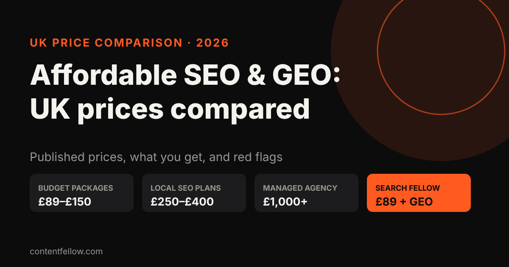
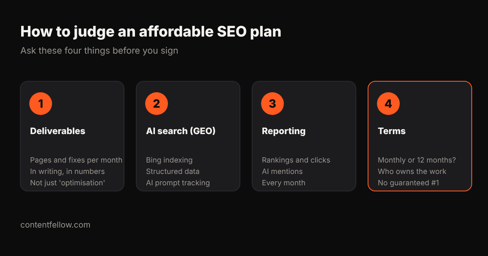

# Affordable SEO and GEO Services for UK Small Businesses: 2026 Price Comparison

> **Quick answer:** Affordable SEO for a UK small business usually costs **£89 to £400 a month**. Budget packages start around £89–£150, local SEO plans from specialist agencies typically cost £250–£400, and managed agency campaigns start around £1,000. In 2026, a good affordable plan should also cover **GEO** (getting named by ChatGPT, Gemini and Perplexity), not just Google. *(Updated October 2026. Prices are as published by each provider on 16 October 2026; check their sites for current offers.)*

**Transparency note:** this comparison is written by ContentFellow, and our Search Fellow plan is included. We've only listed prices that providers publish themselves, and we explain how to judge every option, including ours.

## UK affordable SEO prices compared (published prices)

| Provider / type | Published starting price | Notes |
|---|---|---|
| ContentFellow Search Fellow | £89 a month | SEO + GEO in one plan, monthly billing, free 7-day trial |
| Wrise | "Low cost £99 packages" | Budget SEO packages for small businesses |
| Polaris (guide) | From about £300 a month | For smaller local campaigns, per their UK pricing guide |
| ZainSEO | From about £295 a month | London-focused, local and technical SEO |
| Dandy Marketing | £399 a month (Local) | Fixed local package for one town or area |
| ClickIntelligence | From £1,000 a month | Managed SEO campaigns |
| Typical UK SEO/GEO agency | £1,100–£3,800 a month | See our [LLM optimisation cost guide](/blog/llm-optimisation-cost-small-business-uk/) |

What the table can't show is scope. Two £300 plans can include very different amounts of work, so use the checklist below before comparing prices.

## What should affordable SEO include in 2026?

### 1. Clear monthly deliverables

"Ongoing optimisation" isn't a deliverable. Ask for numbers: how many pages written or improved, which technical fixes, how many directory listings cleaned up, each month.

### 2. AI search (GEO), not just Google

ChatGPT's live search leans on **Bing's index**, and its answers mostly cite websites, directories and "best of" lists. An affordable plan in 2026 should include Bing Webmaster Tools, structured data (schema), answer-first service pages and checking whether AI assistants mention you. Our guide on [how to get recommended by ChatGPT](/blog/get-business-recommended-by-chatgpt-uk/) explains why.

### 3. Monthly reporting you can understand

You should see rankings, clicks from Google Search Console, and which AI prompts name you versus competitors. If a report is only "traffic is up", ask for more.

### 4. Fair terms

Check the minimum term (monthly vs 6–12 months), who owns the content and accounts if you leave, and whether there's a trial or a way to see the work before committing.

## Red flags in cheap SEO

- **Guaranteed #1 rankings.** Nobody controls Google or ChatGPT. Guarantees usually mean tiny keywords nobody searches.
- **"1,000 backlinks for £50".** Bulk links from spam sites can get you penalised.
- **No access to your own accounts.** You should own your Google Business Profile, Search Console and website.
- **Long contracts with no deliverables.** Twelve months of "optimisation" with no written scope is hard to hold anyone to.
- **No mention of AI search.** In 2026, a plan that ignores ChatGPT and Google's AI Overviews is only doing half the job.

## Which level is right for you?

| Your situation | Sensible budget |
|---|---|
| Sole trader or new local business | DIY (free) or £89–£150 a month |
| Established local business in one town | £89–£400 a month |
| Several locations or competitive industry (law, dental, trades in big cities) | £400–£1,000 a month |
| National or ecommerce business | £1,000+ a month |

Not sure if you need GEO, SEO or both? Read [GEO vs SEO: what's the difference](/blog/geo-vs-seo-uk-small-business/).

## How the Search Fellow compares

The **[Search Fellow](/services/search-fellow/) is £89 a month**: SEO for Google, GEO so ChatGPT, Claude and Gemini recommend you, and a monthly report showing rankings and AI visibility side by side. Billing is monthly, you approve changes before they go live, and you can **try it free for 7 days** (AI visibility check, Bing set-up, AI crawler access and a Google Business Profile tidy; you keep every fix). It suits small businesses; if you need large-scale digital PR or hundreds of pages, a bigger agency budget makes more sense.

**[Start your free Search Fellow trial →](/services/search-fellow/)**

## Frequently asked questions

### How much does affordable SEO cost in the UK?
Most UK small businesses pay £89 to £400 a month for affordable SEO. Managed agency campaigns usually start around £1,000 a month.

### Are £99 SEO packages worth it?
They can be, if the deliverables are clear and the work is real: technical fixes, service pages, listings and reporting. Avoid any package that relies on bulk backlinks or guarantees rankings.

### What is the cheapest way to do SEO for a small business?
Do the basics yourself: claim your Google Business Profile and Bing Places, add your services with prices and locations to your website, collect reviews, and verify Search Console and Bing Webmaster Tools. It's free, but takes time.

### Does affordable SEO include ChatGPT and AI search?
Not always. Ask whether the plan includes Bing indexing, structured data and AI visibility tracking. The ContentFellow Search Fellow includes all three.

### How long does affordable SEO take to work?
Technical fixes show within weeks; rankings and AI mentions usually take 3 to 6 months to build, depending on competition in your area.

### Can I cancel an SEO contract?
It depends on the provider; many ask for 6 to 12 months. ContentFellow bills monthly and you can cancel from the next month.
