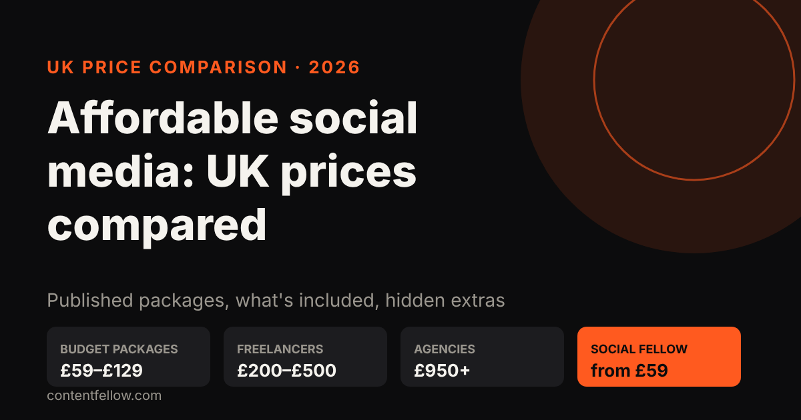
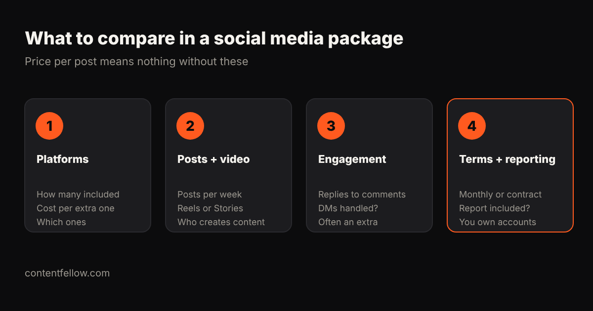

# Affordable Social Media Management for UK Small Businesses: 2026 Price Comparison

> **Quick answer:** Affordable social media management in the UK starts at about **£59 to £129 a month** for a productised plan. Freelancers typically charge £200–£500 a month for basic help, and agency packages usually start around £950 a month and can pass £3,000. The cheapest headline price isn't always the cheapest plan: extras for engagement, reporting and additional platforms can double it. *(Prices as published by each provider on 16 October 2026. Check their sites for current offers.)*

**Transparency note:** ContentFellow wrote this comparison and our Social Fellow is included. We've only listed prices providers publish themselves.

## Published UK social media management prices

| Provider / type | Published price | What the price covers (as published) |
|---|---|---|
| ContentFellow Social Fellow | £59 a month (Manage) or £129 a month (Manage + Post) | Manage: up to 2 platforms, weekday replies, ad set-up. Manage + Post: up to 3 platforms, daily posting, trend research. Free 7-day trial |
| Wrise | £99 a month + VAT | Starter package; extras: platform £40, post £40, reporting £30, engagement £120 a month |
| Freelancers (Birdeye UK guide) | £200–£500 a month | Basic help |
| Hello Social Avenue | Entry level £250–£500; partner package from £950 a month | Light support to done-with-you |
| Small agencies (Birdeye UK guide) | £500–£1,500 a month | Posting, content, reporting |
| Social Chameleon | £3,499 a month + VAT (Basic) | 2 platforms, 16 posts, report, meeting, video editing |

For full UK market ranges (including in-house salaries) see [how much social media management costs in the UK](/blog/social-media-management-cost-uk/).

## Compare the total, not the headline

A £99 package with a second platform (£40), monthly reporting (£30) and engagement (£120) becomes **£289 a month + VAT**. Before comparing, add up what you actually need:

1. **Platforms:** how many are included, and what each extra costs.
2. **Posts and video:** posts per week, whether Reels or Stories are included, and who creates the photos and videos.
3. **Engagement:** replying to comments and messages is often an add-on.
4. **Terms and reporting:** monthly or a fixed contract, is a report included, and do you keep ownership of your accounts and content.

## Red flags

- **Follower guarantees.** Bought or "guaranteed" followers damage reach and trust.
- **No approval step.** You should see posts before they go out.
- **Accounts in the agency's name.** Your pages should always belong to you.
- **Long contracts for basic posting.** Simple posting shouldn't need a 12-month lock-in.

## Which option fits?

| Your situation | Sensible choice |
|---|---|
| You want a consistent presence on 1–3 platforms | Productised plan (£59–£129) |
| You want a person to brief and work with | Freelancer (£200–£500) |
| You run paid ads and need strategy and creative | Agency (£950+) |
| You need original video every month | Add a video service, e.g. [video production](/services/studio-fellow/) or [editing](/services/creator-fellow/) |

## How the Social Fellow compares

The **[Social Fellow](/services/social-fellow/)** is **£59 a month (Manage)** or **£129 a month (Manage + Post)**, where Manage covers up to 2 platforms with weekday replies and ad set-up, and Manage + Post covers up to 3 platforms with daily posting and trend research. Billing is monthly, you approve content before it goes live, and you can **try it free for 7 days** (a short content plan and 5 posts on one platform; you keep the content).

**[Start your free Social Fellow trial →](/services/social-fellow/)**

## Frequently asked questions

### What is the cheapest social media management in the UK?
Productised plans start at about £59 to £129 a month. Some freelancers charge less, but check how many posts, platforms and replies are included.

### Is £99 a month enough for social media management?
It can cover basic posting on one or two platforms. Engagement, reporting and extra platforms are often charged on top, so compare the total.

### Do social media packages include VAT?
Not always. Several UK agencies publish prices plus VAT, so check before comparing.

### Should a small business pay for social media management or do it themselves?
If you post consistently yourself, DIY is fine. If posting keeps slipping, a low-cost managed plan usually pays for itself in time saved.

### Can I try social media management before committing?
Some providers offer trials. The ContentFellow Social Fellow has a free 7-day trial with no card needed.
