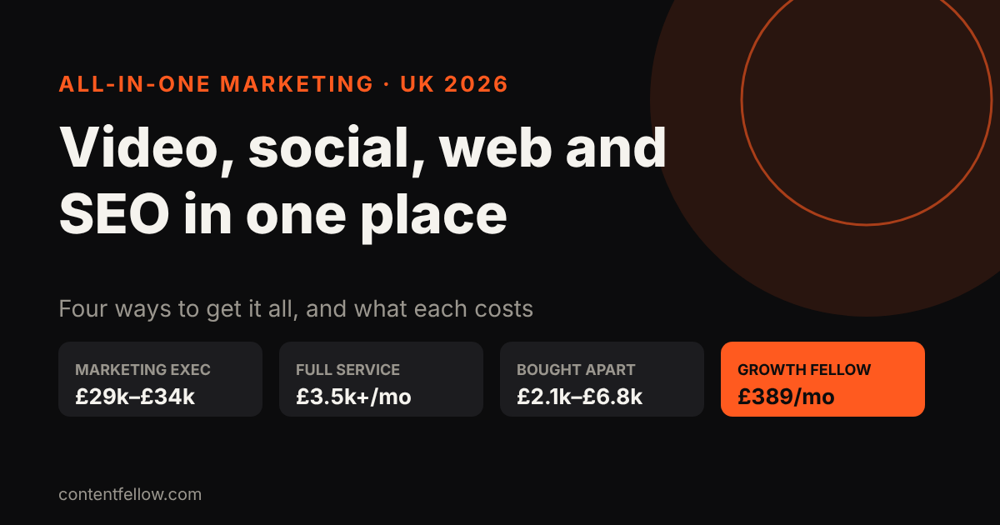
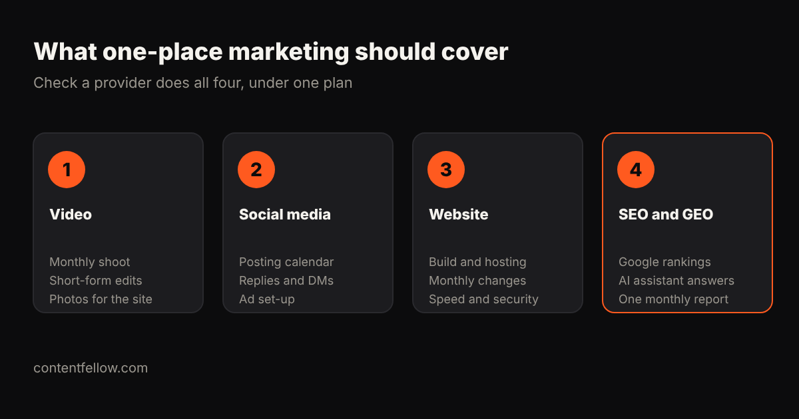

# Who Can Do Video, Social Media, Website and SEO in One Place? (UK 2026)

> **Quick answer:** In the UK, four kinds of provider can handle video, social media, your website and SEO in one place: an in-house marketing hire, a group of freelancers, a full-service agency, or a productised monthly plan. Full-service agency retainers typically cost **£3,500 to £16,750 a month**, and a marketing executive's salary averages **£29,000 to £34,000** before employer costs. Productised plans cost far less: ContentFellow's Growth Fellow covers all four for **£389 a month**, against £555 bought separately. *(Updated October 2026.)*

## The four ways to get all your marketing in one place

| Option | Typical UK cost (2026) | One strategy? | Who manages it | Best for |
|---|---|---|---|---|
| In-house marketing executive | £29,000–£34,000 salary, plus employer costs | Yes, if they're skilled across channels | You | Businesses with daily marketing work |
| Freelancers, one per skill | Each priced separately (see the next table) | Only if you set it | You | Owners with time to coordinate |
| Full-service agency | £3,500–£16,750 a month | Yes | The agency | Larger SMEs with bigger budgets |
| Productised plan (Growth Fellow) | £389 a month | Yes, one Growth lead | The provider | Small businesses on a tight budget |

Sources: [Prospects](https://www.prospects.ac.uk/job-profiles/marketing-executive), citing Marketing Week's 2024 Career and Salary Survey, gives marketing executive salaries of £29,000–£34,000, senior executives £35,000–£42,000 and marketing managers around £58,000. Whito's [UK agency retainer research](https://whito.co.uk/research/uk-agency-retainers/) (updated 12 October 2026) gives full-service retainers of £3,500–£16,750 a month and single-channel retainers of £1,250–£3,500.

## What does it cost to buy each one separately?

Most small businesses start by buying one piece at a time. Here's what each part typically costs on its own in the UK:

| What you need | Typical separate cost (2026) | Source |
|---|---|---|
| Video: monthly shoot cut into social clips | £295–£650 a month (solo operator) | Whito, photography and video costs |
| Social media management (agency) | £800–£2,500 a month | Whito, agency retainers |
| Website care plan | £50–£177.50 a month | Whito, agency retainers |
| SEO (agency) | £1,000–£3,500 a month | Whito, agency retainers |
| **Rough total** | **£2,145–£6,828 a month** | Sum of the ranges above |

Video figures come from Whito's [UK photography and video cost research](https://whito.co.uk/research/photography-costs-uk/) (updated September 2026). Social, website care and SEO figures come from Whito's agency retainer benchmark. The total is our own sum of those ranges, and it doesn't include strategy or anyone tying it together.

That's the hidden cost of buying separately: four suppliers, four invoices, four reports and nobody responsible for the whole plan.

## Option 1: Hire someone in-house

**Pros:** they know your business, they're there every day, and they can react quickly.

**Cons:** one person is rarely great at filming, editing, social media, web development and SEO all at once. On top of a £29,000–£34,000 salary you pay employer National Insurance, pension contributions, holiday, recruitment, a laptop and software. If they leave, you start again.

In-house makes the most sense when there's enough daily marketing work to fill a full-time role, and enough budget to buy in the skills they don't have.

## Option 2: Use freelancers

**Pros:** you get a specialist for each skill and can pick the best person for each job.

**Cons:** you become the project manager. Your videographer, social media manager, web developer and SEO consultant each work to their own plan, on their own schedule, with their own report. Freelancers can be brilliant; the gaps are usually in the handovers between them.

Freelancers suit owners who enjoy managing projects and have a clear idea of what each person should do.

## Option 3: Hire a full-service agency

**Pros:** strategy, creative and channels under one roof, with an account manager and a single plan.

**Cons:** cost and commitment. Full-service retainers start around £3,500 a month, and 12-month contracts are common. Whito advises getting a break clause or a 30-day exit option after an initial period, and making sure your accounts and domains stay in your name.

Agencies are a good fit for businesses with larger budgets, several campaigns and someone internal to manage the relationship.

## Option 4: A productised all-in-one plan

**Pros:** fixed deliverables at a fixed monthly price, with one strategy across every channel. Usually no long contract.

**Cons:** less bespoke than an agency. You get a set amount each month, so very large or unusual projects may need extra help.

This is the model we use at ContentFellow, and the one most small businesses can actually afford.

## Which option fits your business?

| Your situation | Sensible choice |
|---|---|
| Under £500 a month to spend on marketing | A productised plan, or one key freelancer |
| One channel clearly brings in most customers | A specialist for that channel, plus basics elsewhere |
| £3,500+ a month and several campaigns a year | A full-service agency |
| Enough daily work for a full-time role | An in-house hire, plus outside specialists for gaps |

Whatever you choose, **one strategy across all channels** matters more than the model. Your videos should feed your social media, your social media should send people to your website, and your website should be built to rank on Google and be recommended by AI assistants.

## Questions to ask any all-in-one provider

- Who actually shoots, edits, posts, builds and does the SEO?
- What do I get each month, in numbers?
- Is there one person responsible for the overall plan?
- Do I get one combined report, or one per channel?
- What's the minimum term and notice period?
- Do I own the website, content, social accounts and data?
- Do I approve content before it goes live?

## How ContentFellow does it all in one place

The **[Growth Fellow](/services/growth-fellow/) is £389 a month**. It includes all five Fellows, a Growth lead, one strategy, a monthly call and one combined report. Bought separately, the same Fellows cost £555 a month, so you save £166 every month.

| Fellow | What it covers | Price on its own |
|---|---|---|
| Studio Fellow | One on-site shoot a month (up to 3 hours), photo + 4K video, 20 edited photos in 5 working days | £149 a month |
| Creator Fellow | 8 short videos, 1 motion graphics video, 1 podcast edit (up to 60 minutes) | £119 a month |
| Social Fellow (Manage + Post) | Up to 3 platforms, daily posting, trend research | £129 a month |
| Build Fellow | Custom website up to 5 pages, hosting, security, updates, 2 change requests a month | £69 a month |
| Search Fellow | SEO for Google, GEO so ChatGPT, Claude and Gemini recommend you, monthly ranking and AI visibility report | £89 a month |
| **Growth Fellow** | **All five, plus a Growth lead and one strategy** | **£389 a month (£555 separately)** |

Billing is monthly, you approve content before it goes live, and you can add, remove or upgrade Fellows from the next month. We're based in Burnley, Lancashire: shoots happen on-site locally, and everything else is delivered remotely across the UK. We're not VAT registered, so the price is the full price.

Compare every plan on our [pricing page](/pricing/), or find quick answers to common questions in our [answers hub](/answers/). For a deeper look at the numbers, read [outsourced marketing team vs agency vs in-house](/blog/outsourced-marketing-team-cost-uk/).

**[See the Growth Fellow →](/services/growth-fellow/)**

## Frequently asked questions

### Who can do video, social media, website and SEO in one place?
In-house marketers, groups of freelancers, full-service agencies and productised monthly plans can all cover these. For small UK businesses, a productised plan such as ContentFellow's Growth Fellow at £389 a month is usually the most affordable way to get all four under one strategy.

### How much does an all-in-one marketing agency cost in the UK?
Full-service agency retainers typically cost £3,500 to £16,750 a month in 2026. Productised all-in-one plans can cost a fraction of that, with fixed monthly deliverables.

### Is it cheaper to hire a marketing executive or outsource?
For most small businesses, outsourcing is cheaper. A UK marketing executive earns £29,000 to £34,000 on average before employer National Insurance, pension, tools and recruitment, and one person rarely covers every skill.

### Is it better to use one provider or several specialists?
One provider makes it easier to keep a single strategy, one report and one point of contact. Several specialists can work well if you have the time to coordinate them.

### What should an all-in-one marketing package include?
At minimum: regular photo and video content, social media posting, a website that's kept updated and secure, SEO, and one report that shows how it all performs together.

### Can I start with one service and add the others later?
Yes, with most monthly providers. At ContentFellow you can start with one Fellow and add, remove or upgrade from the next month.

*Sources: Prospects, "Marketing executive" job profile (citing Marketing Week's 2024 Career and Salary Survey); Whito, "Marketing Retainer Cost UK 2026" (updated 12 October 2026) and "Photography Costs UK 2026" (updated 25 September 2026); ContentFellow plan prices. Last updated 18 October 2026.*
