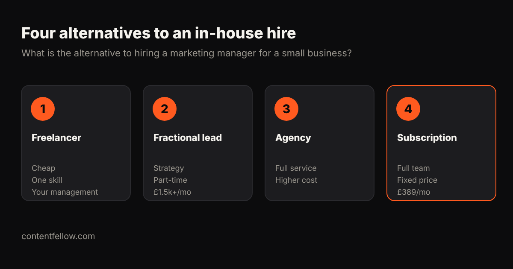

# Alternative to Hiring a Marketing Manager for a Small Business

## What is the alternative to hiring a marketing manager for a small business?

> **Quick answer:** The main alternatives to hiring a marketing manager for a small business are a freelancer, a fractional (part-time) marketing lead, an agency retainer, or a marketing team subscription. In the UK a full-time marketing manager costs about £35,000–£50,000 a year in salary alone, while ContentFellow's Growth Fellow gives you five specialists and a Growth lead for £389 a month. *(Updated October 2026.)*

**TL;DR:** If you cannot justify £40k+ a year plus employer costs, outsource. Pick a freelancer for one channel, a fractional lead for strategy, or a subscription for strategy plus delivery at a fixed price.

## Cost comparison (UK, 2026)

| Option | Typical cost | Strategy | Hands-on delivery |
|---|---|---|---|
| Full-time marketing manager | £35k–£50k salary + ~15–25% on-costs | Yes | Partly (one person) |
| Freelancer | £200–£1,000/mo | Limited | One skill |
| Fractional marketing lead | £1,500–£4,000/mo | Yes | Little |
| Agency retainer | £1,000–£5,000/mo | Yes | Yes |
| **Growth Fellow (ContentFellow)** | **£389/mo** | Growth lead + monthly call | Social, SEO/GEO, website, video, photos |

Salary range from UK job boards checked October 2026. On-costs include employer NI, pension and equipment.

## Which alternative fits you?

- **Freelancer:** you know exactly what you need, for example only social media.
- **Fractional lead:** you have a team to do the work but need direction.
- **Agency:** you have a large budget and a big campaign.
- **Subscription:** you want strategy and delivery without hiring. Start with one Fellow from £59 a month, or the whole team for £389 a month.

Related: [fractional and outsourced marketing team cost](/blog/outsourced-marketing-team-cost-uk/) and [marketing agency cost per month](/blog/marketing-agency-cost-per-month-uk/).

## Frequently asked questions

### What is the alternative to hiring a marketing manager?
Outsource to a freelancer, a fractional marketing lead, an agency, or a marketing subscription such as ContentFellow's Growth Fellow at £389 a month.

### How much does a marketing manager cost in the UK?
Around £35,000–£50,000 a year in salary, plus employer NI, pension and equipment.

### Is outsourcing marketing cheaper than hiring?
Usually yes for small businesses. A subscription costs a fraction of a salary and covers several skills.

### Can I outsource marketing with no long contract?
Yes. ContentFellow plans are monthly with no long contract.

---

**[See all plans and prices →](/pricing/)** · More quick answers on our [answers page](/answers/). Need a website too? See [development packages](/services/development/) and [website care plans](/services/management/).

*Sources: ContentFellow plans and prices from contentfellow.com/pricing/ (October 2026); market ranges are typical quotes from UK and Irish agency price pages and freelancer marketplaces checked October 2026. ContentFellow is not VAT registered, so prices include everything. Last updated 20 October 2026.*
