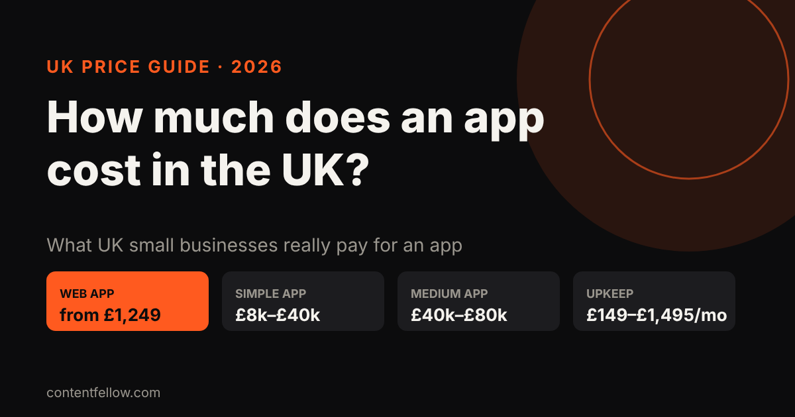
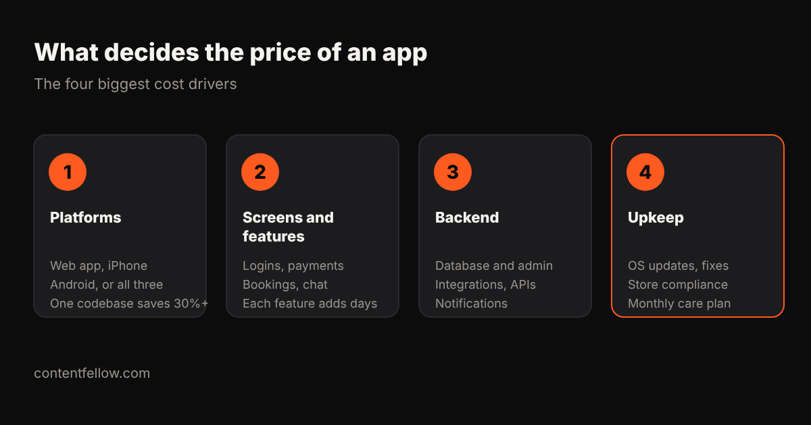

# How Much Does App Development Cost in the UK? (2026 Prices)

> **Quick answer:** In the UK, a simple app built by an agency usually costs **£8,000 to £40,000**, a medium-complexity app **£40,000 to £80,000**, and a complex app **£80,000 or more**. Keeping it running costs roughly **£149 to £1,495 a month**. Small businesses can start far cheaper with a web app (from about **£1,249**) or a fixed-price iPhone and Android app (from **£3,499** with ContentFellow). *(Prices as of October 2026.)*

## How much does it cost to build an app in the UK?

| Type of app | Typical UK agency price | Timeline | Good for |
|---|---|---|---|
| Design and clickable prototype only | £3,000–£12,000 | 2–4 weeks | Testing an idea with investors or customers |
| Simple app or MVP | £8,000–£40,000 | 4–8 weeks | Bookings, loyalty, a single clear job |
| Medium-complexity app | £40,000–£80,000 | 2–4 months | Accounts, payments, admin panel, integrations |
| Complex or enterprise app | £80,000–£200,000+ | 4+ months | Marketplaces, real-time features, heavy compliance |

**Where the numbers come from.** UK studios publish wide but consistent ranges: Fulminous puts a simple MVP at £8,000–£15,000, Foresight Mobile quotes £15,000–£40,000 for a simple app and £40,000–£80,000 for medium complexity, and Appinventiv's UK range runs from £23,780 to over £198,000. Pixelfield puts design and prototyping alone at £3,000–£12,000.

## What does it cost to keep an app running?

Most owners forget this part. Once an app is live it needs hosting, fixes when Apple and Google update their systems, and small improvements.

- **Store fees:** the Apple Developer Program is £79 a year in the UK; Google Play charges a one-off $25.
- **Hosting and backend:** usually £10–£100 a month for a small app.
- **Maintenance plans:** specialist UK studios such as Foresight Mobile charge £675–£1,495 a month. Smaller providers charge less: ContentFellow's [app management plans](/services/management/) run from £149 to £599 a month.

## What makes an app more expensive?

1. **Platforms.** A web app works on every phone from the browser. Native iPhone and Android apps cost more. Building both from one codebase (cross-platform) typically saves 30–40% compared with two separate apps.
2. **Screens and features.** Every login, payment, booking calendar, chat or map adds days of design, build and testing.
3. **Backend.** A database, admin panel, integrations with your other tools and push notifications are often half the work.
4. **Upkeep.** Plan for monthly care from day one so the app doesn't break after the next iOS update.

## Is there a cheaper way for a small business to get an app?

Yes. Many small businesses don't need a £40,000 app. Three cheaper routes:

- **A web app (PWA).** Customers add it to their home screen like an app, with no app store needed. Ideal for bookings, loyalty cards and client portals.
- **A fixed-price simple app.** Agree a tight list of screens up front instead of paying by the hour.
- **Start small, then grow.** Launch the version that does one job well, then add features on a monthly plan.

## ContentFellow app development prices

ContentFellow builds apps at fixed prices, half paid at the start and half at launch ([see all development packages](/services/development/)):

| Plan | Price | What you get |
|---|---|---|
| App Starter | £1,249 | Web app that installs from the browser, up to 5 screens, login and forms |
| App Pro | £3,499 | iPhone and Android app, up to 10 screens, published to both stores |
| App Custom | from £6,499 | Backend, payments, admin panel and notifications |

After launch, keep it running on [App Care from £149 a month](/services/management/).

**[Get a fixed app quote →](/get-started/?service=dev-app)**

## Frequently asked questions

### How much does a simple app cost in the UK?
A simple app or MVP from a UK agency usually costs £8,000 to £40,000. A web app that installs from the browser can cost much less, from about £1,249 with a fixed-price provider.

### How much does it cost to maintain an app?
Expect store fees (£79 a year for Apple), hosting from about £10 a month, and a maintenance plan. UK studios charge £675 to £1,495 a month; smaller providers start from around £149 a month.

### Is it cheaper to build a web app or a native app?
A web app is usually cheaper because one build works on every device and there are no app store reviews. Native iPhone and Android apps cost more but can use more phone features.

### How long does it take to build an app?
A simple app usually takes 4 to 8 weeks, a medium-complexity app 2 to 4 months, and a complex app 4 months or more.

### Do I own my app after it is built?
You should. Check your contract says you own the code, the app store listings and the data, whichever provider you use.

---

*Sources: Fulminous, Foresight Mobile, Appinventiv, Appscrip, WebKatie, Pixelfield, Apple Developer Program UK pricing (reviewed October 2026). Last updated 17 October 2026.*
