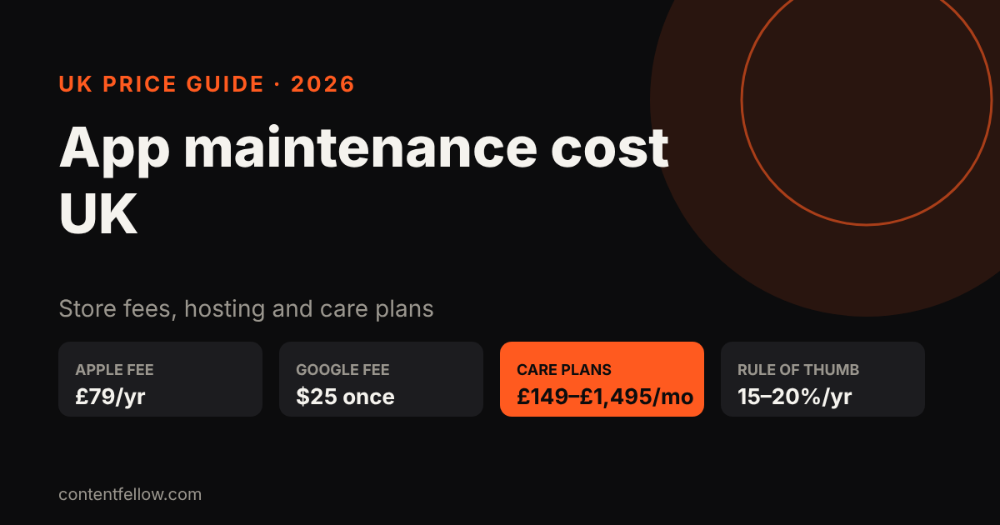
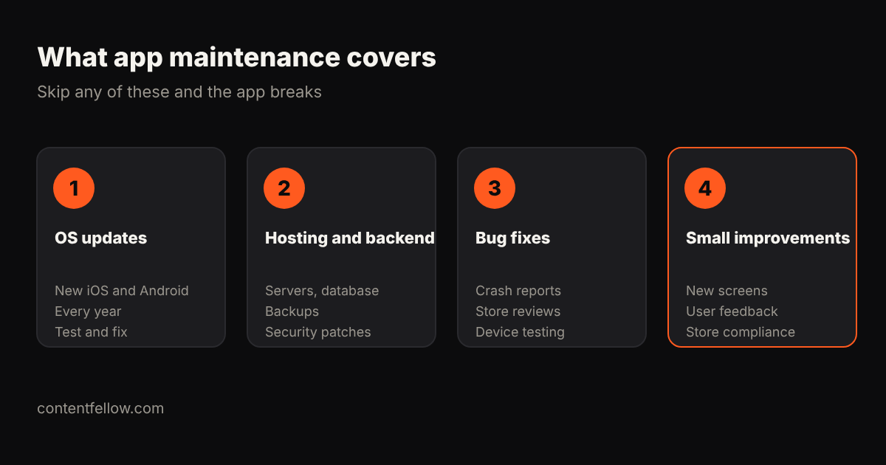

# App Maintenance Cost UK: What It Really Costs to Keep an App Running (2026)

> **Quick answer:** Keeping an app running in the UK costs **£149 to £1,495 a month** on a care plan, depending on the provider and how much change you need, plus **£79 a year** for Apple's developer account, a one-off **$25** for Google Play, and hosting. A common rule of thumb is to budget **15–20% of the build cost every year**. *(UK prices, October 2026.)*

## How much does app maintenance cost?

| Cost | Typical UK price | Notes |
|---|---|---|
| Apple Developer Program | £79 a year | Needed to stay on the App Store |
| Google Play registration | $25 one-off | One payment |
| Hosting and backend | £10–£100+ a month | Grows with users and features |
| Specialist studio care plan | £675–£1,495 a month | Foresight Mobile's published App Care range |
| Smaller provider care plan | £149–£599 a month | ContentFellow App Care plans |
| Rule-of-thumb budget | 15–20% of build cost a year | E.g. £1,000–£1,400 a year on a £7,000 app |

## What does app maintenance include?

1. **OS updates:** Apple and Google release new versions every year. Apps need testing and fixing so they keep working and stay in the stores.
2. **Hosting and backend:** servers, databases, backups and security patches.
3. **Bug fixes:** crash reports, store review issues and testing on new devices.
4. **Small improvements:** tweaks from user feedback and store policy changes.

## What happens if you don't maintain an app?

Apps that aren't updated start crashing on new phones, fall foul of store rules and can be removed from the App Store or Google Play. Fixing a neglected app later usually costs more than steady monthly care.

## ContentFellow app care plans

| Plan | Price | Includes |
|---|---|---|
| App Care | £149 a month | Hosting, iOS and Android updates, bug fixes, store compliance |
| App Care Plus | £359 a month | Plus 2 small feature changes a month and a monthly report |
| App Care Pro | £599 a month | Plus 5 changes a month, a new feature monthly and priority support |

We also take on apps built elsewhere after a quick check. [See management plans →](/services/management/) · Need an app built? [App development from £1,249](/services/development/) and our guide to [app development costs](/blog/app-development-cost-uk/).

## Frequently asked questions

### How much does it cost to maintain an app in the UK?
Expect £149 to £1,495 a month for a care plan, plus £79 a year for Apple, a one-off $25 for Google Play, and hosting.

### What is a good annual budget for app maintenance?
A common rule of thumb is 15 to 20 per cent of the original build cost each year.

### Do I need to update my app every year?
Yes. New iOS and Android versions arrive every year, and apps that aren't updated can stop working or be removed from the stores.

### Can someone else maintain an app another agency built?
Usually, yes. A new provider reviews the code and access first, then takes it onto a care plan.

### Is hosting included in app maintenance?
It depends on the plan. ContentFellow's App Care includes hosting for small apps; check the limits with any provider.

---

*Sources: Foresight Mobile App Care pricing, Apple Developer Program UK, Google Play Console (reviewed October 2026). Last updated 17 October 2026.*
