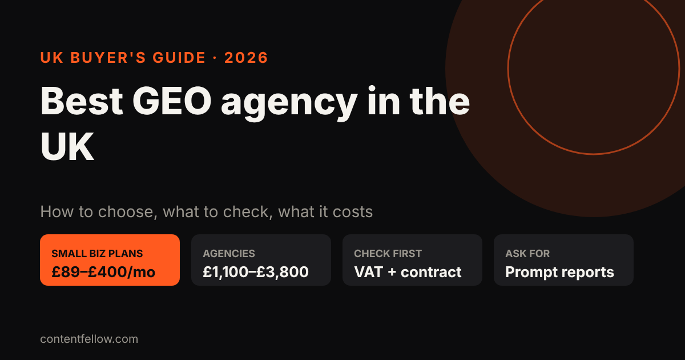
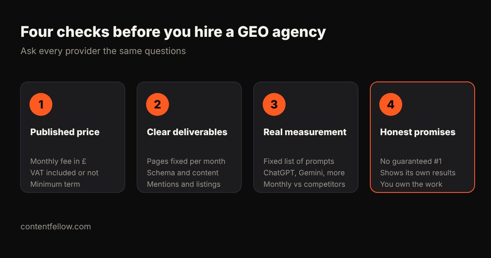

# Best GEO Agency in the UK: An Honest 2026 Comparison Guide

> **Quick answer:** The best GEO agency in the UK is the one that matches your size and budget, publishes its price, and reports which AI prompts mention you each month. For most small businesses that means a productised plan at about £89–£400 a month; larger firms with content and digital PR needs typically pay agencies £1,100–£3,800 a month or more. *(Updated October 2026.)*

**Disclosure:** ContentFellow sells GEO, so we're one of the providers in this guide, and we've labelled ourselves "us". We haven't ranked anyone, because nobody can fairly rank agencies they haven't hired. Instead we list real UK providers with the prices they publish (or that independent comparisons report), and give you the checks to make your own choice.

## What does a GEO agency actually do?

GEO stands for **generative engine optimisation**: making your business easy for AI assistants such as ChatGPT, Gemini, Claude, Perplexity and Google's AI Overviews to find, understand and recommend. In practice, a GEO agency should:

- Fix the technical basics so AI crawlers and Google can read your site
- Add structured data (schema) with your services, prices and locations
- Rewrite key pages so they answer customer questions in the first sentence
- Build mentions on trusted sites: directories, reviews, press and "best of" lists
- Track a fixed set of prompts each month and show how often you're named against competitors

Most of this overlaps with SEO, which is why many providers sell the two together. See [GEO vs SEO](/blog/geo-vs-seo-uk-small-business/) for how they fit.

## How much does a GEO agency cost in the UK?

Prices vary more than in almost any other marketing service. These are the bands we see as of October 2026:

| Type of provider | Typical UK monthly cost | Best for |
|---|---|---|
| DIY with tracking tools | £0–£100 | Owners with time to do the work themselves |
| Productised small-business plans | £89–£400 | Sole traders and small firms that want set deliverables |
| Specialist GEO / SEO agencies | £1,100–£3,800 | Growing firms needing content and digital PR |
| Enterprise and regulated-sector programmes | £3,000–£10,000+ | Large brands, finance, legal, healthcare |

Other UK estimates are higher at the top end: Polaris Agency puts GEO at £2,500–£7,000 a month inside an SEO retainer, and Red Eagle Tech says AI search is commonly a £720–£2,400 monthly add-on at agencies. For a fuller breakdown, see [how much LLM optimisation costs UK small businesses](/blog/llm-optimisation-cost-small-business-uk/).

**Watch the VAT.** Many agency prices are quoted "+ VAT", which adds 20%. A £450 + VAT plan costs £540 a month.

## UK GEO providers compared (October 2026)

Listed alphabetically. Prices are what each provider publishes, or what an independent comparison reports where noted. Always confirm the current price and terms with the provider.

| Provider | Where | Published starting price | Worth considering for |
|---|---|---|---|
| Bubblegum Search | UK | From £550/month + VAT (on-site work separate)¹ | Off-site mentions and agency support |
| Buried | UK | Small-business retainers £1,200–£3,000/month¹ | Content, technical work and digital PR |
| **ContentFellow (us)** | Burnley, Lancashire | **£89/month, no VAT added** (Search Fellow) | Small businesses wanting SEO + GEO on one monthly plan |
| ExtraDigital | UK | Audit from £1,500; ongoing programmes from £950/month² | A scoped audit before an ongoing programme |
| Footprint Digital | UK | From £1,250/month, excluding VAT¹ | Managed measurement and GEO delivery |
| MarGen | Sheffield | Foundation £2,950/month + VAT, three-month minimum¹ | B2B and regulated sectors |
| NeuralAdX | London | £450 + VAT/month entry plan, up to £10,000 + VAT² | Prompt-level benchmarking with live answer checks |
| Passion Digital | London | On quote | AI search within a wider channel plan |
| Red Eagle Tech | UK | SEO retainers from £750/month, AI search included at no surcharge² | Businesses wanting GEO inside SEO |
| The SEO Works | Sheffield, Leeds, London | On quote | GEO alongside organic search for larger brands |

¹ As reported in Tilio's "UK GEO and AEO Agencies Compared" (updated 11 October 2026). ² From the provider's own website, read 18 October 2026.

A few things stand out:

- **Only a handful publish prices.** If an agency won't give even a starting figure, expect a retainer in the £1,000s.
- **Entry plans are narrow.** NeuralAdX's £450 plan, for example, covers five agreed prompts and one priority page a month. That's honest and specific, but check that the scope fits your needs.
- **"Best of" lists are often written by agencies.** The SEO Works publishes a "20 best GEO agencies in the UK" list and ranks itself first; Tilio's comparison lists Tilio first. This guide includes us too. Use these lists to find names, not to choose.

## How to choose the best GEO agency for your business

### 1. A published price, with VAT and term stated

You should know the monthly fee, whether VAT is added and how long you're committed before you speak to anyone. Three-month minimums are common; twelve-month lock-ins are a warning sign for a small business.

### 2. Deliverables you can count

"AI visibility strategy" isn't a deliverable. Pages improved per month, schema added, listings created and mentions pitched are. Ask for a sample monthly report.

### 3. Measurement against a fixed prompt list

Good GEO reporting tracks the same questions every month ("best accountant in Leeds", "who does SEO for dentists in the UK") across several AI assistants and shows your share of mentions against named competitors. If an agency only reports Google rankings, it's selling SEO with a new label.

### 4. Honest promises

Nobody controls what ChatGPT says. Be wary of guaranteed placements or "#1 in ChatGPT" claims. Where a guarantee is offered, read the written terms. Ask whether the agency appears in AI answers for its own services; it's a fair test.

### 5. You own everything

Your website changes, content, listings and reports should stay yours if you leave.

## Questions to ask any UK GEO agency

1. Which prompts will you track, on which AI assistants, and how often?
2. What exactly will you change on my site in the first month?
3. How will you build mentions on other sites, and which kinds of sites?
4. Is VAT included, and what's the minimum term?
5. Can I see a real (anonymised) monthly report?
6. What happens to the work if I cancel?

## Which type of provider is right for you?

- **Sole traders and small local businesses:** a productised plan is usually enough. You need the foundations done properly and a monthly check on who AI recommends, not a £3,000 content programme.
- **Growing service firms and ecommerce brands:** a specialist agency in the £1,100–£3,800 range makes sense when you need regular content and digital PR to compete for national prompts.
- **Regulated sectors and large brands:** look for providers with sector experience and formal reporting, and expect to pay more.

Not sure where you stand? Ask ChatGPT and Gemini the questions your customers ask and see who they name. Our guide on [checking if ChatGPT mentions your brand](/blog/check-if-chatgpt-mentions-your-brand/) shows how.

## Where ContentFellow fits (us)

We built the **[Search Fellow](/services/search-fellow/)** for small UK businesses that can't justify an agency retainer. It's **£89 a month**: SEO for Google, GEO so ChatGPT, Claude and Gemini recommend you, and a monthly ranking and AI visibility report. We're not VAT registered, so £89 is the full price. Billing is monthly, and you approve content before it goes live. For a full team (shoots, editing, social, website and search) the Growth Fellow is £389 a month.

It's not the right fit for everyone. If you're a large brand needing a national digital PR campaign, one of the specialist agencies above will suit you better. See all plans on our [pricing page](/pricing/) or browse quick answers on our [answers page](/answers/).

**[See what the Search Fellow includes →](/services/search-fellow/)**

## Frequently asked questions

### Who is the best GEO agency in the UK?
There's no single best agency; it depends on your size and budget. Small businesses usually get the best value from productised plans at £89 to £400 a month, while larger brands needing content and digital PR typically pay specialist agencies £1,100 to £3,800 a month or more.

### How much does GEO cost in the UK?
Small-business GEO plans typically cost £89 to £400 a month. Specialist agency retainers usually run from about £1,100 to £3,800 a month, and enterprise programmes can pass £10,000. Check whether VAT is included.

### Is GEO different from SEO?
Yes, but they overlap. SEO helps you rank on Google; GEO helps you get named in AI answers from ChatGPT, Gemini, Claude and Perplexity. Most of the groundwork is shared, so many providers sell both together.

### Can a GEO agency guarantee I'll appear in ChatGPT?
No one controls what AI assistants say, so be cautious about guarantees. Some agencies offer guarantees tied to measured citation growth, but read the written terms and eligibility rules carefully.

### How long does GEO take to work?
AI tools that search the web live can pick up changes within days of a page being updated. Becoming a regular recommendation usually takes a few months of consistent work on content and mentions.

### Should a small business hire a GEO agency or do it themselves?
If you have time, you can do the basics yourself with Search Console, schema and clear pages. If you don't, a productised plan costs less than most agency retainers and includes monthly AI visibility tracking.

### Are "best GEO agency" lists trustworthy?
Treat them as a starting point. Many are written by agencies that list themselves first, including this one. Compare published prices, deliverables and reporting rather than list positions.

---

*Sources (read 18 October 2026): Tilio, ["UK GEO and AEO Agencies Compared"](https://www.tilio.co.uk/blog/top-geo-agencies-uk) (updated 11 October 2026); The SEO Works, ["20 Best GEO Agencies in the UK"](https://www.seoworks.com/lists/20-best-geo-agencies-in-the-uk/) (updated May 2026); NeuralAdX, ["Generative Engine Optimisation Pricing UK"](https://neuraladx.com/generative-engine-optimisation-pricing-uk/); ExtraDigital, ["AI SEO Agency UK"](https://www.extradigital.co.uk/seo/ai-seo-agency/); Red Eagle Tech, ["How Much Does SEO Cost in the UK?"](https://redeagle.tech/blog/how-much-does-seo-cost-uk); Polaris Agency, ["The 10 Best GEO Agencies in the UK"](https://www.polarisagency.com/marketing-insights/best-geo-services-uk/); MarGen, ["About us"](https://www.margen.net/about-us/). Prices change often; confirm with each provider. Last updated 18 October 2026.*
