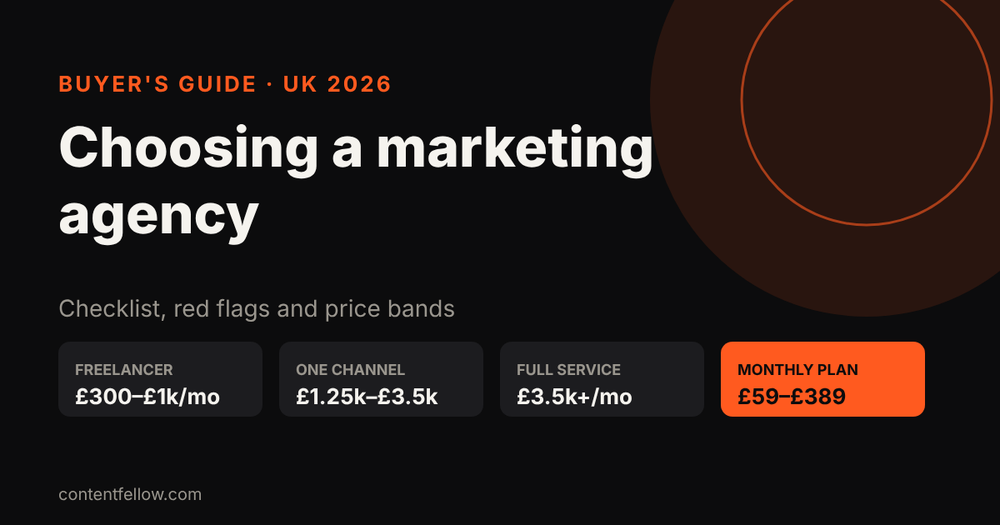
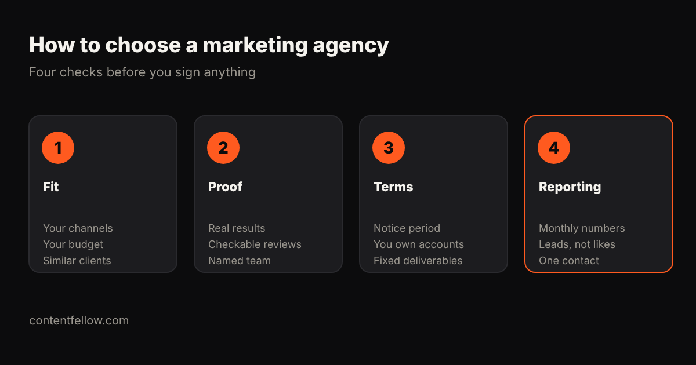

# Best Marketing Agency for Small Businesses in the UK: How to Choose + Prices (2026)

> **Quick answer:** The best marketing agency for a UK small business is the one that covers the channels that bring you customers, publishes clear monthly deliverables, lets you leave on short notice and keeps every account in your name. In 2026 a single-channel agency retainer typically costs **£1,250 to £3,500 a month** and full-service retainers **£3,500 to £16,750**, while productised monthly plans start far lower. Pick on fit and terms, not on the biggest name. *(Updated October 2026.)*

A quick note on honesty: we're ContentFellow, a Burnley-based marketing service, so we're one of the options below. We've marked where we appear as "us". The checklist and red flags apply to everyone, including us.

## How much does a marketing agency cost for a small business in the UK?

| Option | Typical UK cost (2026) | What you usually get | Best for |
|---|---|---|---|
| Doing it yourself | £0 + your time | Whatever you can fit in | Very early businesses |
| Freelancer (one skill) | Roughly £300–£1,000 a month (our estimate) | One specialist, managed by you | One clear gap, such as social media |
| Specialist agency, one channel | £1,250–£3,500 a month | SEO, PPC or social done by a team | Businesses where one channel drives sales |
| Full-service agency | £3,500–£16,750 a month | Strategy plus several channels | Larger SMEs with bigger budgets |
| Productised monthly plan | Fixed price, e.g. £59–£389 a month (us) | Set deliverables each month | Small businesses that want predictable costs |

Sources: Whito's [UK agency retainer research](https://whito.co.uk/research/uk-agency-retainers/) (updated 12 October 2026) gives single-channel retainers of £1,250–£3,500 a month and full-service retainers of £3,500–£16,750. Its channel benchmarks put PPC management at £500–£1,500 a month, social media at £800–£2,500, content marketing at £1,000–£3,000 and email at £500–£1,500. The freelancer range is our own estimate from UK freelance rates, not from Whito. Whito also says SMEs should expect to start at £1,000–£2,000 a month for meaningful agency work.

### What should your business budget?

Whito's research suggests these monthly agency budgets by business size:

| Annual turnover | Typical monthly agency budget |
|---|---|
| Under £100k (solo or micro) | £500–£1,000 |
| £100k–£500k (small) | £500–£1,500 |
| £500k–£2m (medium) | £1,500–£3,000 |
| £2m–£5m (established) | £2,500–£5,000 |
| £5m+ (scaling) | £5,000–£16,750+ |

If your budget sits at the bottom of these bands, a traditional retainer may only buy one channel. That's where freelancers or a productised plan can stretch further.

## What makes an agency "best" for a small business?

There is no single best agency in the UK. There's a best fit for you. Judge every option on four things:

1. **Fit.** Do they do the channels that actually bring you customers? A café needs social media, photos and Google Maps. A B2B consultancy may need LinkedIn and SEO. Have they worked with businesses your size?
2. **Proof.** Can they show results for clients like you, with reviews you can check yourself on Google or elsewhere? Do you know who will actually do the work?
3. **Terms.** What's the minimum term and notice period? Do you own your website, ad accounts, social profiles and data? Are deliverables written down?
4. **Reporting.** Will they report on leads, enquiries and sales, or just impressions and reach? How often, and who is your contact?

## Checklist: what to look for in a small-business marketing agency

- Published prices, or a clear written quote with no vague "ongoing support"
- Monthly deliverables in numbers: posts, videos, pages, hours, reports
- A short minimum term, or a break clause after an initial period
- Accounts, domains and data registered in **your business's name**
- A named person who does the work or manages it
- Reporting on business results, not just activity
- Clear pricing for anything outside the plan
- VAT shown clearly: Whito found 13 of 21 UK providers it checked didn't state VAT beside the plan price
- Reviews from businesses like yours that you can verify
- You approve content before it goes live

## Red flags to watch for

Whito's research lists the warning signs that come up most in UK agency contracts. In plain words:

- **No clear deliverables.** "Ongoing marketing support" with no numbers means you can't measure value.
- **Long lock-in with no break clause.** 12-month contracts are common, but there should be a review point or a 30-day exit after the first period.
- **They own your accounts.** Your Google Ads, social profiles, analytics and domain should be in your name, with the agency given access.
- **Vanity reporting.** Reports full of impressions and reach, with nothing on enquiries or sales.
- **Locked dashboards.** If you can't see your own data, you're dependent, not served.
- **Everything is "out of scope".** If every small request costs extra, the scope was too vague.
- **Guaranteed rankings or results.** Nobody can guarantee a Google position, traffic or leads.

## Questions to ask before you sign

1. Who exactly will do the work, and who is my main contact?
2. What will I get each month, in numbers?
3. What's the minimum term and notice period?
4. Do I own the website, content, ad accounts and data if I leave?
5. How do you report results, and how often?
6. What does work outside the plan cost?
7. Is VAT included in the price you quoted?
8. Can I speak to a current client of a similar size?
9. What happens in the first 30 days?
10. Do I approve content before it goes live?

## Your options compared, honestly

- **Freelancers** are flexible and often cheaper per skill, but you become the project manager, and a team of separate freelancers rarely shares one plan.
- **Specialist agencies** are strong at one thing, such as SEO or paid ads. Good when one channel clearly drives sales.
- **Full-service agencies** give you strategy and many channels, usually with account managers and longer contracts. They suit bigger budgets.
- **Productised monthly plans** sell fixed deliverables at a fixed price. You trade some bespoke strategy for predictable cost and simple terms. ContentFellow is one of these (us).

## Where ContentFellow fits (us)

We're ContentFellow, based in Burnley, Lancashire, working with small businesses across the UK. Instead of a retainer, you hire "Fellows" on monthly plans:

- Social Fellow from £59 a month, Build Fellow (website) £69, Search Fellow (SEO and GEO) £89, Creator Fellow (video editing) £119 and Studio Fellow (on-site shoots) £149
- Growth Fellow, all five plus a Growth lead and one strategy, £389 a month (£555 if bought separately)

Billing is monthly, you approve content before it goes live, and you can add, remove or upgrade a Fellow from the next month. We're not VAT registered, so the price is the full price. We're not the right fit for everyone: if you need large paid-ad budgets managed or a national PR campaign, a specialist agency will serve you better.

Compare every plan on our [pricing page](/pricing/), see what each one does on our [services page](/services/), or browse short answers in our [answers hub](/answers/). For a deeper cost breakdown, read [outsourced marketing team vs agency vs in-house](/blog/outsourced-marketing-team-cost-uk/).

**[See all Fellows →](/services/)**

## Frequently asked questions

### What is the best marketing agency for a small business in the UK?
The best one is the best fit: it covers your key channels, shows checkable results for similar businesses, writes down monthly deliverables and keeps accounts in your name. Compare options on those points rather than on size or awards.

### How much should a small business spend on a marketing agency?
Whito's 2026 research suggests £500 to £1,500 a month for businesses turning over up to £500,000, and £1,000 to £2,000 a month as a starting point for meaningful agency work. Productised plans can cost less.

### How much does a full-service marketing agency cost in the UK?
Full-service retainers covering several channels typically cost £3,500 to £16,750 a month in 2026. Single-channel retainers are usually £1,250 to £3,500.

### Should I sign a 12-month agency contract?
Only with a break clause or performance review. A 30-day exit option after an initial period protects you if the work isn't delivering.

### Who should own my social media and ad accounts?
You should. Accounts, domains and analytics should be registered in your business's name, with the agency given access. That way you keep everything if you leave.

### Can an agency guarantee first place on Google?
No. Nobody controls Google's rankings. Treat any guaranteed ranking, traffic or lead number as a red flag.

### Is a freelancer or an agency better for a small business?
A freelancer suits one clear gap and a business owner with time to manage them. An agency or productised plan suits businesses that need several channels working to one plan.

*Sources: Whito, "Marketing Retainer Cost UK 2026" (updated 12 October 2026); ContentFellow plan prices. Last updated 18 October 2026.*
