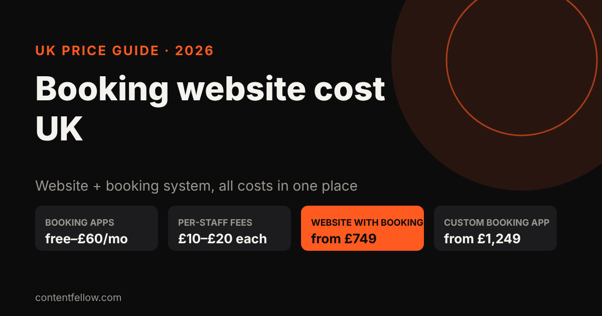
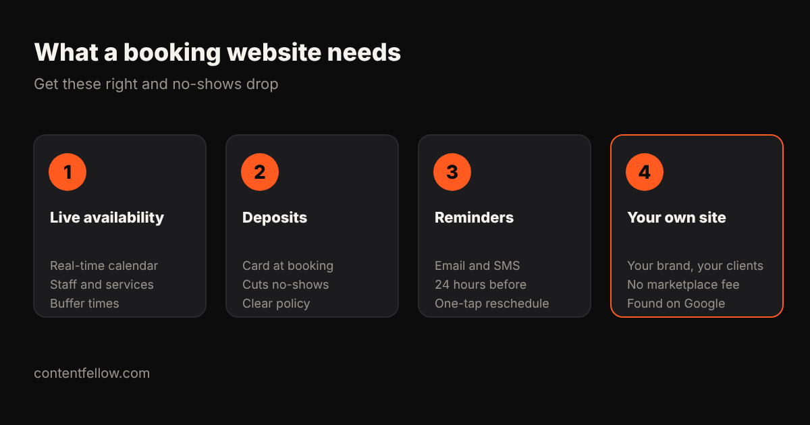

# Booking Website Cost UK: Salons, Clinics and Trades (2026)

> **Quick answer:** A website with online booking costs a UK small business roughly **£0 to £60 a month** for a booking app (plus per-staff and card fees), and **£749 to £3,000** for a professionally built website with booking. A custom booking web app starts around **£1,249**. Watch out for marketplace fees: some booking apps charge a one-off commission (Fresha charges 20%) on new clients they send you. *(October 2026.)*

## What does online booking cost?

| Option | Typical cost | Watch out for |
|---|---|---|
| Free booking tools (Setmore, SimplyBook.me free tiers) | £0 | Booking limits, branding, fewer reminders |
| Salon and clinic apps (Fresha, Booksy, GlossGenius) | about £20–£60 a month per location | £10–£20 per extra staff member; card fees; marketplace commission on new clients |
| Website with built-in booking (ContentFellow Grow) | £749 one-off | Pick a booking tool that fits your services |
| Custom booking web app | from £1,249 | Scope it tightly: services, staff, deposits |
| Agency custom booking site | £3,000–£10,000 | Long timelines |

Published plans are a guide: Fresha lists an independent plan around $19.95 a month plus per-staff fees and a one-time 20% fee on new marketplace clients; Booksy starts at $29.99 a month plus $20 per extra team member (2026 published US prices; UK prices are similar in pounds).

## What should a booking website include?

1. **Live availability:** a real-time calendar by service and staff member, with buffer times.
2. **Deposits:** take a card or deposit at booking. It's the simplest way to cut no-shows.
3. **Reminders:** automatic email or SMS 24 hours before, with one-tap reschedule.
4. **Your own website:** clients book with you, under your brand, without a marketplace taking a cut of repeat customers, and Google can find you.

## Booking app vs your own website

Marketplaces like Fresha and Booksy can bring new clients, but you pay for them and you're listed next to competitors. Your own website with booking keeps repeat clients direct. Many salons and clinics use both: the marketplace for discovery, their own site for regulars.

## ContentFellow booking websites

- **Grow website (£749):** up to 15 pages with a booking or quote form, Google Analytics and SEO setup.
- **App Starter (£1,249):** a custom booking web app with login, services and staff.
- Keep it running with [Care from £49 a month](/services/management/).

[See development packages →](/services/development/) · Also read: [how long a website takes to build](/blog/how-long-to-build-a-website-uk/).

## Frequently asked questions

### How much does a booking website cost in the UK?
Booking apps cost from free to about £60 a month plus staff and card fees. A professionally built website with booking typically costs £749 to £3,000.

### Is Fresha free in the UK?
Fresha now charges a monthly subscription for most businesses, plus a one-time commission on new clients it brings through its marketplace. Check its current UK pricing.

### How do I stop no-shows?
Take a deposit or card details at booking, send automatic reminders, and set a clear cancellation policy.

### Do I need my own website if I use a booking app?
It helps. Your own site keeps repeat clients booking directly, builds your brand and gets found on Google and in AI answers.

### Can tradespeople use online booking?
Yes. Plumbers, electricians and cleaners often use a quote request form or booked call slots instead of fixed appointments.

---

*Sources: GlossGenius, Booksy and Meetergo booking software comparisons (2026). Last updated 17 October 2026.*
