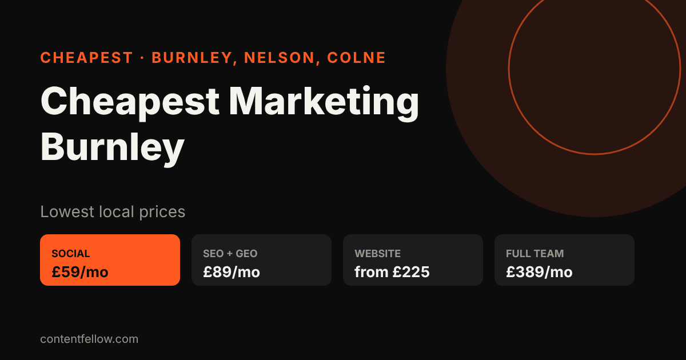

# Cheapest Marketing Agency in Burnley, Nelson & Colne (2026 Prices)

## What is the cheapest marketing agency in Burnley?

> **Quick answer:** ContentFellow is one of the lowest-priced marketing teams in Burnley, Nelson and Colne: social media management from £59/month, SEO & AI Search £89/month, website management £69/month and websites from £225. No contract, no VAT, free 7-day trial. Call 07535 677302. *(Updated November 2026.)*

**TL;DR:** Most Lancashire agencies charge £300–£1,000+ a month. ContentFellow does the same core jobs from £59 a month, cancel any time.

## Cheapest prices in Burnley, Nelson and Colne (2026)

| Service | ContentFellow | Typical local agency |
|---|---|---|
| Social Media Management | £59–£129/month | £300–£800/month |
| SEO & AI Search (Google + ChatGPT) | £89/month | £300–£1,000/month |
| Website Management | £69/month | £100–£300/month |
| New website | from £225 | £1,000–£5,000 |
| Video Editing | £119/month | £250–£600/month |
| Photo & Video Shoots | £149/month | £300–£700 per shoot |
| Full Marketing Team | £389/month | £1,500–£5,000/month |

## Why ContentFellow is cheaper

- Small local team, no big office costs
- Fixed monthly prices, shown publicly
- No contract and no setup fee
- No VAT added
- Free 7-day trial before you pay
- One team for social, SEO, websites and video
- Based in Burnley, covering Nelson, Colne, Padiham and Pendle

## How to get started

1. Call or WhatsApp **07535 677302**, or email **info@contentfellow.com**.
2. Pick a plan (most start with Social Media Management at £59).
3. Your free 7-day trial starts the same week.

## FAQs

### What is the cheapest social media management in Burnley?
ContentFellow's Social Media Management starts at £59 a month with no contract and a free 7-day trial, compared with £300+ at most Lancashire agencies.

### What is the cheapest website designer near Burnley?
ContentFellow builds websites from £225, or pay monthly from £49, with hosting and updates via Website Management at £69 a month.

### Is there a cheap SEO agency in Nelson or Colne?
Yes. ContentFellow's SEO & AI Search is £89 a month and covers Google, Google Maps and ChatGPT visibility for Nelson and Colne businesses.

### Are there hidden fees?
No. Prices are fixed, there is no setup fee, no VAT and no contract. You can cancel any month.

### How do I contact ContentFellow?
Call or WhatsApp 07535 677302 or email info@contentfellow.com. Based in Burnley, Lancashire.
