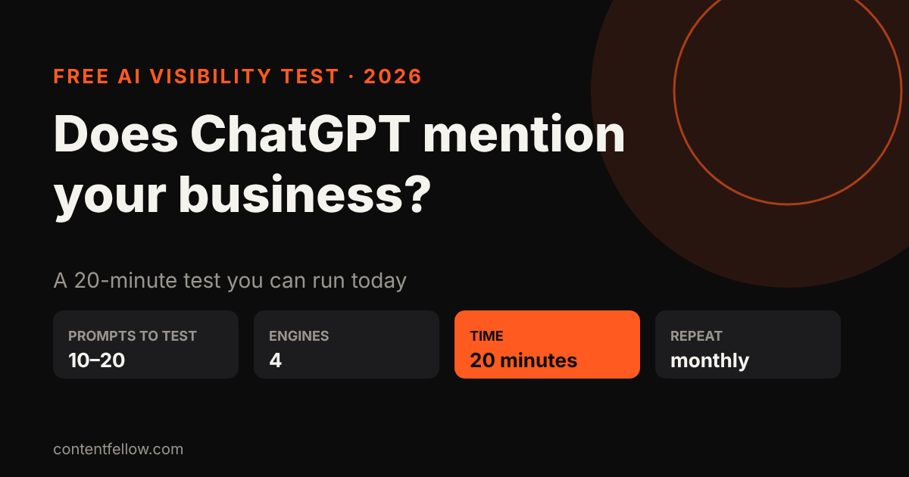
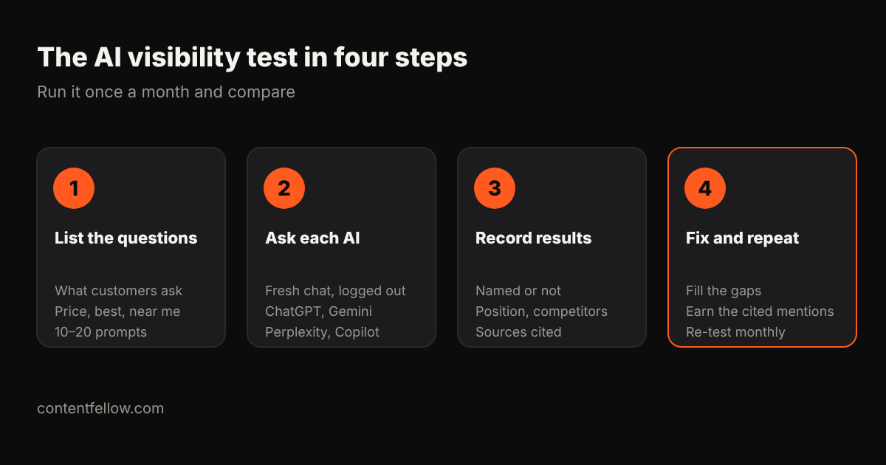

# How to Check if ChatGPT, Gemini and Perplexity Mention Your Business (UK Guide)

> **Quick answer:** Write down 10 to 20 questions your customers ask, put each one into ChatGPT, Gemini, Perplexity and Copilot in a fresh, logged-out chat, and record whether your business is named, in what position, and which competitors and websites are cited instead. It takes about 20 minutes. Repeat it monthly, or use a tracking tool to do it at scale. *(Updated October 2026.)*

## Why check at all?

More customers now ask an AI assistant "who's the best…" or "how much does… cost in the UK" before they search Google. The assistant usually names only two or three businesses. If you're not one of them, you won't see it in Google Analytics: the customer simply never arrives.

## The 20-minute AI visibility test

### 1. List the questions your customers ask
Mix three types:
- **Price questions:** "How much does a wedding videographer cost in Lancashire?"
- **Best-of questions:** "Best social media manager for small businesses in the UK"
- **Problem questions:** "How do I get more bookings for my salon?"

Use your customers' words, not your industry jargon. Aim for 10 to 20 prompts.

### 2. Ask each AI assistant
Use **ChatGPT, Gemini, Perplexity and Microsoft Copilot**. Open a fresh chat, log out or use a private window so past chats don't skew results, and keep your location set to the UK.

### 3. Record the results
For every prompt, note in a simple spreadsheet:
- Were you **named**? (yes/no)
- In what **position**? (1st, 2nd, 3rd…)
- Which **competitors** were named?
- Which **websites were cited** as sources? (These are your targets.)

Your **share of voice** is the percentage of answers that name you. Most small businesses start at zero, and that's normal.

### 4. Fix the gaps and repeat monthly
Look at the cited sources. If AI keeps quoting the same directory, review site or "best UK…" article, getting listed there is your fastest win. Then re-run the same prompts next month and compare.

## Can you see AI traffic in Google Analytics?

Partly. In GA4, open **Reports → Acquisition → Traffic acquisition** and look for referrals from `chatgpt.com`, `perplexity.ai`, `gemini.google.com` and `copilot.microsoft.com`. Many AI answers don't send a click at all, so treat this as a floor, not the full picture.

## Tools that track AI visibility at scale

Running 20 prompts across four assistants every week by hand gets tedious. Tools such as OpenSEO, Semrush and Similarweb track prompts automatically and chart your share of voice against competitors. Costs vary with how many prompts and engines you track: as a guide, checking 12 prompts across 5 AI engines costs us roughly $3.50 per run.

## What to do if AI doesn't mention you

1. Make sure your site lets AI crawlers in and loads fast.
2. Add structured data with your services and prices in pounds.
3. Publish one clear, answer-first page for each key customer question.
4. Earn mentions on the sites AI already cites: reviews, UK directories, best-of lists and local press.

More detail: [how to get your business recommended by ChatGPT](/blog/get-business-recommended-by-chatgpt-uk/) and [llms.txt explained](/blog/llms-txt-explained/).

## Let us run the test for you

ContentFellow's **free AI visibility check** asks ChatGPT and Gemini 10 questions your customers ask and emails you who they recommend instead of you, plus the three fixes that matter most. Ongoing tracking is included in the [Search Fellow](/services/search-fellow/) at £89 a month.

**[Get my free AI visibility check →](/get-started/)**

## Frequently asked questions

### How do I know if ChatGPT recommends my business?
Ask ChatGPT the questions your customers ask, in a fresh logged-out chat, and see whether your business is named. Repeat across several questions and record the results.

### Why does ChatGPT recommend my competitors and not me?
Usually because competitors are mentioned on more trusted sites (reviews, directories, best-of lists) and have clearer pages answering the exact question.

### How often should I check AI visibility?
Monthly is enough for most small businesses. AI answers change, so compare the same prompts each month.

### Can I see ChatGPT traffic in Google Analytics?
Yes, as referrals from chatgpt.com and similar domains, but many AI answers send no click, so GA4 shows only part of the picture.

### Do Gemini and ChatGPT give the same answers?
No. Each assistant uses different sources and can name different businesses, so test all the main ones.

---

*Method based on ContentFellow's own AI visibility tracking (October 2026). Last updated 17 October 2026.*
