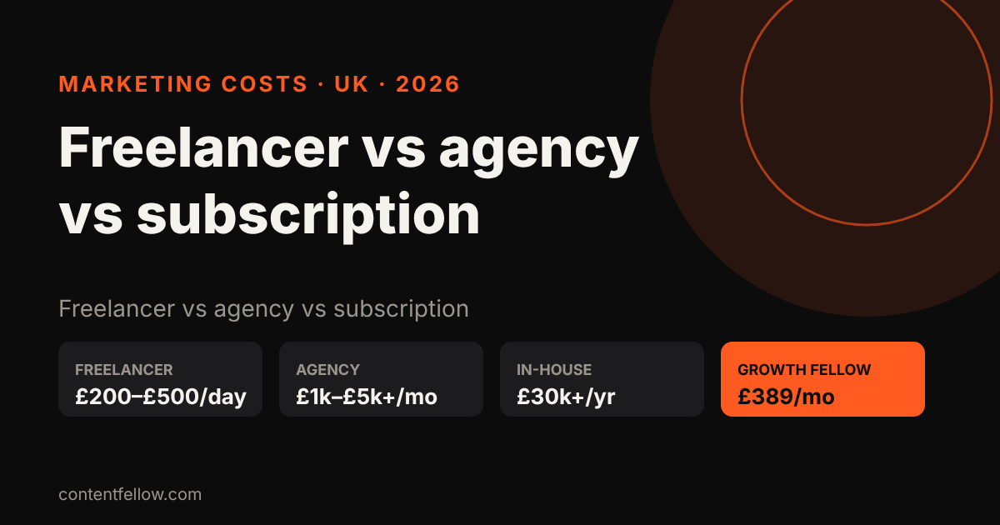
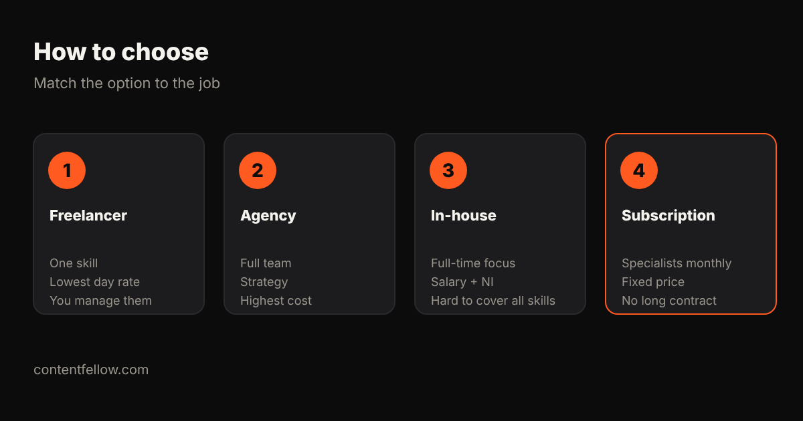

# Is It Cheaper to Hire a Freelancer or an Agency for Marketing? UK Costs 2026

## Is it cheaper to hire a freelancer or an agency for marketing?

> **Quick answer:** For one skill, a freelancer is usually cheaper than an agency: UK marketing freelancers typically charge £200–£500 a day, while small-business agency retainers usually start around £1,000–£5,000 a month. But if you need several skills (video, social, website and SEO), hiring separate freelancers adds up and you become the project manager, so a full-service agency or a marketing subscription can work out cheaper per skill. ContentFellow's Growth Fellow covers all five for £389 a month. *(Updated October 2026.)*

**TL;DR:** One job, one skill: freelancer. Strategy plus lots of channels and a big budget: agency. Several skills on a small budget without managing four people: subscription.

## UK cost comparison (2026)

| Option | Typical UK cost | Good for | Watch out for |
|---|---|---|---|
| Freelancer | £25–£75 per hour, £200–£500 per day | One clear task or skill | Availability, holidays, you manage them |
| Several freelancers | £1,000–£3,000+ a month combined | Covering video, social, web, SEO | Coordination, mixed quality |
| Agency retainer | £1,000–£5,000+ a month | Strategy, campaigns, larger budgets | Minimum terms (often 6–12 months) |
| In-house marketer | £28,000–£40,000 salary plus employer NI and pension | Full-time focus | One person rarely covers every skill |
| Marketing subscription | £59–£389 a month at ContentFellow | Small businesses wanting specialists monthly | Set monthly scope |

Ranges are typical quotes from UK freelancer platforms, agency price pages and job listings checked in October 2026.

## When a freelancer is cheaper

- You need one thing done well: a logo, a website refresh, a batch of videos.
- You have time to brief, review and chase.
- You already know your strategy.

## When an agency is worth it

- You have a budget of a few thousand pounds a month.
- You need strategy, campaigns and reporting across many channels.
- You want one accountable team.

## The middle option: a marketing subscription

A subscription gives you specialists for a fixed monthly price, without hiring or a long contract. At ContentFellow you pick Fellows: [Social Fellow £59](/services/), Build Fellow £69, Search Fellow £89, Creator Fellow £119, Studio Fellow £149, or all five in Growth Fellow for £389 a month (save £166). You approve everything before it goes live, and can add or drop Fellows from next month.

Compare: [outsourced marketing team costs](/blog/outsourced-marketing-team-cost-uk/) and [all-in-one marketing for UK small businesses](/blog/all-in-one-marketing-uk-small-business/).

## Questions to ask whichever you choose

1. What exactly is included each month?
2. What is the minimum contract and notice period?
3. Who owns the website, accounts and files?
4. How do you report results?
5. Is VAT on top? (ContentFellow isn't VAT registered, so prices are the full amount.)

## Frequently asked questions

### Is it cheaper to hire a freelancer or an agency for marketing?
For a single skill, a freelancer is usually cheaper. For several skills at once, an agency or a marketing subscription can cost less than hiring and managing multiple freelancers.

### How much does a marketing freelancer cost in the UK?
Typically £25 to £75 an hour or £200 to £500 a day, depending on skill and experience.

### How much does a marketing agency cost per month in the UK?
Small-business retainers usually start around £1,000 and can go well beyond £5,000 a month.

### What is a marketing subscription?
A fixed monthly plan that gives you set marketing work from specialists, such as social media, video or SEO, without a long contract.

### Can I try ContentFellow before paying?
Yes. Several Fellows start with a free trial, such as 3 free videos with the Creator Fellow.

---

**[See all services and prices →](/services/)** · More quick answers on our [answers page](/answers/). Want a site you own? See [development packages](/services/development/) and [website care plans](/services/management/).

*Sources: ContentFellow plans and prices from contentfellow.com/pricing/ (October 2026); market ranges are typical quotes from UK freelancer marketplaces and agency price pages checked October 2026. Prices include everything: ContentFellow is not VAT registered. Last updated 19 October 2026.*
