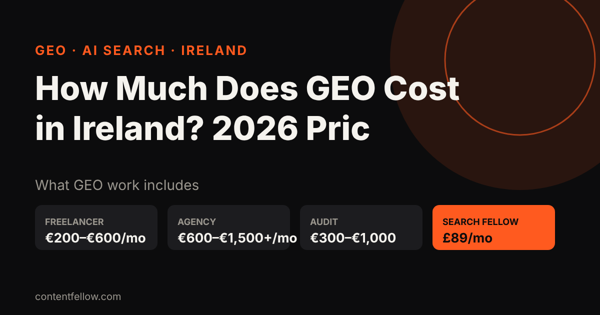
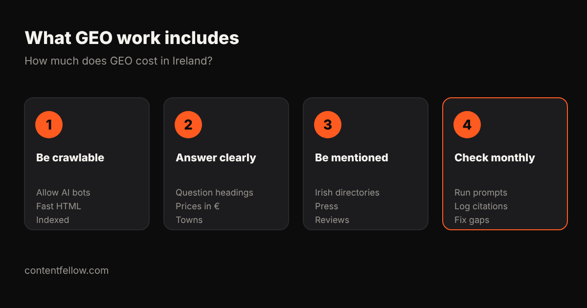

# How Much Does GEO Cost in Ireland? 2026 Prices in Euro

## How much does GEO cost in Ireland?

> **Quick answer:** GEO (generative engine optimisation) in Ireland typically costs €200–€600 a month from a freelancer and €600–€1,500 or more a month from an agency, with one-off AI visibility audits around €300–€1,000. ContentFellow's Search Fellow covers SEO and GEO together for a fixed £89 a month (roughly €100–€110), with no VAT added. *(Updated October 2026.)*

**TL;DR:** Most Irish small businesses need €100–€600 a month of GEO work: clear answer pages, structured data, mentions on trusted Irish and UK sites, and a monthly check of what ChatGPT, Gemini and Perplexity say. Ask whether quotes include 23% VAT.

## GEO prices in Ireland (2026)

| Option | Typical price | What you usually get |
|---|---|---|
| One-off AI visibility audit | €300–€1,000 | Prompt test across ChatGPT, Gemini, Perplexity, list of fixes |
| Freelancer retainer | €200–€600/mo | Content updates, schema, a few citations |
| Agency retainer | €600–€1,500+/mo | Strategy, content, digital PR, reporting |
| ContentFellow Search Fellow | £89/mo (~€100–€110) | SEO + GEO, monthly ranking and AI visibility report |

Ranges are typical quotes from Irish and UK agency price pages checked October 2026. Many Irish agencies quote excluding VAT at 23%.

## What drives the price

- **How many prompts you track.** Ten buyer questions is cheap to monitor; hundreds across markets is not.
- **Content volume.** Each new answer page (with prices, towns and FAQs) is the main cost.
- **Mentions and PR.** Getting listed on Irish directories and "best of" articles takes outreach time.
- **Languages.** Irish-language or EU multi-language work adds cost.

## Is GEO different from SEO?

GEO builds on SEO. Assistants such as Gemini and Copilot lean on Google and Bing indexes, so pages that rank and answer questions clearly are the ones that get cited. Read our [GEO vs SEO guide](/blog/geo-vs-seo-uk-small-business/) and [how to get recommended by ChatGPT](/blog/get-business-recommended-by-chatgpt-uk/).

## ContentFellow for Irish businesses

We are based in Burnley, UK and work with Irish clients remotely. **Search Fellow is £89 a month** for SEO and GEO, with a monthly ranking and AI visibility report. Want everything? **Growth Fellow is £389 a month** for all five Fellows. No VAT is added and there is no long contract. Compare UK prices in [LLM optimisation cost for UK small businesses](/blog/llm-optimisation-cost-small-business-uk/).

## Frequently asked questions

### How much does GEO cost in Ireland?
Usually €200–€600 a month from a freelancer and €600–€1,500 or more from an agency. A one-off audit is about €300–€1,000.

### Do Irish GEO agencies charge VAT?
VAT-registered Irish businesses add 23%. Always ask if a quote includes VAT.

### Is GEO worth it for a small Irish business?
Yes if customers ask AI assistants for recommendations in your sector. Start with a small monthly plan and track which prompts mention you.

### Can a UK company do GEO for an Irish business?
Yes. GEO is done remotely. ContentFellow's Search Fellow is £89 a month for SEO and GEO.

---

**[See all plans and prices →](/pricing/)** · More quick answers on our [answers page](/answers/). Need a website too? See [development packages](/services/development/) and [website care plans](/services/management/).

*Sources: ContentFellow plans and prices from contentfellow.com/pricing/ (October 2026); market ranges are typical quotes from UK and Irish agency price pages and freelancer marketplaces checked October 2026. ContentFellow is not VAT registered, so prices include everything. Last updated 20 October 2026.*
