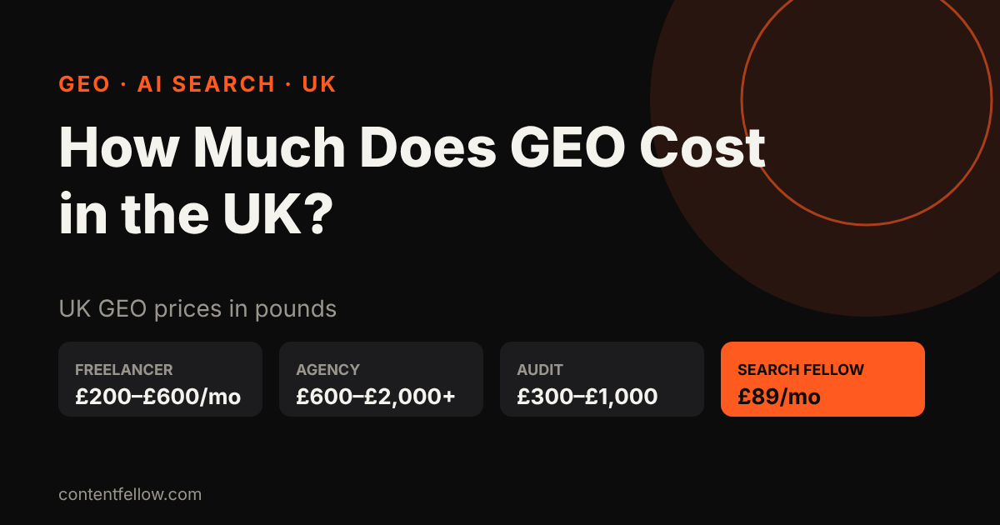
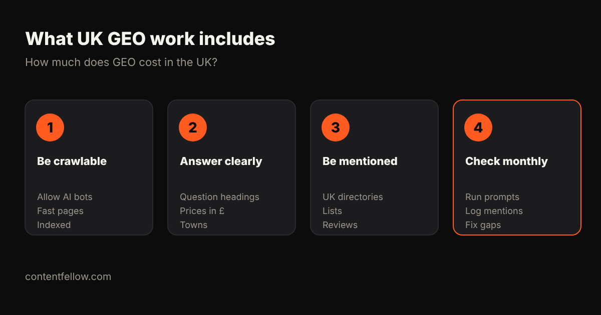

# How Much Does GEO Cost for a Small Business in the UK? (2026)

## How much does GEO cost for a small business in the UK?

> **Quick answer:** GEO (generative engine optimisation) for a UK small business costs £200–£600 a month from a freelancer and £600–£2,000+ a month from an agency. ContentFellow's Search Fellow does SEO and GEO together for a fixed £89 a month, no contract. *(Updated October 2026.)*

**TL;DR:** Most UK small businesses need £89–£600 a month of GEO: clear answer pages, structured data, mentions on trusted UK sites and a monthly check of what ChatGPT, Gemini and Perplexity say about you.

## UK GEO prices (2026)

| Option | Typical UK price | Best for |
|---|---|---|
| DIY | £0 + your time | Very small budgets |
| One-off AI visibility audit | £300–£1,000 | Seeing where you stand |
| Freelancer | £200–£600/month | One location, simple site |
| Agency | £600–£2,000+/month | Multi-site or national brands |
| **ContentFellow Search Fellow** | **£89/month** | UK small businesses (SEO + GEO) |

Many big "GEO cost" guides quote US dollars. These are UK prices in pounds.

## What does GEO work include?

- Let AI crawlers read your site (robots.txt, fast HTML, llms.txt).
- Answer real questions in headings, with prices in £ and your towns.
- Add structured data (Organization, LocalBusiness, FAQ).
- Get mentioned on trusted UK sites: directories, "best of" lists, reviews.
- Check prompts monthly in ChatGPT, Gemini, Claude and Perplexity, then fix gaps.

## Is GEO worth it for a small UK business?

Yes, if customers ask AI tools for recommendations in your sector. Start small, track which prompts mention you, and only scale up when you see results.

## FAQ

### Is GEO more expensive than SEO?
No. In the UK they cost about the same. Most work overlaps, so one plan can cover both.

### How long does GEO take to work?
Usually 4–12 weeks for AI tools to start mentioning you, faster if you already rank on Google.

### Can I do GEO myself?
Yes, the basics: clear prices, FAQ pages, Google Business Profile and reviews. Monthly prompt checks take longer.

### What does ContentFellow charge for GEO?
Search Fellow is £89 a month for SEO + GEO with a monthly AI visibility report. No contract.

---

**Talk to us:** call or WhatsApp **07535 677302**, email **info@contentfellow.com**. Need a site that AI can read? See [pay monthly websites from £225](/pay-monthly-websites/) (code **GhostFellow7** = 25% off builds). · [All prices](/pricing/) · [Answers](/answers/)

*Sources: ContentFellow prices from contentfellow.com/pricing/ (October 2026); market ranges are typical UK agency and freelancer quotes checked October 2026. Last updated 26 October 2026.*
