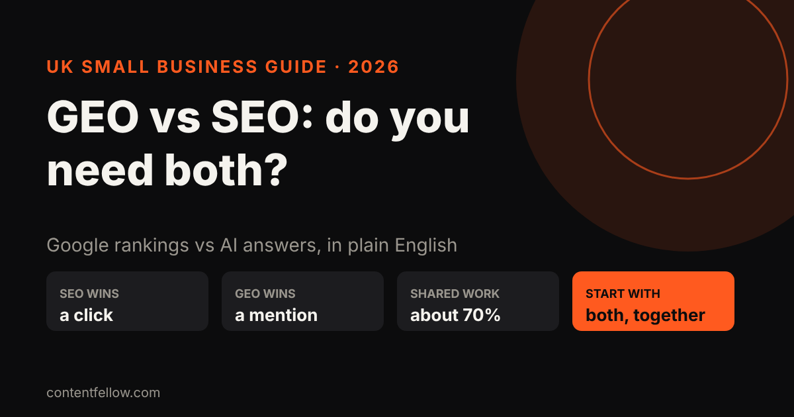
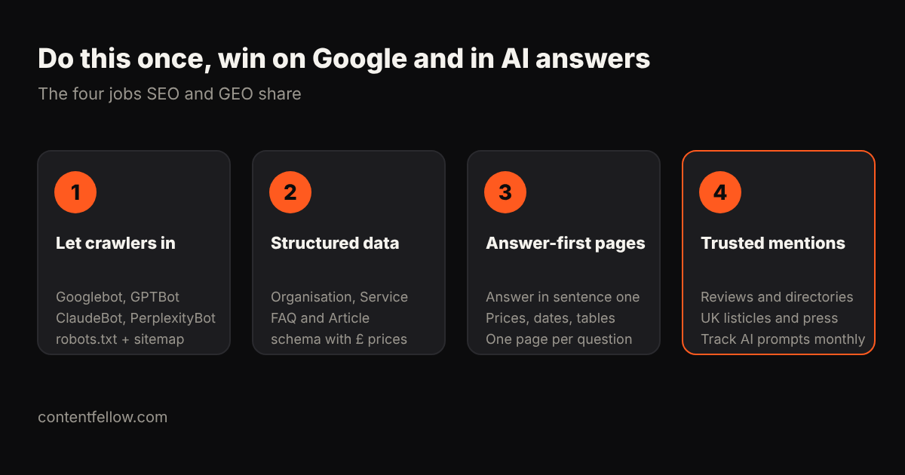

# GEO vs SEO: What's the Difference, and Do UK Small Businesses Need Both? (2026)

> **Quick answer:** SEO (search engine optimisation) gets your website ranked on Google so people click through to you. GEO (generative engine optimisation) gets your business **named inside AI answers** from ChatGPT, Gemini, Claude, Perplexity and Google's AI Overviews. Most of the work overlaps, so UK small businesses should do both together rather than pay for them separately. *(Updated October 2026.)*

## First, which "GEO" are we talking about?

Search for "GEO vs SEO" and some pages explain **geographic** targeting, meaning ranking in a particular town or country. That's usually called local SEO.

In 2026, **GEO almost always means generative engine optimisation**: making your business easy for AI assistants to find, trust and recommend. It's also called AEO (answer engine optimisation), LLMO or AI SEO. This guide uses that meaning.

## What's the difference between GEO and SEO?

The simplest way to put it: **SEO wins a click, GEO wins a mention.** On Google, people see a list of links and choose one. In an AI answer, the assistant reads many sources and names two or three businesses. Often nobody clicks anything; the recommendation is the result.

| | SEO | GEO |
|---|---|---|
| Where you show up | Google and Bing results pages | ChatGPT, Gemini, Claude, Perplexity, Google AI Overviews |
| What you win | A ranking and a click to your site | A mention or citation inside the answer |
| What the engine looks for | Relevant pages, links, speed, good user signals | Clear facts, structured data, consistent mentions on trusted sites |
| How you measure it | Rankings, clicks and impressions in Search Console | Share of AI answers that name you for your key prompts |
| How fast it moves | Usually 3 to 6 months | Days for AI tools that search live; months to become a regular recommendation |
| Typical UK small-business cost | Often bundled; standalone SEO retainers vary widely | £89 to £400 a month on a combined plan ([see full price guide](/blog/llm-optimisation-cost-small-business-uk/)) |

## How much of the work overlaps?

A lot. We estimate around 70% of the effort is shared, because both kinds of engine need the same foundations:

1. **Crawler access.** Google needs to crawl your site; so do GPTBot, ClaudeBot and PerplexityBot. One robots.txt and one sitemap serve both.
2. **Structured data.** Organisation, Service, FAQ and Article schema help Google show rich results and help AI tools quote your facts correctly, including your prices in pounds.
3. **Answer-first pages.** A page that answers the question in its first sentence ranks better on Google and gets quoted more by AI.
4. **Trusted mentions.** Reviews, directory listings and articles on other UK sites build authority for Google and give AI assistants confidence to name you.

The part that's genuinely different is **measurement and a few GEO-only tasks**: tracking which AI prompts mention you, adding an `llms.txt` file, and getting listed on the "best of" pages that AI assistants like to cite.

## Do UK small businesses need both?

For most, yes, and doing them together is cheaper than doing them apart. Here's how to decide what to lean on first:

- **Local trades and services** (plumbers, salons, clinics): start with SEO and Google Business Profile, then add GEO. Many local searches still end on Google Maps.
- **Professional and online services** (agencies, consultants, coaches, SaaS): lean on GEO early. Buyers increasingly ask ChatGPT "who's the best…" before they search.
- **Brand-new websites:** do the shared foundations first. Neither SEO nor GEO works until search engines and AI crawlers can read your site.
- **Businesses already ranking on Google:** add GEO now. You've built most of the foundation, and AI answers are where your competitors aren't measuring yet.

## How should you split a small budget?

If you pay for help, buy one plan that covers both rather than two suppliers. A sensible split for a UK small business:

- **About 70%** on shared foundations: technical fixes, structured data, answer-first content.
- **About 20%** on mentions: reviews, UK directories and pitching "best of" lists.
- **About 10%** on AI visibility tracking: checking each month which prompts name you and which name competitors.

Similarweb suggests small businesses put **10 to 20% of their search budget** into AI visibility. Our split sits inside that range, because most GEO work is also SEO work.

For pound-by-pound prices, see our guide: [how much LLM optimisation costs UK small businesses](/blog/llm-optimisation-cost-small-business-uk/).

## Is SEO dead because of AI search?

No. Google still sends most website traffic for most UK businesses, and AI assistants often build their answers from pages that already rank well. What's changed is that ranking alone isn't enough: you also want to be the business the AI names. That's why the two belong together.

## How ContentFellow handles SEO and GEO

The **[Search Fellow](/services/search-fellow/) is £89 a month** and covers both: SEO to climb Google, GEO so ChatGPT, Claude and Gemini recommend you, and a monthly report showing rankings and AI visibility side by side. For a full team (shoots, editing, social, website and search), the **[Growth Fellow](/services/growth-fellow/) is £389 a month**.

**[Pick your Search Fellow →](/services/search-fellow/)**

## Frequently asked questions

### What is the difference between GEO and SEO?
SEO helps your website rank in Google and Bing results so people click through. GEO helps your business get named inside AI-generated answers from ChatGPT, Gemini, Claude and Perplexity.

### Does GEO mean geographic SEO?
Not usually, in 2026. GEO now most often means generative engine optimisation for AI search. Optimising for a location is normally called local SEO.

### Is GEO replacing SEO?
No. AI assistants often draw on pages that already rank well, so strong SEO supports GEO. Most businesses need both, and around 70% of the work is shared.

### Should a small business start with SEO or GEO?
Start with the shared foundations: crawler access, structured data and answer-first pages. Local businesses then lean on SEO and Google Business Profile; online and professional services should add GEO early.

### How do I measure GEO results?
Track a list of the questions your customers ask, across ChatGPT, Gemini, Claude and Perplexity, and record how often each one names your business compared with competitors.

### How much does GEO and SEO cost in the UK?
Combined plans for small businesses typically cost £89 to £400 a month. Agency retainers cost about £1,100 to £3,800 a month. See our full UK price guide for details.

---

*Sources: Google UK search results reviewed 16 October 2026 (Entlify, GEO SEO, Local Website Design, Aptimized); Similarweb, "How to Adapt Your SEO Budget for AI Search Optimization". The 70% overlap figure is ContentFellow's estimate based on the shared tasks listed above. Last updated 16 October 2026.*
