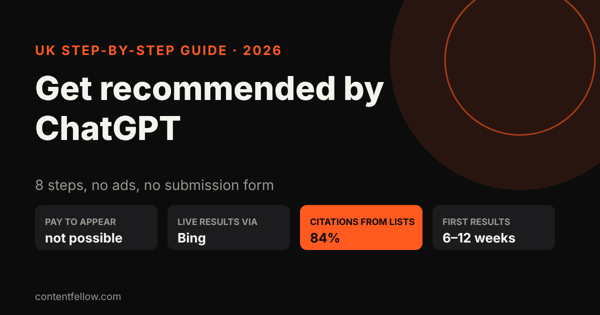
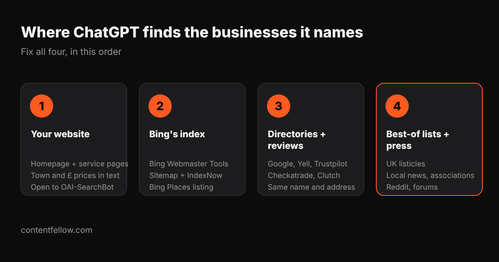

# How to Get Your Business Recommended by ChatGPT: A UK Step-by-Step Guide (2026)

> **Quick answer:** You can't pay ChatGPT to recommend your business, and there's no form to submit. ChatGPT names businesses it can find and trust: it reads your website, Bing's search results, directories, reviews and "best of" lists. To get recommended, make your site clear and crawlable, get indexed on Bing, keep your details identical across UK directories, collect reviews, and get mentioned on lists ChatGPT already cites. Then check the same prompts every month. *(Updated October 2026.)*

## Where does ChatGPT get its business recommendations?

ChatGPT answers from two places: what the model learned in training, and a **live web search** it runs for current or buying questions. That search uses OpenAI's own crawler (OAI-SearchBot) and search partners, mainly **Bing's index**, not Google's. If Bing can't find you, ChatGPT's live search usually can't either.

What it cites is mostly not your blog:

- A Yext study of 6.8 million AI citations (October 2025) found **44% came from businesses' own websites and 42% from listings and directories**. Only 14% came from other third-party sites.
- In a 2026 study of 9,434 ChatGPT answers about local services in the US and Canada, Cheers found **84% of answers with citations cited a directory, review site or "best of" list**. When ChatGPT cited a business's own site, it linked the **homepage (37%) or a service page (24%)**, and a blog post only 1% of the time.

Those studies are North American, but the lesson carries over to the UK: **your homepage, your service pages and your directory listings do the heavy lifting.**

## Step 1: Check what ChatGPT says about you today

Open a new chat (logged out, or in a private window) and ask what your customers would ask. Write down who gets named, and which sources are linked.

- "Best [your service] in [your town]"
- "Who should I use for [the problem you solve] in [your area]?"
- "Affordable [your service] for small businesses in the UK"
- "Is [your business name] any good?"
- "[Your business name] vs [a competitor]"

Use 10 to 12 prompts and keep them in a spreadsheet. This is your baseline. The sites ChatGPT links are your to-do list.

## Step 2: Let the AI crawlers in

Check `yourdomain.co.uk/robots.txt`. It must not block **OAI-SearchBot** (ChatGPT search), **GPTBot** (OpenAI training), **Bingbot**, **ClaudeBot** or **PerplexityBot**. Some website builders and security plugins block them by default.

Then verify your site in **Bing Webmaster Tools** (free, it can import from Google Search Console in a few clicks), submit your sitemap, and switch on **IndexNow** so new pages reach Bing in hours rather than weeks.

## Step 3: Make your homepage and service pages answer-first

ChatGPT quotes pages that state facts plainly. On your homepage and each service page, say in the first two sentences:

- **What** you do, in the words customers use
- **Where** you work: town, county, or "UK-wide"
- **Who** it's for
- **What it costs**, in pounds, even as a "from" price

Give each main service its own page, and add a page per town if you serve several areas. A page called "Wedding videographer in Burnley" is easier to cite than a homepage that tries to say everything.

## Step 4: Add structured data

Structured data (schema markup) is code that tells machines your facts directly. Add **Organization or LocalBusiness** (name, address, phone, area served), **Service** with an **Offer** in GBP, and **FAQPage** for your common questions. Test it with Google's Rich Results Test; Bing reads the same markup.

## Step 5: Make your details identical across UK directories

AI engines cross-check. If your name, address and phone number differ between sites, they trust you less. Use exactly the same business name, address, phone and one-line description on:

| Directory | Who it's for | Cost |
|---|---|---|
| Google Business Profile | Everyone | Free |
| Bing Places for Business | Everyone (feeds Bing) | Free |
| Apple Business Connect | Everyone (Apple Maps, Siri) | Free |
| Yell, Thomson Local, Scoot | Local services | Free basic listing |
| Trustpilot | Everyone | Free basic plan |
| Checkatrade, TrustATrader, MyBuilder | Trades | Paid membership |
| Clutch, DesignRush | Agencies and B2B | Free profile |
| Companies House, LinkedIn | Limited companies, B2B | Free |

## Step 6: Collect reviews on more than one platform

ChatGPT reads what reviews say, not just the stars. A business with recent reviews on Google, Trustpilot and an industry site looks safer than one with reviews in a single place. Ask happy customers to mention **the service and the town** in their own words ("great kitchen fitter in Preston"), because that's how the AI matches you to a prompt.

## Step 7: Get onto the lists ChatGPT already cites

Go back to the sources from Step 1. If ChatGPT keeps citing "10 best [service] in Manchester" articles, contact those sites and ask to be considered. Also try:

- Your local newspaper or business magazine (a short story or expert quote)
- Trade associations and chambers of commerce (member directories)
- Supplier and partner pages ("our recommended installers")
- Honest, helpful answers on Reddit and forums where your customers ask questions

One mention on a list ChatGPT already trusts can do more than ten new blog posts.

## Step 8: Track the same prompts every month

Re-run your Step 1 prompts once a month and note who's named. In GA4, look for visits from **chatgpt.com** and **perplexity.ai** under traffic acquisition. And ask every new customer how they found you; "ChatGPT told me" is now a real answer.

## How long does it take, and what does it cost?

| Step | Time (DIY) | Cost |
|---|---|---|
| 1. Baseline prompts | 1 hour | Free |
| 2. Crawlers + Bing Webmaster Tools | 1–2 hours | Free |
| 3. Answer-first service pages | 1–3 days | Free–£500 if you pay a writer |
| 4. Structured data | 2–4 hours | Free |
| 5. Directory clean-up | 1 day | Free–£300/yr for paid listings |
| 6. Reviews | Ongoing | Free |
| 7. Lists and press | 2–4 hours a month | Free |
| 8. Monthly tracking | 1 hour a month | Free–£100/mo for a tool |

Technical fixes reach Bing in days. Reviews and mentions take longer: most small businesses should expect to see changes in ChatGPT's answers after **6 to 12 weeks**, not overnight. For a full price breakdown, see [how much LLM optimisation costs UK small businesses](/blog/llm-optimisation-cost-small-business-uk/).

## Do you still need Google SEO?

Yes. Most of these steps also lift your Google rankings, and Google still sends most website traffic. The two work best together, which we explain in [GEO vs SEO: what's the difference for UK small businesses](/blog/geo-vs-seo-uk-small-business/).

## Get it done for you

The **[Search Fellow](/services/search-fellow/) is £89 a month**. We fix your crawler access, Bing indexing, structured data and service pages, keep your directory listings consistent, and send a monthly report showing which ChatGPT, Gemini, Claude and Perplexity prompts name you and which name your competitors.

**[Pick your Search Fellow →](/services/search-fellow/)**

## Frequently asked questions

### Can I pay to be recommended by ChatGPT?
No. There's no advertising product, listing fee or submission form that places a business in ChatGPT's recommendations. You get named by being easy to find and widely trusted online.

### Does ChatGPT use Google to find businesses?
Not mainly. ChatGPT's live search uses OpenAI's own crawler and Bing's index, so verify your site in Bing Webmaster Tools and claim Bing Places as well as Google Business Profile.

### How long does it take to get recommended by ChatGPT?
Technical fixes can reach Bing within days, but reviews and third-party mentions build up over weeks. Most small businesses should allow 6 to 12 weeks before judging results.

### Does this work for local businesses in the UK?
Yes. Local prompts like "best plumber in Leeds" lean heavily on directories, reviews and pages that name a service and a town, all things a small local business can control.

### How do I check if ChatGPT recommends my business?
Ask it the questions your customers would ask, in a fresh logged-out chat, and record who it names each month. Check GA4 for visits from chatgpt.com too.

### Do I need an agency to get recommended by ChatGPT?
No. Every step in this guide can be done yourself. A monthly plan saves time and adds tracking across several AI engines; it shouldn't cost thousands.
