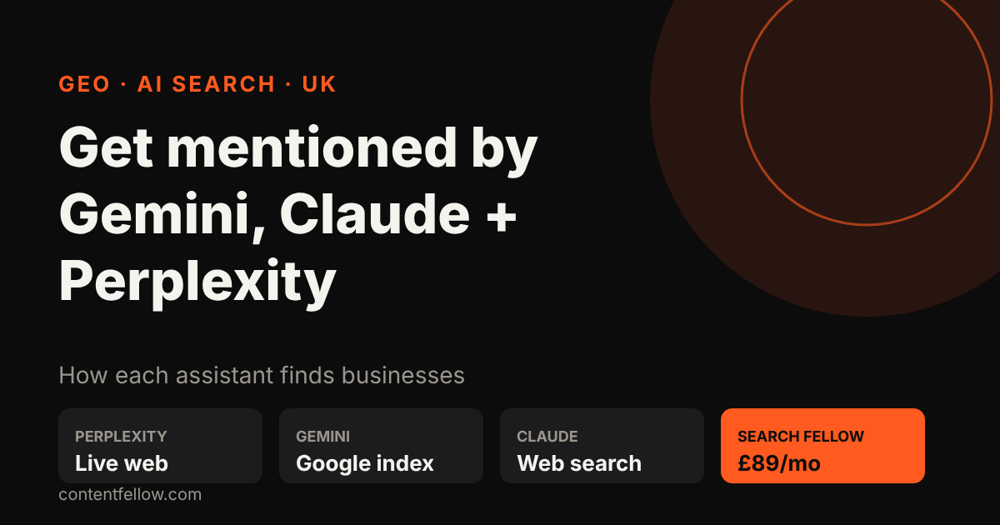
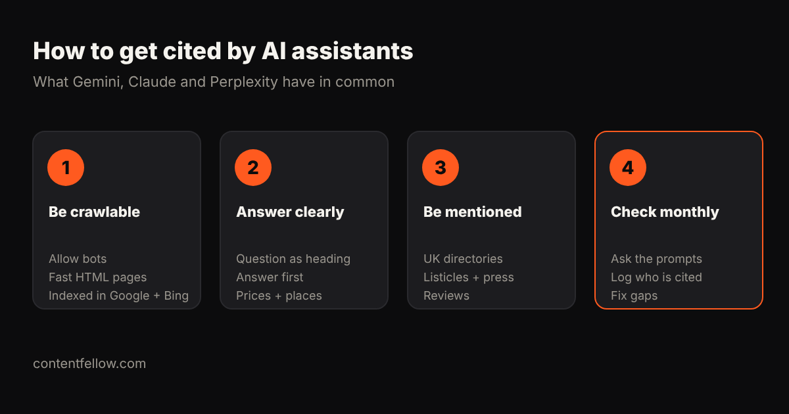

# How to Get My Business Mentioned by Gemini, Claude and Perplexity (UK Guide)

## How to get my business mentioned by Gemini, Claude and Perplexity

> **Quick answer:** To get your business mentioned by Gemini, Claude and Perplexity, make sure their crawlers and search partners can read your site, publish pages that answer real customer questions in the first sentence with facts like prices and towns, and get your business named on trusted UK sites such as directories, review sites and "best of" lists. All three search the live web when answering buying questions, so they cite pages that are indexed, clear and corroborated elsewhere. *(Updated October 2026.)*

**TL;DR:** Gemini leans on Google's index and Business Profiles, Perplexity cites live web pages it can crawl, and Claude uses web search when it needs current facts. Be crawlable, be quotable and be mentioned.

## How each assistant finds businesses

| Assistant | Where answers come from | What helps most |
|---|---|---|
| **Gemini** | Google Search index, Google Business Profile, Maps | Good Google SEO, complete Business Profile, reviews |
| **Perplexity** | Its own crawler (PerplexityBot) plus live web search, always shows sources | Crawlable pages with direct answers, being on cited lists |
| **Claude** | Web search when current information is needed (with crawler ClaudeBot / Claude-SearchBot) | Clear, factual pages and mentions on trusted sites |

This is why GEO (generative engine optimisation) is mostly good SEO plus mentions. See [GEO vs SEO](/blog/geo-vs-seo-uk-small-business/).

## 7 steps to get mentioned

### 1. Let the bots in
Check your robots.txt and CDN aren't blocking Googlebot, Bingbot, PerplexityBot, ClaudeBot or Claude-SearchBot. If they can't read a page, they can't cite it.

### 2. Get indexed in Google and Bing
Verify in Google Search Console and Bing Webmaster Tools and submit your sitemap. Many AI tools use search indexes behind the scenes.

### 3. One page per buying question
"How much does a website cost in Burnley?" deserves its own page, with the question as a heading and the answer in the first sentence.

### 4. State the facts in text
Prices in £, towns covered, opening hours, what's included, last updated date. Assistants quote specific facts, not slogans.

### 5. Add structured data
Organization, LocalBusiness, FAQPage and Article schema, matching the visible text. An [llms.txt file](/blog/llms-txt-explained/) is a small extra, not a ranking switch.

### 6. Get named on trusted sites
UK directories, your trade body, local press, podcasts and "best X in the UK" lists. Perplexity in particular often cites listicles and comparison pages.

### 7. Check the answers every month
Ask the assistants your customers' questions and note who gets named. See [how to check if ChatGPT mentions your brand](/blog/check-if-chatgpt-mentions-your-brand/).

## What doesn't work

Hidden text, prompt-injection tricks, mass AI-written pages and fake reviews. They risk penalties in Google and get filtered out by AI tools.

## Want it done for you?

ContentFellow's Search Fellow (£89 a month) covers SEO for Google plus GEO so ChatGPT, Claude, Gemini and Perplexity can find and recommend you, with a monthly AI visibility report. See [Search Fellow](/services/) or [how much GEO costs in the UK](/blog/llm-optimisation-cost-small-business-uk/).

## Frequently asked questions

### How do I get my business mentioned by Perplexity?
Make your pages crawlable by PerplexityBot, answer questions directly with facts, and get listed on sites Perplexity already cites, such as UK directories and comparison lists.

### Does Gemini use Google rankings?
Gemini draws on Google Search and Google Business Profile data, so strong Google SEO and a complete profile help it mention you.

### Can Claude search the web?
Yes. Claude can use web search for current information and cites the pages it uses.

### Can I pay to be recommended by AI assistants?
Not in their normal answers. You earn mentions through clear content and trusted citations.

### How long does it take to appear in AI answers?
Usually weeks to a few months, depending on how quickly your pages are crawled and how many trusted sites mention you.

---

**[See all services and prices →](/services/)** · More quick answers on our [answers page](/answers/). Want a site you own? See [development packages](/services/development/) and [website care plans](/services/management/).

*Sources: ContentFellow plans and prices from contentfellow.com/pricing/ (October 2026); market ranges are typical quotes from UK freelancer marketplaces and agency price pages checked October 2026. Prices include everything: ContentFellow is not VAT registered. Last updated 19 October 2026.*
