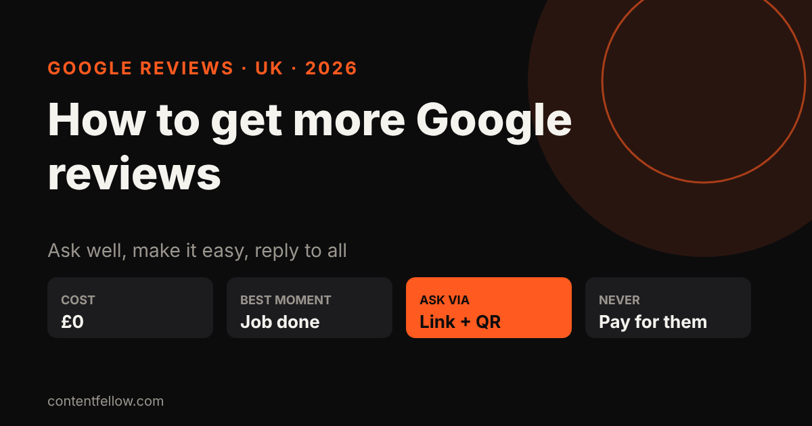
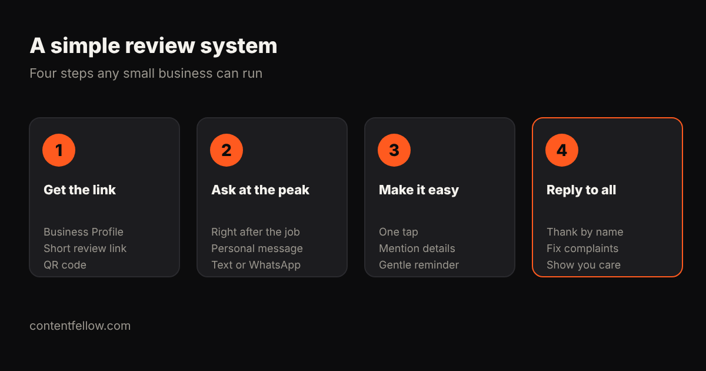

# How to Get More Google Reviews for a UK Small Business (2026)

## How to get more Google reviews for a UK small business

> **Quick answer:** The way to get more Google reviews for a UK small business is to ask every happy customer, personally, right after the job, with a one-tap review link from your Google Business Profile, then reply to every review. Never pay, offer discounts for reviews, or only ask customers you know are happy in a way that hides bad reviews: Google's policies and the UK's consumer law (the Digital Markets, Competition and Consumers Act 2024) both prohibit fake or incentivised reviews. *(Updated October 2026.)*

**TL;DR:** Get your short review link, ask at the moment the customer is happiest, make it one tap, and reply to everything. A steady trickle of recent reviews beats a burst.

## Why Google reviews matter

- **Ranking:** Google lists review count and score as part of "prominence" in local results. See [how to rank on Google Maps](/blog/rank-on-google-maps-uk/).
- **Choice:** people compare star ratings and recent comments before they call.
- **AI answers:** ChatGPT, Gemini and Google's AI Overviews draw on review signals when they recommend local businesses. See [how to get recommended by ChatGPT](/blog/get-business-recommended-by-chatgpt-uk/).

## 8 steps to get more Google reviews

### 1. Get your review link
In your Google Business Profile, choose "Ask for reviews" (or "Get more reviews") and copy the short link. Turn it into a QR code for counters, invoices and van doors.

### 2. Ask at the peak moment
Ask straight after a job is finished, a product arrives or a customer says thanks. Waiting a week halves the response.

### 3. Ask personally
"Hi Sarah, thanks for choosing us for the kitchen. If you have a minute, a Google review really helps a small local business like ours: [link]." A named, human message works far better than a generic email blast.

### 4. Use the channel they use
Text or WhatsApp often beats email for trades, salons and restaurants.

### 5. Prompt for detail, not stars
Suggest what they might mention ("the service, the area, how long it took"). Detailed reviews with towns and services help both customers and search.

### 6. Send one reminder
One polite follow-up after 3–5 days is fine. More than that is pestering.

### 7. Reply to every review
Thank people by name. For a bad review, reply calmly, apologise where right and take it offline. Future customers read the replies.

### 8. Build it into your process
Add the link to invoices, email signatures, receipts and your website. Ask staff to mention it at the end of every job.

## What you must not do

Under Google's policies and the UK's DMCC Act 2024 (enforced by the CMA from April 2025), don't:

- buy reviews or post fake ones (including from friends or staff)
- offer discounts, prizes or freebies in return for reviews
- "review gate" by only sending the link to customers you know are happy while steering others away
- copy reviews from other sites

## Want help?

ContentFellow's Search Fellow (£89 a month) sets up a review routine, keeps your Business Profile up to date and handles local SEO and GEO. See [Search Fellow](/services/).

## Frequently asked questions

### How do I get a Google review link?
Open your Google Business Profile, select "Ask for reviews" and copy the short link. You can share it by text, email or a QR code.

### Can I offer a discount for a Google review?
No. Incentivised reviews break Google's policies and UK consumer law. You can simply ask.

### How many Google reviews does a small business need?
There is no set number, but more recent, detailed reviews than nearby competitors help. Aim for a steady few every month.

### Should I reply to negative reviews?
Yes. Reply politely, acknowledge the issue and offer to sort it offline. It shows future customers you care.

### Can I remove a bad Google review?
Only if it breaks Google's policies, for example fake or offensive content. You can report it from your Business Profile.

---

**[See all services and prices →](/services/)** · More quick answers on our [answers page](/answers/). Want a site you own? See [development packages](/services/development/) and [website care plans](/services/management/).

*Sources: ContentFellow plans and prices from contentfellow.com/pricing/ (October 2026); market ranges are typical quotes from UK freelancer marketplaces and agency price pages checked October 2026. Prices include everything: ContentFellow is not VAT registered. Last updated 19 October 2026.*
