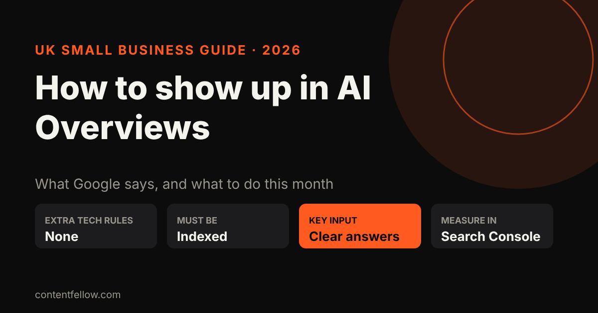
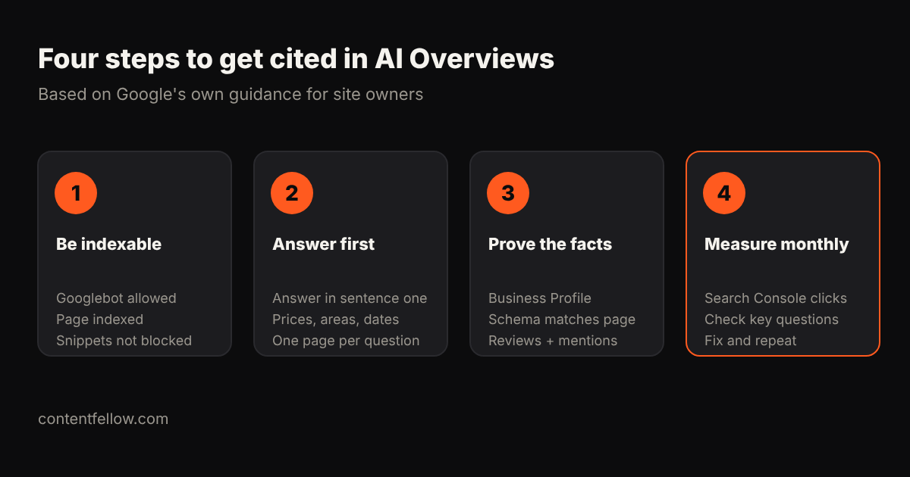

# How to Show Up in Google AI Overviews: A Practical Guide for UK Small Businesses (2026)

> **Quick answer:** To show up in Google AI Overviews, your page must be indexed by Google and eligible to appear with a snippet; Google says there are no additional technical requirements. After that, you earn citations the same way you earn rankings: let Googlebot crawl, answer the question clearly in the first sentence, keep your Google Business Profile and structured data accurate, and build trusted mentions. *(Updated October 2026.)*

## What are Google AI Overviews?

AI Overviews are the AI-written summaries that appear at the top of some Google results, with links to the websites they drew on. Google's newer **AI Mode** works in a similar way but lets people ask follow-up questions. Both can send customers to a small business website, if your page is one of the links.

Two things from Google's own documentation matter most for small businesses ([Google Search Central, "AI features and your website"](https://developers.google.com/search/docs/appearance/ai-features)):

- **AI Overviews often don't show.** Google says they appear only when its systems decide they add something beyond the normal results. Many simple local searches still show the map pack and blue links instead.
- **They use "query fan-out".** Google may run several related searches behind the scenes to build one answer, so it can cite a wider range of pages than a normal results page. A small site with one very clear page on a narrow question has a real chance.

## What does Google say you need to do?

Less than most "AI SEO" sellers suggest. Google's guidance says you can apply **the same foundational SEO best practices** as for normal Search, that "specific optimization isn't required", and that the only technical requirement is that a page is **indexed and eligible to be shown with a snippet**. Google's list of worthwhile basics is:

- Crawling allowed in robots.txt, and by your host or CDN
- Content easy to find through internal links
- A good page experience
- Important content in text, not only in images or video
- High-quality images and video supporting the text
- Structured data that matches the visible text
- Up-to-date Merchant Center and Business Profile information

Google's separate guide, ["Optimizing your website for generative AI features on Google Search"](https://developers.google.com/search/docs/fundamentals/ai-optimization-guide) (updated July 2026), adds one more point worth underlining: create **non-commodity content**, meaning unique, expert-led information that goes beyond what everyone else already says.

## How to show up in AI Overviews: 8 practical steps

### 1. Check Google can index your key pages

Verify your site in [Google Search Console](https://search.google.com/search-console/about) and use the URL Inspection tool on your homepage and main service pages. If a page isn't indexed, it can't be cited. Also check you haven't added `nosnippet` or a very short `max-snippet` by accident, as Google lists these as controls that limit what appears in AI features.

### 2. Make sure Googlebot isn't blocked

Open `yourdomain.co.uk/robots.txt`. Googlebot must be allowed. Some security plugins and CDNs block bots by default, so check with your host too. Note that blocking **Google-Extended** does not remove you from AI Overviews; Google says that control applies to training and grounding in some of its other systems, while robots.txt rules for Googlebot are the control for Search.

### 3. Answer the question in the first sentence

Write one page per real customer question ("How much does a boiler service cost in Burnley?") and answer it in the opening sentence, with a number if there is one. Then add the detail: what's included, timings, areas covered. AI summaries quote short, specific statements far more readily than marketing copy.

### 4. Put your facts in text: prices, areas and dates

If your prices only appear in a PDF or an image, Google's AI can't quote them reliably. State prices or price ranges in pounds, the towns you cover and when the page was last updated. A clear table often works well.

### 5. Keep your Google Business Profile complete

For local businesses this is the biggest single lever. Google names Business Profile information in its guidance for AI features, and its optimisation guide says accurate Business Profiles help your services be visible in AI responses. Fill in categories, services, opening hours and service areas, add real photos and reply to reviews.

### 6. Add structured data that matches the page

Use Organization or LocalBusiness, Service, FAQPage and Article schema where they fit. Google's one rule here is that the structured data must **match the visible text**. Don't mark up prices, reviews or FAQs that visitors can't see.

### 7. Earn mentions on trusted UK sites

AI answers lean on sources that agree with each other. Consistent listings (Google, Bing Places, Yell, trade bodies), genuine reviews and mentions in local press or "best of" articles all help Google trust your facts. This is the slowest step, so start early.

### 8. Measure, then improve one page a month

Search Console includes AI Overviews and AI Mode traffic within the normal **Performance report** ("Web" search type), but doesn't separate it out. So also search your 10 most important customer questions on Google each month, note whether an AI Overview appears and who it cites, and improve the page that should have been chosen. Our guide on [checking if ChatGPT mentions your brand](/blog/check-if-chatgpt-mentions-your-brand/) uses the same method for other AI tools.

## What does this cost a UK small business?

| Approach | Typical UK cost (October 2026) | What you get |
|---|---|---|
| Do it yourself | £0, plus your time | Search Console, Business Profile, page rewrites |
| Productised SEO + GEO plan | £89–£400 a month | Done-for-you fixes, content and monthly AI visibility reporting |
| SEO/GEO agency retainer | £1,100–£3,800 a month | Larger content and digital PR programmes |

For the full breakdown, see [how much LLM optimisation costs UK small businesses](/blog/llm-optimisation-cost-small-business-uk/), or compare every ContentFellow plan on our [pricing page](/pricing/).

## Common myths about AI Overviews

- **"You need special AI schema or an llms.txt file for Google."** Google says there are no additional technical requirements. An [llms.txt file](/blog/llms-txt-explained/) can help some other AI tools, but it isn't a Google AI Overviews requirement.
- **"AI Overviews kill all clicks."** They do reduce clicks on some queries: Ahrefs found a 34.5% lower click-through rate for top results when an AI Overview appears (reported by the [Digital Marketing Institute](https://digitalmarketinginstitute.com/blog/google-ai-overviews-what-do-they-mean-for-search)). But Google says clicks from results pages with AI Overviews are higher quality, with visitors spending more time on the site. Being one of the cited links is the goal.
- **"Only big brands get cited."** Query fan-out means Google looks across many supporting pages. A specific, well-structured local page can beat a vague national one.

## How AI Overviews fit with ChatGPT and other AI tools

The work above also helps with ChatGPT, Gemini, Claude and Perplexity, because they all reward clear facts, structured data and trusted mentions. That wider job is called GEO (generative engine optimisation). See [GEO vs SEO](/blog/geo-vs-seo-uk-small-business/) and [how to get recommended by ChatGPT](/blog/get-business-recommended-by-chatgpt-uk/) for the next steps, or browse quick answers on our [answers page](/answers/).

## Want it done for you?

The **[Search Fellow](/services/search-fellow/) is £89 a month**: SEO for Google, GEO so ChatGPT, Claude and Gemini recommend you, and a monthly report showing your rankings and AI visibility. Monthly billing, no VAT added, and you approve content before it goes live.

**[Get your Search Fellow →](/services/search-fellow/)**

## Frequently asked questions

### How do I get my business into Google AI Overviews?
Make sure your pages are indexed and eligible for a snippet in Google Search, then answer customer questions clearly in the first sentence. Keep your Google Business Profile and structured data accurate and build mentions on trusted sites.

### Are there special technical requirements for AI Overviews?
No. Google says a page only needs to be indexed and eligible to show with a snippet. There is no special markup or file required.

### Can I pay to appear in AI Overviews?
You can't pay to be a cited source. Google has been testing ads in and around AI Overviews, but organic citations are earned through normal SEO.

### Does blocking Google-Extended remove me from AI Overviews?
No. Google says robots.txt rules for Googlebot control how your site is crawled for Search, including AI features. Google-Extended relates to training and grounding in some of Google's other systems.

### How do I know if my site appears in AI Overviews?
Search Console counts AI Overview traffic within the Performance report but doesn't separate it. Check your key customer questions on Google each month and note who is cited.

### How long does it take to appear in AI Overviews?
If your page is already indexed and ranking, changes can show once Google recrawls it, which can take days to months. New sites need to be indexed and trusted first.

### Do AI Overviews show for local searches in the UK?
Sometimes. Google only shows them when it decides they add value, and many local searches still show the map pack first. That's why your Google Business Profile matters as much as your website.

---

*Sources: Google Search Central, ["AI features and your website"](https://developers.google.com/search/docs/appearance/ai-features) (last updated 10 December 2025) and ["Optimizing your website for generative AI features on Google Search"](https://developers.google.com/search/docs/fundamentals/ai-optimization-guide) (last updated 10 July 2026); Digital Marketing Institute, ["Google AI Overviews: What Do They Mean for Search?"](https://digitalmarketinginstitute.com/blog/google-ai-overviews-what-do-they-mean-for-search) (October 2025), citing Ahrefs. All read 18 October 2026. Last updated 18 October 2026.*
