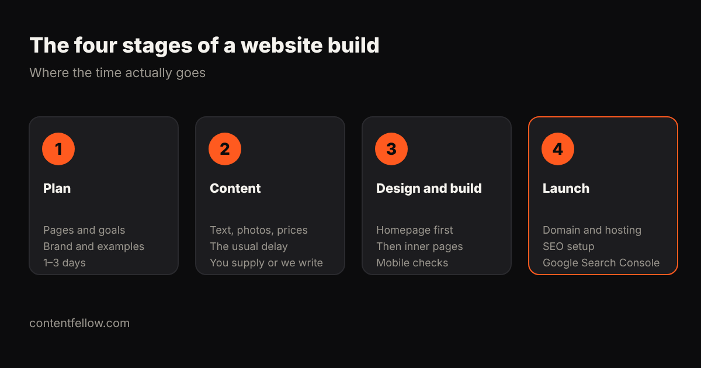

# How Long Does It Take to Build a Website in the UK? (2026)

> **Quick answer:** A simple 5-page small business website usually takes **1 to 2 weeks** with a fixed-price package, a 10–15 page business site or small online shop **2 to 4 weeks**, and a custom agency build **6 to 12 weeks**. The biggest delay is almost always content: text, photos and prices. *(UK, October 2026.)*

## Website build timelines by type

| Type of website | Typical timeline | ContentFellow package |
|---|---|---|
| Simple brochure site (up to 7 pages) | 1–2 weeks | Launch, £349 |
| Business site with blog and booking (up to 15 pages) | 2–4 weeks | Grow, £749 |
| Small online shop (up to 100 products) | 2–4 weeks | Shop, £1,499 |
| Custom agency build | 6–12 weeks | — |
| Web app or portal | 3–8 weeks | App Starter from £1,249 |

## Where does the time go?

1. **Plan (1–3 days):** agree the pages, the goal of the site, your brand and examples you like.
2. **Content (the usual delay):** text, photos, prices and testimonials. If you're waiting on content, nothing else can finish.
3. **Design and build:** homepage design first, then inner pages, then mobile and speed checks.
4. **Launch:** domain, hosting, SEO setup and Google Search Console.

## How to get your website live faster

- Have your **logo, photos and prices ready** before you start.
- Send **two or three websites you like**. It saves rounds of design changes.
- **Decide quickly on feedback.** Most projects stall waiting for approvals.
- **Launch with the essentials,** then add pages monthly on a care plan.

## Fixed price, fixed timeline

Our development packages come with a fixed price and a clear timeline: Launch £349, Grow £749, Shop £1,499. Pay half to start and half at launch. [See development packages](/services/development/) · Prefer monthly? The [Build Fellow at £69 a month](/services/build-fellow/) includes a 5-page site. Compare both in [subscription vs one-off build](/blog/website-subscription-vs-one-off-build/).

## Frequently asked questions

### How long does a small business website take to build?
A simple 5 to 7 page site usually takes 1 to 2 weeks once content is ready. Larger business sites take 2 to 4 weeks.

### Why do website projects take longer than expected?
Most delays come from missing content (text, photos, prices) and slow feedback, not the build itself.

### How long does an online shop take to build?
A small shop with up to 100 products usually takes 2 to 4 weeks, depending on how ready the product photos and descriptions are.

### Can a website be built in a week?
Yes, a simple site can launch in about a week if the content and feedback are ready.

### How long do agencies take to build a website?
Custom agency builds typically take 6 to 12 weeks, including discovery, design rounds and testing.

---

*Timelines based on ContentFellow delivery times and typical UK agency schedules (October 2026). Last updated 17 October 2026.*
