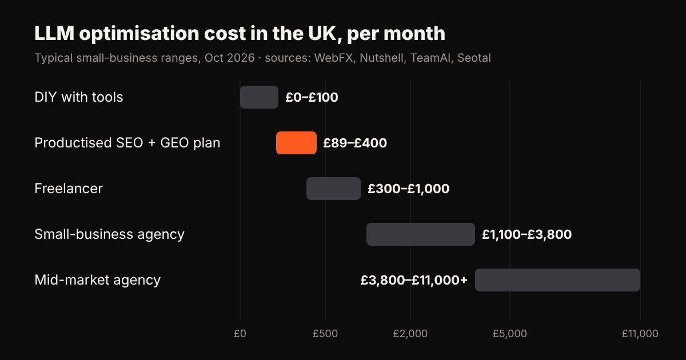
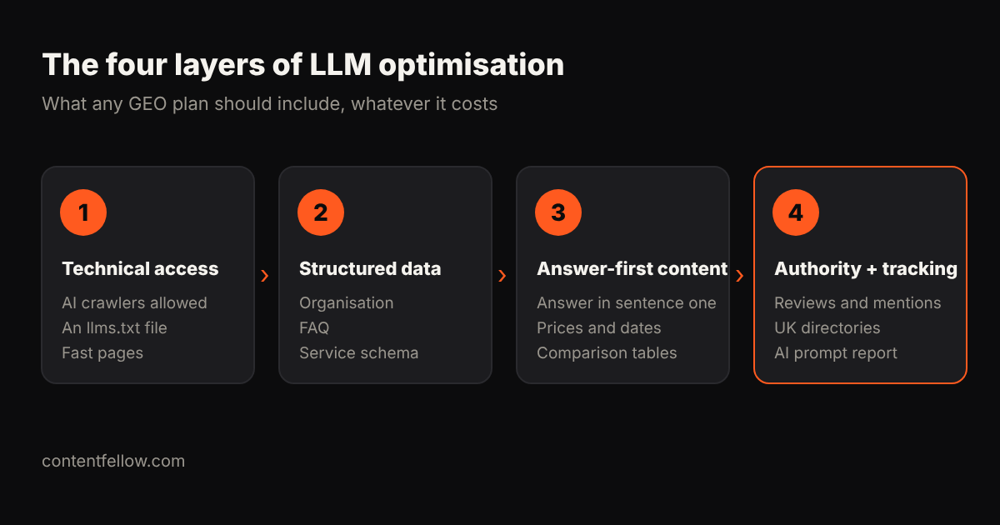

# How Much Does LLM Optimisation Cost for Small Businesses? (UK Prices, 2026)

> **Quick answer:** In the UK, LLM optimisation (also called GEO or AI search optimisation) costs a small business roughly **£0–£100 a month DIY**, **£89–£400 a month on a productised plan**, **£300–£1,000 a month with a freelancer**, and **£1,100–£3,800 a month with a traditional agency**. Most small businesses get the best return from a £89–£400 monthly plan that combines SEO and GEO with a monthly AI visibility report. *(Prices as of October 2026.)*

## What is LLM optimisation (and what isn't it)?

LLM optimisation is the work of making your business easy for large language models such as ChatGPT, Claude, Gemini and Perplexity to **find, understand and recommend** when someone asks them a question. You'll also see it called **GEO (generative engine optimisation)**, **AEO (answer engine optimisation)**, **LLMO** or **AI SEO**. They all describe the same goal: being the business the AI names in its answer.

Two things share the name and are *not* covered here:

- **LLM cost optimisation** for developers (cutting the API bill of an AI app).
- **The LLM degree** (Master of Laws).

If you're a small business owner wondering why ChatGPT recommends a competitor instead of you, you're in the right place.

## How much does LLM optimisation cost in the UK?

Almost every price guide on page one of Google quotes US agencies in dollars. Here is the same market translated into what a UK small business actually pays. US figures are converted at roughly $1 = £0.76 and rounded.

| Option | Typical UK monthly cost | What you usually get | Best for |
|---|---|---|---|
| DIY with tools | £0–£100 | Your own time, a visibility tracker (from about £22/month), free schema plugins | Sole traders with time to spare |
| Productised SEO + GEO plan | £89–£400 | Fixed monthly deliverables: technical fixes, structured data, content, AI visibility report | Most small businesses |
| Freelancer | £300–£1,000 | One specialist, scope varies a lot | Businesses with one clear project |
| Small-business agency retainer | £1,100–£3,800 | Strategy, content programme, digital PR, reporting | Growing firms in competitive markets |
| Mid-market / enterprise agency | £3,800–£11,000+ | Multi-market programmes, large content and PR teams | National and multi-country brands |
| One-off GEO audit or setup | £400–£5,500 (once) | Audit, schema, llms.txt, fixes list | A fresh start before ongoing work |

**Where the numbers come from.** WebFX, Nutshell and TeamAI all put small-business GEO retainers at **$1,500–$5,000 a month** (about £1,100–£3,800). A study of 60 agency price lists by Seotal found the **median entry AI SEO package was $750 a month** (about £570), with the middle half between $461 and $2,000, and software plans starting at $29 a month. Practitioners on Reddit report one-off GEO setups from **$500 to $7,200**.

## What drives the price up or down?

1. **How competitive your category is.** A plumber in Leeds needs far less work than a London law firm or a SaaS brand.
2. **How many markets you target.** UK-only is cheaper. Adding Ireland, Germany or France multiplies content and tracking.
3. **Content volume.** AI engines cite pages that answer questions clearly. More questions to cover means more pages.
4. **Digital PR and mentions.** LLMs trust brands that other trusted sites mention. Earning those mentions is the most expensive part of agency retainers.
5. **Reporting depth.** Tracking dozens of prompts across ChatGPT, Claude, Gemini and Perplexity every day costs more than a monthly spot check.
6. **The state of your website.** Slow pages, missing structured data or blocked AI crawlers need fixing first, usually as a one-off.

## What should a small business budget for GEO?

A simple rule: **spend 10–20% of your search budget on AI visibility**, which Similarweb recommends for small and local businesses. If you have no search budget yet, start like this:

- **Under £100 a month:** do it yourself. Fix the basics below and track a handful of prompts.
- **£89–£400 a month:** hire a productised plan that does SEO and GEO together. This is where most UK small businesses see the best return, because the same work (clear pages, structured data, reviews, mentions) lifts both Google rankings and AI recommendations.
- **£1,000+ a month:** only once you've proven that search brings you customers and you need digital PR at scale.

## What's included in a good LLM optimisation plan?

Whatever you pay, check the plan covers these four layers:

1. **Technical access.** AI crawlers (GPTBot, ClaudeBot, PerplexityBot, Google-Extended) allowed in robots.txt, fast pages, an `llms.txt` file, clean sitemap.
2. **Structured data.** Organisation, LocalBusiness, Product or Service, FAQ and Article schema so machines read your facts correctly.
3. **Answer-ready content.** Pages that answer real customer questions in the first two sentences, with prices, comparisons and dates stated plainly.
4. **Authority and tracking.** Reviews, directory listings and mentions on trusted UK sites, plus a monthly report showing which AI prompts mention you and which mention competitors.

If a quote doesn't say how it measures AI visibility, ask. "We'll improve your AI presence" isn't a deliverable.

## How to do LLM optimisation yourself (free to £100 a month)

If your budget is close to zero, these steps cover 80% of the basics:

1. Search ChatGPT, Gemini and Perplexity for the five questions your customers ask most. Note who gets recommended.
2. Make sure your robots.txt doesn't block AI crawlers.
3. Add FAQ and LocalBusiness schema (free plugins exist for most site builders).
4. Write one page per key question with the answer in the first sentence, and a price where you can.
5. Get listed and reviewed on the UK directories and review sites your sector uses.
6. Repeat step 1 every month and track the change.

## Is LLM optimisation worth it for a small business?

For most UK small businesses, yes, if the cost stays proportionate. More buyers now ask an AI assistant for a recommendation before they search Google, and the assistant usually names only two or three businesses. Being one of them is worth more than ranking eighth on Google. The risk is overpaying. A £3,000-a-month agency retainer rarely makes sense for a business turning over less than £500,000 a year. A £89–£400 plan that does SEO and GEO together usually does.

## How ContentFellow prices LLM optimisation

At ContentFellow, SEO and GEO sit in one plan. The **[Search Fellow](https://contentfellow.com/#fellows) costs £89 a month** and covers SEO to climb Google, GEO so ChatGPT, Claude and Gemini recommend you, and a monthly ranking and AI visibility report. If you want production, editing, social, your website and search working as one team, the **[Growth Fellow](https://contentfellow.com/#growth) is £389 a month** instead of £555 separately. Plans are monthly, and you can add or remove Fellows from the next month. See [how it works](https://contentfellow.com/#how).

**[Pick your Search Fellow →](https://contentfellow.com/#fellows)**

## Frequently asked questions

### How much does GEO cost for a small business in the UK?
Most UK small businesses pay between £89 and £400 a month for a productised SEO and GEO plan. Traditional agency retainers cost about £1,100–£3,800 a month, and DIY with tools costs £0–£100 a month.

### Is LLM optimisation the same as SEO?
No, but they overlap. SEO aims to rank pages on Google, while LLM optimisation aims to get your brand named in AI answers. Both rely on clear content, structured data and trusted mentions, so doing them together is cheaper than paying for each separately.

### What is LLM search optimisation called?
It goes by several names: GEO (generative engine optimisation), AEO (answer engine optimisation), LLMO (large language model optimisation) and AI SEO. They describe the same practice.

### How long does LLM optimisation take to work?
Technical fixes and structured data can be picked up within weeks, as AI tools that search the web live (Perplexity, ChatGPT search, Gemini) read new pages quickly. Becoming a consistent recommendation usually takes three to six months of content and mentions.

### Can I do LLM optimisation myself?
Yes. Allowing AI crawlers, adding schema, writing answer-first pages and collecting reviews cost little beyond your time. Most owners hire help when they need regular content and monthly tracking across several AI platforms.

### Why do US price guides quote such high prices?
They quote US agency retainers for US businesses, usually $1,500–$5,000 a month. UK productised plans are cheaper because they offer fixed deliverables instead of open-ended agency hours.

### How do I know if ChatGPT recommends my business?
Ask it the questions your customers ask, in a fresh chat, and note who it names. A proper plan tracks dozens of these prompts across ChatGPT, Claude, Gemini and Perplexity every month and reports your share of mentions against competitors.

---

*Sources: WebFX, "How Much Does Generative Engine Optimization Cost in 2026?"; Nutshell, "What Is the GEO Cost for Businesses in 2026?"; TeamAI, "What Is the Cost of GEO in 2026?"; Seotal agency pricing study (2026); Similarweb, "How to Adapt Your SEO Budget for AI Search Optimization". Currency converted at approximately $1 = £0.76. Last updated 16 October 2026.*
