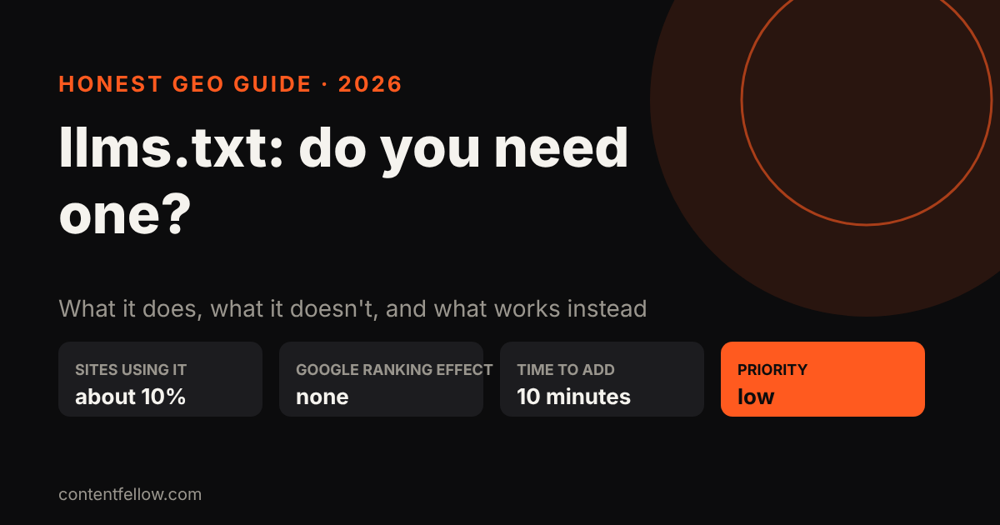
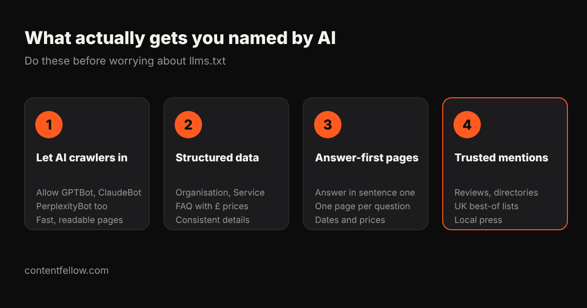

# llms.txt Explained: Should Your Small Business Have One? (2026)

> **Quick answer:** llms.txt is a plain text file at the root of a website that lists its most important pages for AI tools. It takes about 10 minutes to add and does no harm, but **it does not improve Google rankings or AI Overviews**, and there's no evidence it gets you mentioned more by ChatGPT or Gemini. Treat it as an optional extra, not a GEO strategy. *(Updated October 2026.)*

## What is llms.txt?

llms.txt is a proposed standard, introduced by Jeremy Howard of Answer.AI in September 2024. It's a short Markdown file at `yoursite.com/llms.txt` that gives AI systems a curated list of your key pages, each with a one-line description: a table of contents written for machines.

It isn't the same as **robots.txt**, which tells crawlers what they may or may not access. llms.txt can't block anything.

## Does llms.txt help SEO or AI visibility?

Not in any measurable way, based on what's public in 2026:

- **Google:** on 15 June 2026 Google added guidance to its AI optimisation documentation saying llms.txt has no effect on Search rankings or AI Overviews. Google's John Mueller has compared it to the old meta keywords tag.
- **Research:** an SE Ranking study of 300,000 domains found about 10% had an llms.txt file and that having one didn't predict AI citations.
- **Bot logs:** OtterlyAI recorded 84 visits to llms.txt out of 62,100 AI bot requests over 90 days. AI search crawlers mostly read your normal HTML pages.
- **No major AI company** (OpenAI, Google, Anthropic, Meta or Perplexity) had publicly confirmed that its answer engine reads the file as of early 2026.

Where it *does* get used is by **AI coding assistants** (such as Cursor and GitHub Copilot) reading developer documentation. That matters for software companies, not for most local businesses.

## Should a small business add one?

If your website provider can add it in a few minutes, fine: it's harmless, and it's a tidy summary of your services and prices. But if someone is charging you extra for "llms.txt optimisation" as a way to rank in ChatGPT, be sceptical.

## What actually gets you mentioned by ChatGPT and Gemini?

1. **Let AI crawlers in.** Make sure robots.txt allows GPTBot, ClaudeBot and PerplexityBot, and that your pages load fast.
2. **Structured data.** Organisation, Service and FAQ schema with your real prices in pounds.
3. **Answer-first pages.** Answer the customer's question in the first sentence, one page per question.
4. **Trusted mentions.** Reviews, UK directories, "best of" lists and local press. AI assistants lean heavily on these.

For a step-by-step version, read [how to get your business recommended by ChatGPT](/blog/get-business-recommended-by-chatgpt-uk/) and [GEO vs SEO](/blog/geo-vs-seo-uk-small-business/).

## How to add an llms.txt file (if you want one)

Create a text file called `llms.txt` with your business name, one line on what you do, then a list of your key pages with a short description, and upload it to your site's root folder. Keep it accurate and update it when prices change.

## How ContentFellow helps

Our [Search Fellow](/services/search-fellow/) (£89 a month) focuses on what moves results: technical access, structured data, answer-first content, mentions and a monthly AI visibility report. We add llms.txt as part of setup, at no extra charge, because it's quick, not because it ranks you.

**[Get a free AI visibility check →](/get-started/)**

## Frequently asked questions

### What is llms.txt?
A Markdown file at the root of a website that lists its key pages with short descriptions so AI tools can find them. It was proposed by Jeremy Howard of Answer.AI in 2024.

### Does llms.txt improve Google rankings?
No. Google said in June 2026 that llms.txt has no effect on Search rankings or AI Overviews.

### Does ChatGPT read llms.txt?
There's no public confirmation that ChatGPT's answer engine uses it. Studies of AI bot traffic show crawlers rarely request the file.

### Is llms.txt the same as robots.txt?
No. robots.txt controls which crawlers can access your site; llms.txt only suggests which pages matter and can't block anything.

### What should I do instead to appear in AI answers?
Allow AI crawlers, add structured data, write answer-first pages with clear prices, and earn reviews and mentions on trusted UK sites.

---

*Sources: Google Search Central AI optimisation guide (June 2026 update); SE Ranking llms.txt study; OtterlyAI llms.txt experiment; Limy AI bot traffic analysis (reviewed October 2026). Last updated 17 October 2026.*
