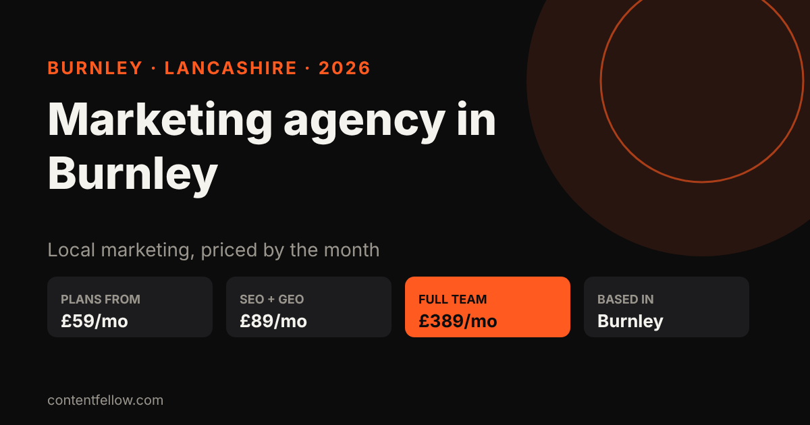
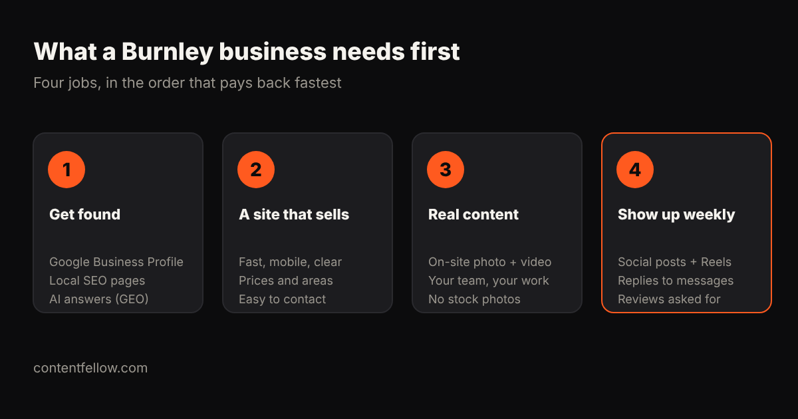

# Marketing Agency in Burnley: What Local Businesses Need and What It Costs (2026)

> **Quick answer:** A Burnley small business usually needs four things from a marketing agency: to be found on Google and in AI answers, a website that turns visits into enquiries, real photo and video of the business, and a steady social media presence. ContentFellow is a marketing service based in Burnley, Lancashire that does all four on monthly plans from £59, or £389 a month for the full team. *(Updated October 2026.)*

This guide is written by ContentFellow, so we're one of the options it describes. We've kept the advice useful whoever you hire: what to buy first, what it should cost, and what to ask any Burnley agency before you sign.

## What do Burnley businesses actually need from marketing?

Most local customers find a business in one of three ways: a Google search ("electrician Burnley"), Google Maps, or a recommendation. In 2026 a fourth is growing fast: people ask ChatGPT, Gemini or Google's AI Overviews "who's the best… near me?" and contact whoever gets named.

In practice that means four jobs, in roughly this order:

1. **Get found.** A complete Google Business Profile, local SEO pages for the towns you serve, and the listings and facts AI assistants rely on (that last part is called GEO, generative engine optimisation).
2. **A website that sells.** Fast on a phone, with your prices or price ranges, the areas you cover and one obvious way to get in touch.
3. **Real content.** Photos and short videos of your premises, your team and your work. Customers trust them more than stock photos, and they feed your website, Google profile and social pages.
4. **Show up every week.** Regular posts, Reels and replies, plus a habit of asking happy customers for reviews.

Not every business needs all four at once. A busy trades firm with a full diary might only need the "get found" job done properly. A new café in the town centre might need content and social first.

## How much does a marketing agency cost in Burnley?

It depends on the model you buy. These are typical UK ranges as of October 2026:

| Option | Typical UK cost | Best for |
|---|---|---|
| Freelancer, one skill | £300–£1,000 a month each | One job, and you have time to manage them |
| Specialist agency, one channel | £2,000–£5,000 a month | One channel that drives most of your sales |
| Full-service agency retainer | £2,000–£10,000 a month | Larger firms with a marketing manager |
| Productised monthly plans (ContentFellow) | £59–£389 a month | Small businesses that want set prices and no long contract |

For the full breakdown, including what an in-house hire really costs, see our guide to [outsourced marketing team costs in the UK](/blog/outsourced-marketing-team-cost-uk/). Every ContentFellow price is on our [pricing page](/pricing/). We're not VAT registered, so the prices shown are what you pay.

## What ContentFellow offers Burnley businesses

ContentFellow splits marketing into "Fellows": specialists on simple monthly plans. You can hire one, several, or the whole team, and add, remove or upgrade from the next month. You approve content before it goes live. Full details are on our [services page](/services/).

| Fellow | What you get each month | Price |
|---|---|---|
| Social Fellow: Manage | Up to 2 platforms, weekday replies, ad set-up | £59/mo |
| Social Fellow: Manage + Post | Up to 3 platforms, daily posting, trend research | £129/mo |
| Build Fellow | Custom website up to 5 pages, hosting, security, updates, 2 change requests | £69/mo |
| Search Fellow | SEO for Google, GEO so ChatGPT, Claude and Gemini recommend you, monthly ranking and AI visibility report | £89/mo |
| Creator Fellow | 8 short videos, 1 motion graphics video, 1 podcast edit (up to 60 minutes) | £119/mo |
| Studio Fellow | 1 on-site shoot (up to 3 hours), photo and 4K video, 20 edited photos in 5 working days | £149/mo |
| Growth Fellow | All five Fellows, a Growth lead, one strategy, a monthly call and combined report | £389/mo (£555 separately) |

If you'd rather own your website outright, our one-off [development packages](/services/development/) start at £349 for a site of up to 7 pages, £749 with a blog and booking, or £1,499 for a shop of up to 100 products.

## Which areas do you cover?

ContentFellow is based in **Burnley, Lancashire**. On-site photo and video shoots cover Burnley and about 20 miles around it, including:

- **Burnley** and **Padiham**
- **Nelson**, **Brierfield**, **Colne** and the rest of **Pendle**
- **Accrington** and Hyndburn
- **Blackburn**
- Clitheroe, Rawtenstall, Haslingden and Todmorden

Everything else (editing, social media, websites, SEO and GEO) is done remotely, so it works the same in Burnley as anywhere in the UK. See our [Burnley page](/burnley/) for local details.

## Which plan should a Burnley business start with?

- **Trades and home services** (plumbers, roofers, electricians): start with the **Search Fellow (£89)**. Most of your work comes from Google, Maps and increasingly AI answers.
- **Cafés, salons, gyms and shops**: start with **Social Fellow: Manage + Post (£129)** plus a **Studio Fellow (£149)** shoot, so you have real photos and videos to post.
- **No website, or an old one**: the **Build Fellow (£69)** gets you a fast, custom site with hosting and changes included.
- **Growing firms that want it all handled**: the **Growth Fellow (£389)** costs less than one specialist agency channel and saves £166 against buying the five Fellows separately.

## What should you ask any Burnley marketing agency?

Whoever you choose, these questions separate good agencies from expensive ones:

1. **What exactly do I get each month?** Ask for numbers: posts, videos, pages, reports.
2. **How long is the contract?** Twelve-month lock-ins are common. Monthly is better for a small business.
3. **Is VAT included?** Many quotes are shown before VAT, which adds 20%.
4. **Who owns the website, photos and accounts?** You should.
5. **How will I know it's working?** Expect a monthly report with rankings, enquiries or AI visibility, not just "reach".
6. **Can I see local work?** A Burnley or East Lancashire example tells you more than a big-brand logo.

## Frequently asked questions

### Is there a marketing agency based in Burnley?
Yes. ContentFellow is based in Burnley, Lancashire. It runs photo and video shoots on-site across Burnley and East Lancashire, and delivers editing, social media, websites and SEO remotely.

### How much does marketing cost for a small business in Burnley?
UK agencies typically charge £2,000 to £10,000 a month, and freelancers £300 to £1,000 per skill. ContentFellow's monthly plans run from £59 for social media to £389 for the full team.

### Do you cover Nelson, Pendle, Accrington and Blackburn?
Yes. On-site shoots cover Burnley and about 20 miles around it, including Padiham, Nelson, Pendle, Accrington and Blackburn. All other services work remotely anywhere in the UK.

### Can you help my Burnley business show up on Google Maps and ChatGPT?
Yes. The Search Fellow (£89 a month) covers local SEO, your Google Business Profile and GEO, so AI assistants like ChatGPT and Gemini can find and recommend you.

### Do I have to sign a long contract?
No. ContentFellow plans are billed monthly, and you can add, remove or upgrade Fellows from the next month.

### Do your prices include VAT?
ContentFellow is not VAT registered, so the prices shown are the full amount you pay. Many agencies quote before VAT, so check when comparing.

---

**[See all services and prices →](/services/)** · More quick answers on our [answers page](/answers/).

*Sources: ContentFellow plans and prices from contentfellow.com/pricing/ (October 2026); UK agency and freelancer price ranges from our guide to [outsourced marketing team costs](/blog/outsourced-marketing-team-cost-uk/). Last updated 18 October 2026.*
