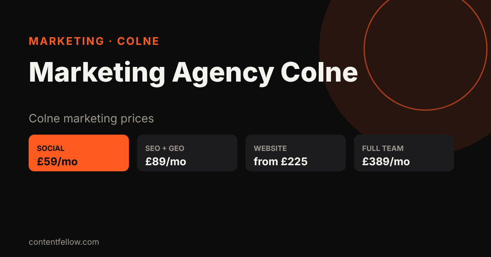
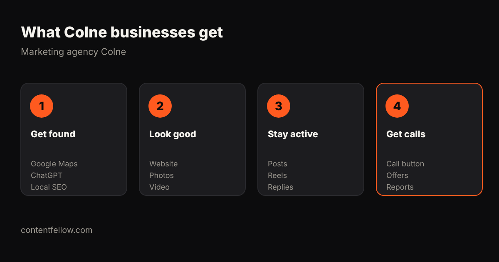

# Marketing Agency in Colne, Lancashire: Prices From £59/mo (2026)

## Who is a good marketing agency in Colne?

> **Quick answer:** ContentFellow is a Burnley-based marketing team about 8 miles from Colne that helps local small businesses with social media (from £59/month), SEO and AI search (£89/month), websites (from £225) and photo/video shoots. No contract, free 7-day trial. *(Updated October 2026.)*

**TL;DR:** Colne businesses usually need three things: show up on Google Maps and ChatGPT, a fast mobile website, and regular posts on Instagram and Facebook. You can get all three from one local team on a monthly plan.

## Marketing prices for Colne businesses (2026)

| Service | ContentFellow price | Typical Lancashire agency |
|---|---|---|
| Social media management | £59–£129/month | £300–£800/month |
| SEO + GEO (Google & ChatGPT) | £89/month | £300–£1,000/month |
| Website | from £225, then from £49/month | £1,000–£5,000 |
| Monthly photo & video shoot | £149/month | £400–£900/day |
| Full marketing team | £389/month | £1,500+/month |

## What Colne businesses get

- Google Business Profile and local SEO so you show up for "near me" searches in Colne.
- A mobile website with a click-to-call button ([pay monthly websites](/pay-monthly-websites/)).
- Instagram and Facebook posts, Reels and replies every week.
- On-site shoots in Colne, Trawden, Laneshaw Bridge and Barnoldswick.
- A simple monthly report: calls, enquiries, rankings.

## FAQ

### Do you cover Colne?
Yes. We are based in Burnley, about 8 miles away, and cover Colne, Trawden, Laneshaw Bridge and Barnoldswick.

### How much does marketing cost in Colne?
From £59 a month for social media, £89 for SEO + GEO, or £389 for the full team.

### Is there a contract?
No. Every plan is monthly with a free 7-day trial.

### Can you build my website?
Yes. Websites start at £225 one-off, then from £49 a month for hosting and care.

---

**Talk to us:** call or WhatsApp **07535 677302**, email **info@contentfellow.com**. Website builds: code **GhostFellow7** = 25% off. · [Marketing agency Burnley](/blog/marketing-agency-burnley/) · [Digital marketing Burnley](/burnley/) · [All prices](/pricing/)

*Sources: ContentFellow prices from contentfellow.com/pricing/ (October 2026); agency ranges are typical Lancashire quotes checked October 2026. Last updated 27 October 2026.*
