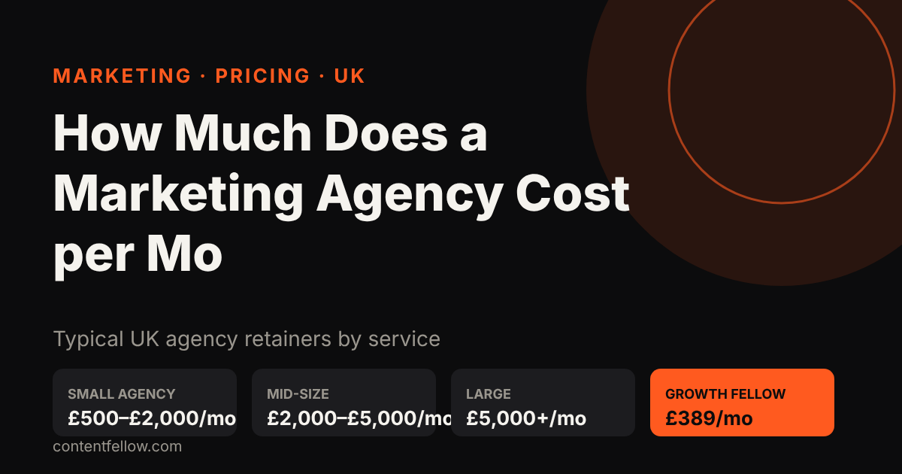
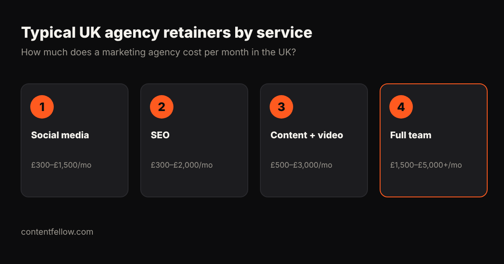

# How Much Does a Marketing Agency Cost per Month in the UK? (2026)

## How much does a marketing agency cost per month in the UK?

> **Quick answer:** A marketing agency in the UK typically costs £500–£2,000 a month for a small business retainer, £2,000–£5,000 a month from a mid-size agency, and £5,000 or more a month for larger, multi-channel work. ContentFellow offers fixed monthly plans from £59 a month, or every specialist together for £389 a month with Growth Fellow. *(Updated October 2026.)*

**TL;DR:** Budget £500–£2,000 a month for one or two channels from a small UK agency. Watch for set-up fees, 6–12 month minimum terms and VAT on top. Fixed subscriptions are a cheaper way to start.

## UK marketing agency prices per month (2026)

| Service | Small agency / freelancer | Mid-size agency |
|---|---|---|
| Social media management | £300–£1,000 | £1,000–£2,500 |
| SEO | £300–£1,000 | £1,000–£3,000 |
| Content, photo and video | £500–£1,500 | £1,500–£4,000 |
| Paid ads management (excl. ad spend) | £300–£800 | £800–£2,000 |
| Full outsourced marketing team | £1,500–£3,000 | £3,000–£8,000+ |

Typical ranges from UK agency price pages and freelancer marketplaces checked October 2026. Most agencies are VAT registered, so add 20%.

## Hidden costs to ask about

- **Set-up or onboarding fees** of £250–£1,500.
- **Minimum terms** of 3, 6 or 12 months.
- **Ad spend** is almost always extra.
- **VAT** at 20% on top of the quoted price.

## ContentFellow monthly plans

| Plan | Price | What you get |
|---|---|---|
| Social Fellow | £59 or £129/mo | Manage, or manage + post |
| Build Fellow | £69/mo | Site up to 5 pages, hosting, 2 changes/month |
| Search Fellow | £89/mo | SEO + GEO, monthly report |
| Creator Fellow | £119/mo | 8 short videos, motion graphic, podcast edit |
| Studio Fellow | £149/mo | Monthly shoot, 20 edited photos |
| **Growth Fellow** | **£389/mo** | All 5 Fellows (save £166) |

No VAT is added and there is no long contract. See [all plans](/pricing/), or compare [outsourced marketing team cost](/blog/outsourced-marketing-team-cost-uk/) and [the best marketing agency for small businesses](/blog/best-marketing-agency-small-business-uk/).

## Frequently asked questions

### How much does a marketing agency cost per month in the UK?
Usually £500–£2,000 a month for a small business and £2,000–£5,000 from a mid-size agency, plus VAT.

### What is a typical marketing retainer in the UK?
Around £1,000–£3,000 a month for one or two channels with reporting.

### Do UK agencies charge set-up fees?
Many do, typically £250–£1,500. Ask before you sign.

### What is the cheapest way to get a marketing team?
A fixed subscription. ContentFellow's Growth Fellow gives you all five specialists for £389 a month.

---

**[See all plans and prices →](/pricing/)** · More quick answers on our [answers page](/answers/). Need a website too? See [development packages](/services/development/) and [website care plans](/services/management/).

*Sources: ContentFellow plans and prices from contentfellow.com/pricing/ (October 2026); market ranges are typical quotes from UK and Irish agency price pages and freelancer marketplaces checked October 2026. ContentFellow is not VAT registered, so prices include everything. Last updated 20 October 2026.*
