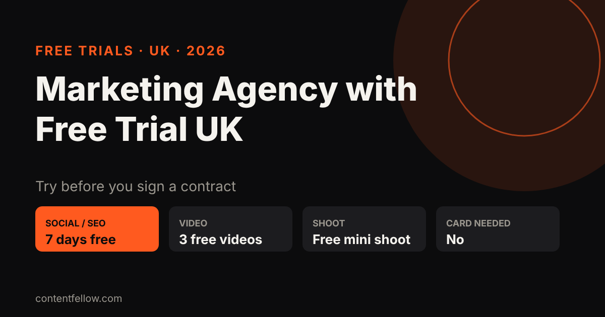
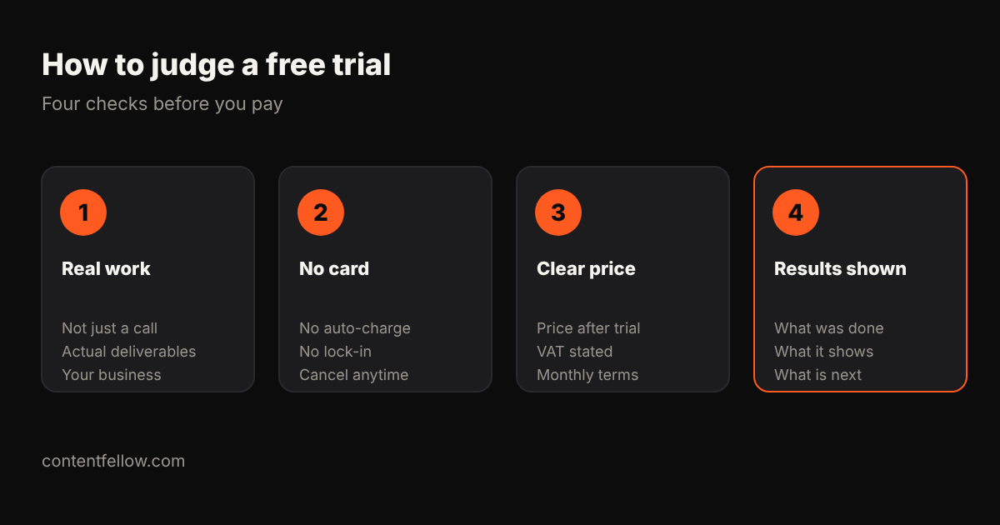

# Marketing Agency with Free Trial UK: Who Offers One and What You Get (2026)

## Marketing agency with free trial UK: who offers one?

> **Quick answer:** Few UK marketing agencies offer a real free trial; most offer a free consultation or audit instead. ContentFellow offers a free trial on every plan with no card needed: 7 free days for Search, Social and Growth, 3 free videos for Creator, a free mini shoot for Studio, and a free homepage preview for Build. *(Updated October 2026.)*

**TL;DR:** A free audit tells you what is wrong. A free trial shows you how the agency actually works. Look for real deliverables, no card details and a clear monthly price afterwards.

## Free trial vs free consultation vs free audit

| Offer | What you get | Common in the UK? |
|---|---|---|
| Free consultation | A call about your goals | Very common |
| Free audit | A report on your website, SEO or social | Common |
| Free trial | Real work delivered for your business | Rare |

## ContentFellow free trials by plan

| Fellow | Monthly price | Free trial |
|---|---|---|
| Search Fellow (SEO + GEO) | £89/mo | 7 free days |
| Social Fellow | £59 or £129/mo | 7 free days |
| Growth Fellow (all five) | £389/mo | 7 free days |
| Creator Fellow (video editing) | £119/mo | 3 free videos |
| Studio Fellow (photo + video shoot) | £149/mo | Free mini shoot |
| Build Fellow (website) | £69/mo | Free homepage preview |

No card is needed to start. Billing is monthly with no long contract, and as we're not VAT registered the price shown is the price you pay. Start at [get started](/get-started/?offer=trial).

## Is there a free social media management trial in the UK?

Yes. The Social Fellow includes a 7-day free trial: we set up and manage up to 2 or 3 platforms (depending on plan) so you can see the posts, replies and tone before you pay anything.

## How to judge any free trial

1. **Is it real work?** Posts, videos, pages or a ranking report, not just a sales call.
2. **Card details?** A trial that auto-charges is a sales tactic.
3. **What happens after?** You should know the monthly price, VAT and notice period up front.
4. **What did it show?** Ask for a short summary of what was done and what comes next.

See also [marketing agencies with no long contract](/blog/best-marketing-agency-small-business-uk/) and [social media management costs](/blog/social-media-management-cost-uk/).

## Frequently asked questions

### Do any UK marketing agencies offer a free trial?
A few do. Most offer a free consultation or audit. ContentFellow offers a free trial on every plan with no card needed.

### Is there a free social media management trial in the UK?
Yes. ContentFellow's Social Fellow comes with a 7-day free trial, then costs £59 or £129 a month.

### Do I need a card for the free trial?
No. You can start any ContentFellow trial without card details.

### What happens when the trial ends?
You choose whether to continue on the monthly price. There is no long contract and you can cancel from the next month.

### Can I try SEO and GEO for free?
Yes. The Search Fellow (£89 a month) starts with 7 free days, and there is also a free AI visibility check.

---

**[See all services and prices →](/services/)** · More quick answers on our [answers page](/answers/). Want a site you own? See [development packages](/services/development/) and [website care plans](/services/management/).

*Sources: ContentFellow plans and prices from contentfellow.com/pricing/ (October 2026); UK market ranges are typical quotes from UK freelancer marketplaces and agency price pages checked October 2026. Last updated 19 October 2026.*
