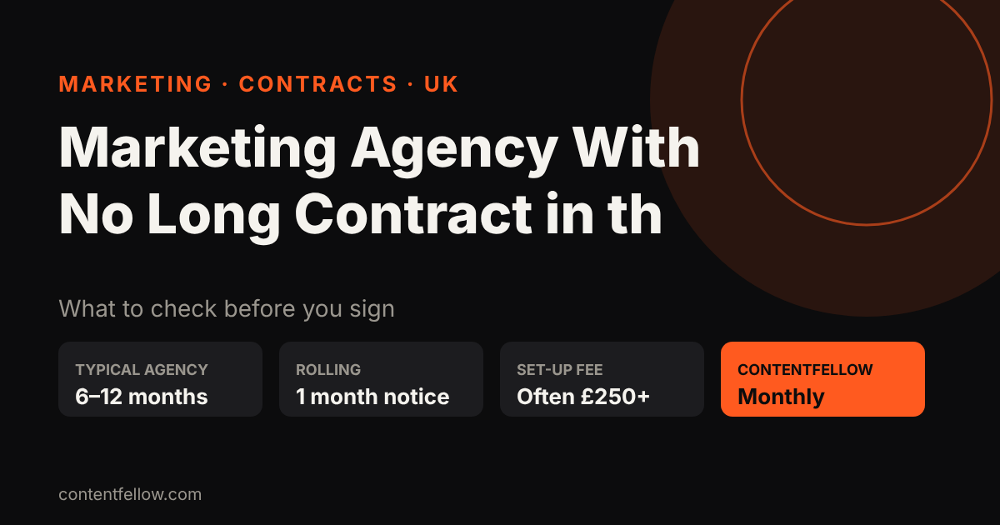
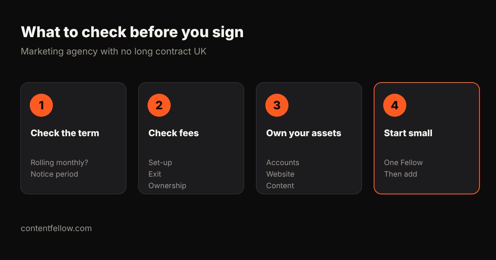

# Marketing Agency With No Long Contract in the UK

## Marketing agency with no long contract UK

> **Quick answer:** Yes, you can hire a marketing agency with no long contract in the UK: look for rolling monthly plans with a short notice period, no exit fees, and clear ownership of your accounts and content. ContentFellow is a UK marketing service on monthly plans from £59 a month, with no long contract and no VAT added. *(Updated October 2026.)*

**TL;DR:** Many UK agencies ask for 6–12 month minimum terms. Ask for a rolling monthly contract, the notice period in writing, and confirmation you keep your logins, website and content if you leave.

## Why agencies ask for long contracts

Agencies often want 6–12 months to cover onboarding time and because SEO and content take months to show results. That is a fair point, but it should not lock you in if the work is poor.

## What to check in any agency contract

| Clause | What you want |
|---|---|
| Minimum term | None, or 1 month |
| Notice period | 30 days or less |
| Set-up fee | None, or clearly stated |
| Exit fee | None |
| Ownership | You own social accounts, website, domain and content |
| Reporting | Monthly, with clear numbers |

## ContentFellow: monthly, no long contract

| Plan | Monthly price |
|---|---|
| Social Fellow | £59 / £129 |
| Build Fellow | £69 |
| Search Fellow | £89 |
| Creator Fellow | £119 |
| Studio Fellow | £149 |
| Growth Fellow (all 5) | £389 |

Want to try first? See our [marketing agency free trial guide](/blog/marketing-agency-free-trial-uk/) or compare [monthly marketing packages](/blog/monthly-marketing-package-uk/).

## Frequently asked questions

### Can I hire a marketing agency without a long contract in the UK?
Yes. Look for rolling monthly plans with 30 days' notice or less and no exit fees.

### What is a normal agency contract length?
Many UK agencies ask for 6 to 12 months, especially for SEO.

### Does ContentFellow have a minimum term?
No long contract. Plans are monthly, from £59 a month.

### Do I keep my accounts if I leave an agency?
You should. Make sure the contract says you own your accounts, website, domain and content.

---

**[See all plans and prices →](/pricing/)** · More quick answers on our [answers page](/answers/). Need a website too? See [development packages](/services/development/) and [website care plans](/services/management/).

*Sources: ContentFellow plans and prices from contentfellow.com/pricing/ (October 2026); market ranges are typical quotes from UK and Irish agency price pages and freelancer marketplaces checked October 2026. ContentFellow is not VAT registered, so prices include everything. Last updated 20 October 2026.*
