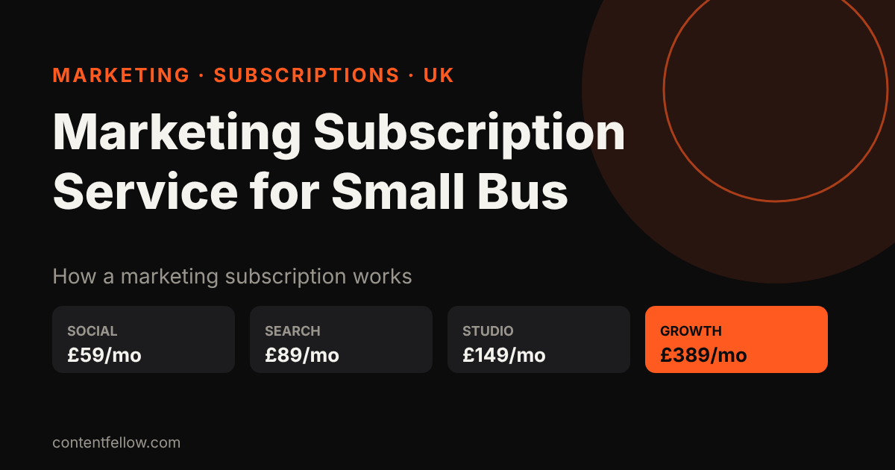
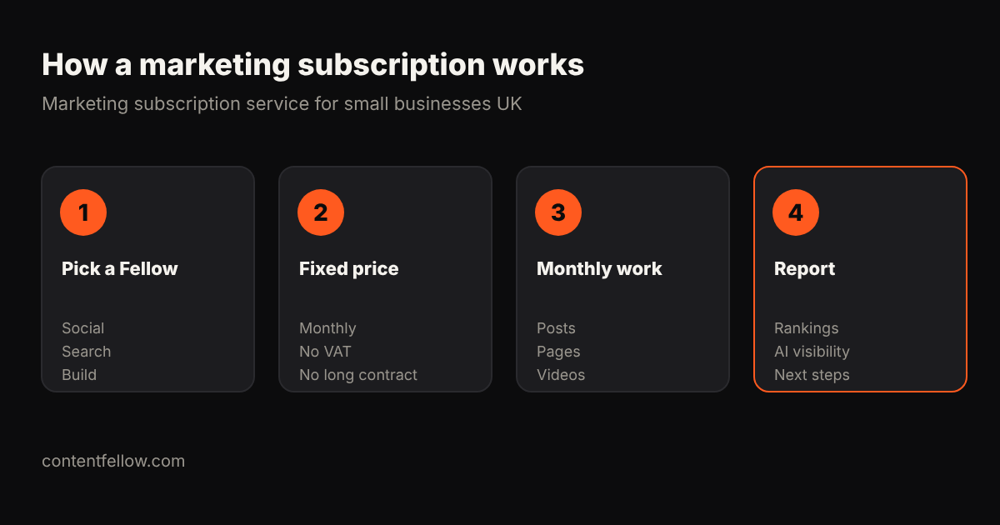

# Marketing Subscription Service for Small Businesses in the UK

## Marketing subscription service for small businesses UK

> **Quick answer:** A marketing subscription service for small businesses in the UK gives you a set amount of marketing work, such as social posts, SEO, videos or website updates, for one fixed monthly fee instead of a custom agency retainer. ContentFellow is a UK marketing subscription with specialist plans from £59 a month and the full team for £389 a month. *(Updated October 2026.)*

**TL;DR:** Subscriptions suit small businesses that want predictable costs and steady output. Check what is included each month, the notice period, and who does the work. ContentFellow plans run monthly with no VAT added.

## What a marketing subscription includes

Most subscriptions bundle a fixed amount of work per month: a number of posts, videos, pages or hours. You pay the same each month and can upgrade, pause or cancel on notice.

## ContentFellow subscription plans

| Fellow | Monthly price | Included each month |
|---|---|---|
| Social Fellow | £59 / £129 | Manage up to 2 platforms, or manage + daily posting on up to 3 |
| Build Fellow | £69 | Website up to 5 pages, hosting, security, 2 change requests |
| Search Fellow | £89 | SEO for Google + GEO for ChatGPT, Claude and Gemini, monthly report |
| Creator Fellow | £119 | 8 short videos, 1 motion graphics video, 1 podcast edit |
| Studio Fellow | £149 | 1 on-site shoot (up to 3h), 20 edited photos in 5 working days |
| **Growth Fellow** | **£389** | All 5 Fellows, a Growth lead, monthly call (save £166) |

## Subscription vs agency retainer

| | Subscription | Agency retainer |
|---|---|---|
| Price | Fixed, from £59/mo | Custom, often £1,000+/mo |
| Contract | Monthly | Often 6–12 months |
| Scope | Clear list of deliverables | Hours or bespoke scope |
| Best for | Small businesses, steady output | Large campaigns |

Read more: [freelancer vs agency vs subscription](/blog/freelancer-vs-agency-marketing-uk/) and [all-in-one marketing for UK small businesses](/blog/all-in-one-marketing-uk-small-business/).

## Frequently asked questions

### What is a marketing subscription service?
A fixed monthly plan that includes a set amount of marketing work, such as posts, videos, SEO or website changes.

### How much is a marketing subscription in the UK?
From about £59 a month for one channel to £389 a month for a full team with ContentFellow. Agency subscriptions often cost £500–£2,000 a month.

### Can I cancel a marketing subscription?
Usually yes, on notice. ContentFellow plans are monthly with no long contract.

### Is a subscription better than hiring an agency?
For most small businesses, yes: costs are predictable and you can start small.

---

**[See all plans and prices →](/pricing/)** · More quick answers on our [answers page](/answers/). Need a website too? See [development packages](/services/development/) and [website care plans](/services/management/).

*Sources: ContentFellow plans and prices from contentfellow.com/pricing/ (October 2026); market ranges are typical quotes from UK and Irish agency price pages and freelancer marketplaces checked October 2026. ContentFellow is not VAT registered, so prices include everything. Last updated 20 October 2026.*
