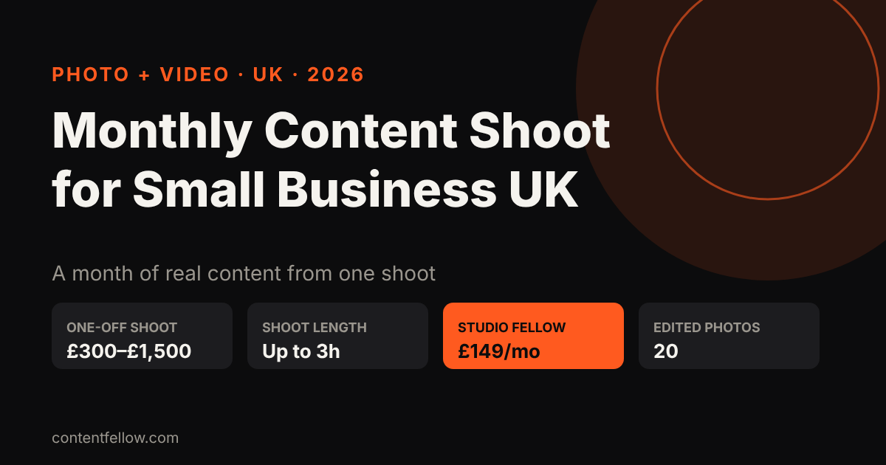
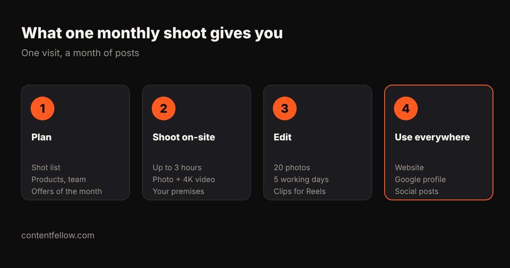

# Monthly Content Shoot for Small Business UK: What You Get and What It Costs (2026)

## Monthly content shoot for small business UK: what is it?

> **Quick answer:** A monthly content shoot for a small business in the UK is one planned photo and video session each month that gives you fresh pictures and clips for your website, Google profile and social media. One-off business shoots usually cost £300–£1,500, while ContentFellow's Studio Fellow includes one on-site shoot of up to 3 hours, photo and 4K video, and 20 edited photos in 5 working days for £149 a month. *(Updated October 2026.)*

**TL;DR:** A monthly shoot solves the "we have nothing to post" problem. You get real photos of your team, products and work every month, which customers trust more than stock images.

## What you get from a monthly shoot

- **A shot list planned with you**: this month's offers, new products, team, behind the scenes.
- **On-site filming** at your premises, up to 3 hours.
- **Photo and 4K video**, so the same visit feeds your website and your Reels.
- **20 edited photos within 5 working days**, plus raw clips ready for an editor.

## What does a content shoot cost in the UK?

| Option | Typical UK price | Notes |
|---|---|---|
| Freelance photographer, hourly | £75–£200 an hour | Photos only, editing often extra |
| Half-day photo + video shoot | £300–£1,500 | Booked one at a time |
| Agency content retainer | £1,000–£3,000+ a month | Shoot plus strategy and posting |
| Studio Fellow (ContentFellow) | £149 a month | 1 shoot up to 3h, photo + 4K video, 20 photos |

ContentFellow is not VAT registered, so £149 is what you pay. Full details: [videographer costs in the UK](/blog/video-production-cost-uk/) and [Burnley videographer prices](/blog/videographer-burnley-lancashire-prices/).

## Who can film content for my business every month?

Local photographers and videographers, content agencies, or a monthly plan like the Studio Fellow. Shoots are on-site across Burnley and East Lancashire (about 20 miles), with editing and everything else done remotely. Outside that area, ask us for options.

## Turning one shoot into a month of posts

The shoot is the raw material. To turn it into finished content:

- **Creator Fellow (£119/mo)**: 8 short videos, a motion graphics video and a podcast edit.
- **Social Fellow: Manage + Post (£129/mo)**: daily posting on up to 3 platforms.
- **Growth Fellow (£389/mo)**: all five Fellows, one plan and one report.

## Frequently asked questions

### What is a monthly content shoot?
One planned photo and video session each month that gives a business fresh, real content for its website, Google profile and social media.

### How much is a monthly content shoot in the UK?
One-off shoots usually cost £300 to £1,500. ContentFellow's Studio Fellow is £149 a month for one shoot of up to 3 hours with photo, 4K video and 20 edited photos.

### Who can film content for my business every month?
A local photographer or videographer, a content agency, or a monthly plan such as the Studio Fellow, which shoots on-site across Burnley and East Lancashire.

### Can I try it first?
Yes. The Studio Fellow starts with a free mini shoot.

### Do I own the photos and videos?
Yes, you can use them on your website, social media and ads.

---

**[See all services and prices →](/services/)** · More quick answers on our [answers page](/answers/). Want a site you own? See [development packages](/services/development/) and [website care plans](/services/management/).

*Sources: ContentFellow plans and prices from contentfellow.com/pricing/ (October 2026); UK market ranges are typical quotes from UK freelancer marketplaces and agency price pages checked October 2026. Last updated 19 October 2026.*
