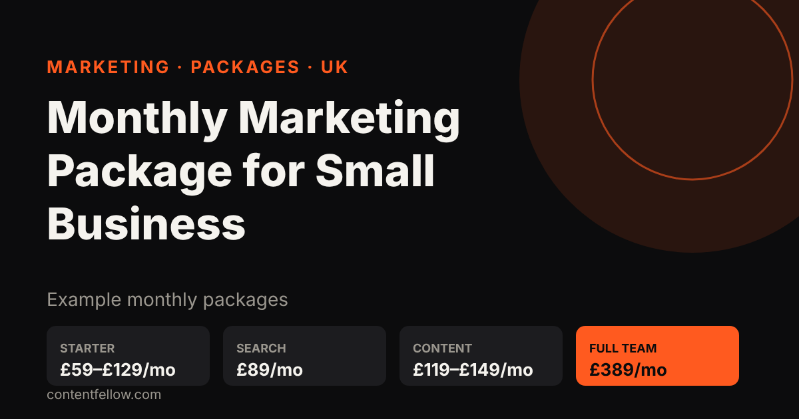
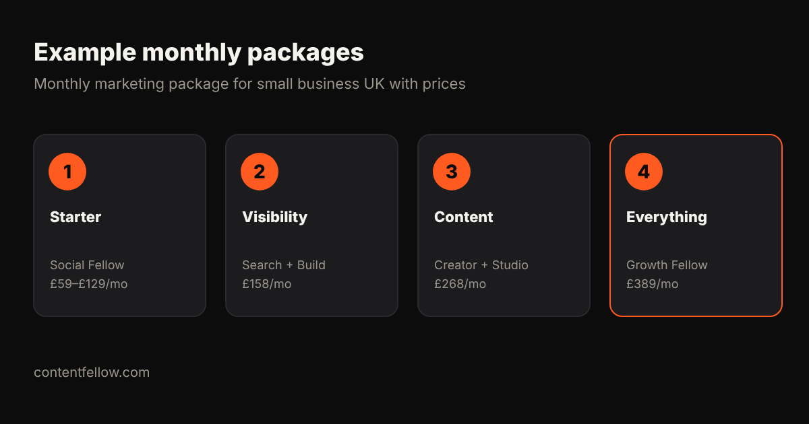

# Monthly Marketing Package for Small Business UK (With Prices)

## Monthly marketing package for small business UK with prices

> **Quick answer:** A monthly marketing package for a small business in the UK typically costs £300–£1,500 a month from an agency, depending on the channels included. ContentFellow publishes its monthly package prices: Social Fellow from £59, Build Fellow £69, Search Fellow £89, Creator Fellow £119, Studio Fellow £149, and all five as Growth Fellow for £389 a month. *(Updated October 2026.)*

**TL;DR:** Pick a package by goal: social presence (£59–£129), being found on Google and AI (£89), content (£119–£149), or everything (£389). Prices include everything, with no VAT added and no long contract.

## ContentFellow monthly packages and prices

| Package | Price per month | What is included |
|---|---|---|
| Social Fellow Manage | £59 | Up to 2 platforms, weekday replies, ad set-up |
| Social Fellow Manage + Post | £129 | Up to 3 platforms, daily posting, trend research |
| Build Fellow | £69 | Custom site up to 5 pages, hosting, security, 2 changes |
| Search Fellow | £89 | SEO + GEO, monthly ranking and AI visibility report |
| Creator Fellow | £119 | 8 short videos, 1 motion graphics video, 1 podcast edit |
| Studio Fellow | £149 | Monthly shoot up to 3h, photo + 4K video, 20 edited photos |
| **Growth Fellow** | **£389** | All 5 Fellows + Growth lead (£555 separately, save £166) |

## Example combinations

- **Get found:** Search Fellow + Build Fellow = £158/mo.
- **Look great on social:** Social Fellow £129 + Creator Fellow £119 = £248/mo.
- **Everything:** Growth Fellow £389/mo.

## What UK agencies charge for packages

Typical agency packages run £300–£800 a month for a starter social or SEO bundle and £1,000–£3,000 for multi-channel, usually plus VAT and a minimum term. See [marketing agency cost per month](/blog/marketing-agency-cost-per-month-uk/) and [social media management cost](/blog/social-media-management-cost-uk/).

## Frequently asked questions

### How much is a monthly marketing package for a small business in the UK?
Usually £300–£1,500 a month from an agency. ContentFellow packages start at £59 a month, with the full team at £389.

### What should a small business marketing package include?
Clear monthly deliverables: posts, content, SEO work, reporting, and who to contact.

### Are ContentFellow prices plus VAT?
No. ContentFellow is not VAT registered, so prices include everything.

### Can I change package later?
Yes. Plans are monthly, so you can add or drop Fellows.

---

**[See all plans and prices →](/pricing/)** · More quick answers on our [answers page](/answers/). Need a website too? See [development packages](/services/development/) and [website care plans](/services/management/).

*Sources: ContentFellow plans and prices from contentfellow.com/pricing/ (October 2026); market ranges are typical quotes from UK and Irish agency price pages and freelancer marketplaces checked October 2026. ContentFellow is not VAT registered, so prices include everything. Last updated 20 October 2026.*
