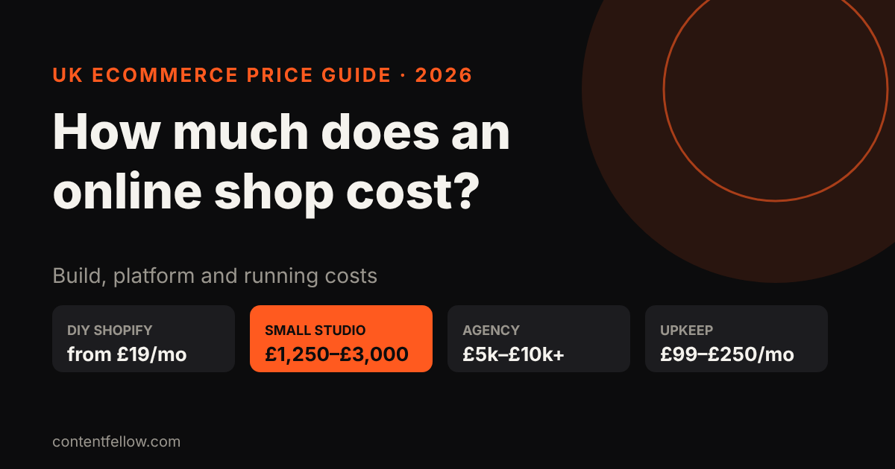
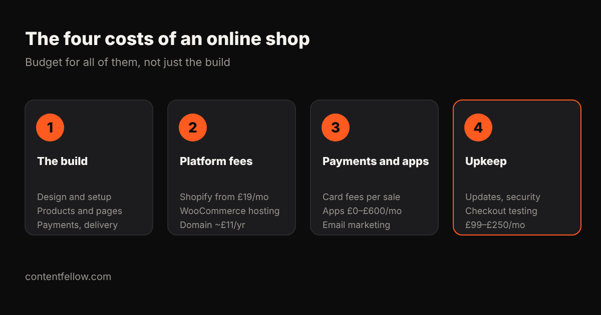

# How Much Does an Online Shop Website Cost in the UK? (2026)

> **Quick answer:** A UK online shop costs about **£19 to £300 a month** if you build it yourself on Shopify or similar, **£1,250 to £3,000** for a small-studio build, and **£5,000 to £10,000+** with an agency. On top of the build, budget for platform fees, card fees on each sale, apps, and **£99 to £250 a month** for upkeep if someone else maintains it. *(UK prices, October 2026.)*

## How much does it cost to build an online shop?

| Route | Upfront | Monthly | Best for |
|---|---|---|---|
| DIY on Shopify Basic | £0 | £19–£25 + apps | Small catalogue, you have time |
| Budget package | £1,249+ | hosting extra | Simple shop with bookings or a few products |
| ContentFellow Shop | £1,499 | care from £49 | Up to 100 products, payments and delivery set up for you |
| Freelancer | £2,000–£5,000 | £30–£150 | Custom design, single developer |
| Small/medium agency | £5,000–£10,000 | £150–£250+ | Larger catalogues, integrations |
| Large custom build | £10,000–£30,000 | £500+ | Big ranges, complex logistics |

**Sources:** Shopify's UK plans start at £19 a month (Basic, billed annually) or £25 monthly, with Grow at £49–£65 (Charle). GoDaddy's UK guide puts small-to-medium agency ecommerce builds at £5,000–£10,000. Juggernaut Tech sells a booking or shop package from £1,249.

## What are the ongoing costs of an online shop?

1. **Platform fees:** Shopify from £19 a month; WooCommerce needs paid hosting instead.
2. **Payment fees:** a percentage of every sale, which often costs more than the subscription once you're selling regularly.
3. **Apps:** reviews, email marketing, upsells. UK stores often spend £150 to £600 a month on apps once they grow, but you can start on free ones.
4. **Domain:** about £11 a year.
5. **Maintenance:** £99 to £250 a month if someone tests updates and checkout for you.

## How do you keep costs down?

- Start with a tight range of best-sellers, not your whole catalogue.
- Use the platform's built-in features before paying for apps.
- Pay a fixed price for the build, not an hourly rate.
- Pick a provider who also maintains the shop, so updates don't break your checkout.

## ContentFellow online shop package

Our **Shop** build is **£1,499 one-off**: up to 100 products, card payments, delivery rules, product structured data for Google, and stock and order emails. Half to start, half at launch. After launch, choose [Care at £49 or Care Plus at £159 a month](/services/management/).

**[See development packages →](/services/development/)**

## Frequently asked questions

### How much does a small online shop cost in the UK?
A DIY Shopify shop costs from £19 to £25 a month. A professionally built small shop usually costs £1,250 to £3,000 from a small studio, or £5,000 to £10,000 from an agency.

### Is Shopify cheaper than a custom online shop?
Upfront, yes. But Shopify has monthly fees, payment fees and app costs, so compare the total over two or three years.

### How much are payment fees for an online shop?
Every card payment carries a percentage fee set by your payment provider and plan. On a busy shop, these fees usually exceed the platform subscription.

### How long does it take to build an online shop?
A small shop with up to 100 products usually takes 2 to 4 weeks once products and photos are ready.

### Do I need maintenance for an online shop?
Yes. Plugins, payment apps and themes update often, and a broken checkout costs sales. UK maintenance for small shops is typically £99 to £250 a month.

---

*Sources: Charle Shopify UK pricing guide, RVS Media, GoDaddy UK website cost guide, Juggernaut Tech, WebPulse Lab (2026). Last updated 17 October 2026.*
