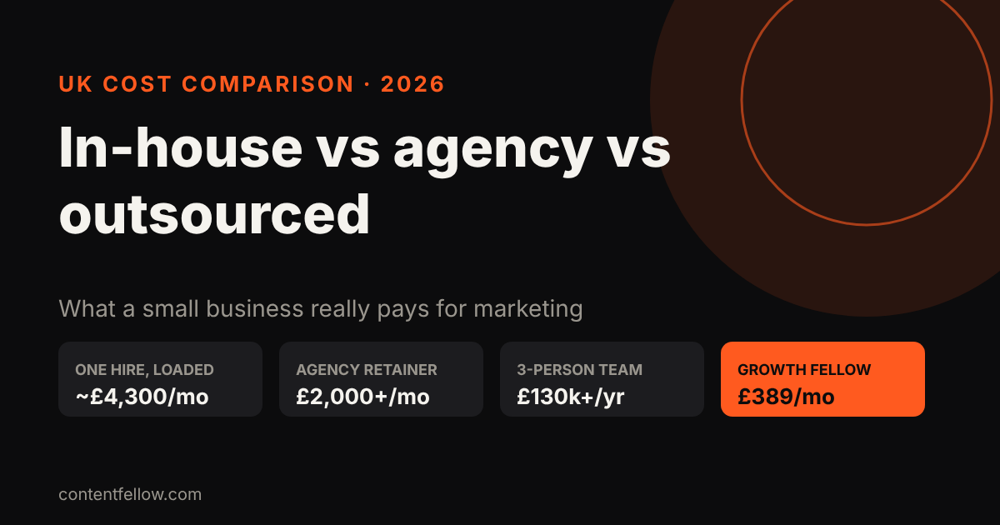
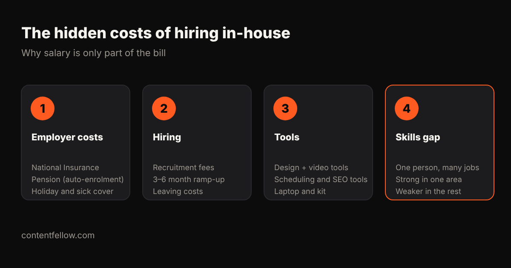

# Outsourced Marketing Team vs Agency vs In-House: UK Costs Compared (2026)

> **Quick answer:** A single in-house marketing hire in the UK costs **35–45% more than their salary** once you add National Insurance, pension, recruitment, tools and training: a £30,000 content manager really costs about **£51,000 a year (£4,300 a month)**. Specialist agencies typically charge **£2,000–£10,000 a month**, and a three-person in-house team outside London costs £130,000–£180,000 a year. For small businesses, productised outsourced teams cost far less: ContentFellow's Growth Fellow is **£389 a month** for five specialists. *(Updated October 2026.)*

## UK marketing costs at a glance

| Option | Typical monthly cost | What you get | Best for |
|---|---|---|---|
| Founder does it | £0 + your time | Whatever you have time for | Very early businesses |
| Freelancers (one per skill) | £300–£1,000 each | Specialist skills, managed by you | Businesses with time to coordinate |
| Specialist agency (one channel) | £2,000–£5,000 | One channel done well (e.g. SEO) | Businesses where one channel drives sales |
| Content or full-service agency | £5,000–£25,000 | Strategy plus several channels | Mid-sized companies |
| One in-house hire | ~£4,300 (loaded) | One generalist, full-time | Businesses with lots of daily marketing work |
| Three-person in-house team | £10,800–£15,000 | A small department | Companies spending £150k+ a year on marketing |
| Productised team (Growth Fellow) | £389 | Five Fellows + a Growth lead | Small businesses wanting a full team on a small budget |

Sources: MarketingMary's UK analysis (2026) gives the 35–45% hidden-cost figure, the £51,000 loaded cost of a £30,000 content manager, the £130,000–£180,000 three-person team cost outside London, and agency ranges of £2,000–£5,000 a month for boutique SEO, £5,000–£10,000 for content agencies and £12,000–£25,000 for full-service B2B agencies.

## The hidden costs of hiring in-house

The salary is only the start. On top of it you pay:

1. **Employer costs:** National Insurance, auto-enrolment pension, holiday and sick cover.
2. **Hiring costs:** recruitment fees of £4,000–£5,000 per hire, and a three-to-six month ramp-up before they're fully productive. If they leave, you pay it again.
3. **Tools:** design, video, scheduling and SEO software, plus a laptop and phone. Often £1,500–£2,000 a year.
4. **The skills gap:** one person is rarely great at video, social, web, SEO and analytics at once. You get one strength and four compromises.

That doesn't make in-house wrong. It makes it right **at scale**: MarketingMary's analysis finds in-house teams become more cost-efficient once annual marketing spend passes roughly £120,000–£150,000.

## Agency vs outsourced team: what's the difference?

- **A traditional agency** usually sells strategy and campaigns on a retainer, often with a 6 to 12 month contract, account managers and monthly meetings. Great for bigger budgets; heavy for a 5-person business.
- **An outsourced marketing team** gives you the people who do the work (shooting, editing, posting, building, optimising) on a simpler monthly arrangement, often productised with fixed deliverables.
- **Freelancers** give you specialists, but you become the project manager, which costs your time.

## Which option fits your business?

| Your situation | Sensible choice |
|---|---|
| Under £1,000 a month to spend | A productised team or one or two freelancers |
| One channel clearly drives sales (e.g. Google) | A specialist for that channel, plus basics elsewhere |
| £2,000–£10,000 a month, growing fast | An agency or a hybrid: one internal owner plus outside specialists |
| £150,000+ a year and daily marketing work | Start building in-house, keep specialists for gaps |

Whatever you choose, **one strategy across channels** matters more than the model. Five freelancers each doing their own thing rarely add up to a plan.

## What can you get for under £400 a month?

At small-business budgets, the most useful mix is usually:

- **Regular content:** a monthly shoot and short videos ([video production costs](/blog/video-production-cost-uk/), [video editing costs](/blog/video-editing-cost-uk/))
- **Consistent social posting** ([social media management costs](/blog/social-media-management-cost-uk/))
- **A website that converts and stays updated** ([website costs](/blog/small-business-website-cost-uk/))
- **SEO and GEO** so Google and AI assistants recommend you ([GEO vs SEO](/blog/geo-vs-seo-uk-small-business/))
- **One monthly report** that ties it together

Bought separately from freelancers, that list can easily pass £2,000 a month.

## Questions to ask any marketing provider

- Who exactly does the work, and who is my main contact?
- What are the monthly deliverables, in numbers?
- What's the minimum term and notice period?
- Do I own the content, accounts, website and data?
- How do you report results, and how often?

## How ContentFellow prices a full marketing team

The **[Growth Fellow](/services/growth-fellow/) is £389 a month**, against £555 for the five Fellows separately, a saving of £166 a month. You get all five specialists (Studio, Creator, Social, Build and Search), a Growth lead who sets one strategy across them, a monthly call and one combined report. Billing is monthly, you approve content before it goes live, and you can change Fellows from the next month.

**[See the Growth Fellow →](/services/growth-fellow/)**

## Frequently asked questions

### How much does it cost to hire a marketing manager in the UK?
Expect the real cost to be 35–45% above the salary. A £30,000 content manager costs about £51,000 a year once National Insurance, pension, recruitment, tools and training are included.

### Is outsourcing marketing cheaper than hiring in-house?
For most small businesses, yes. In-house teams tend to become more cost-efficient only once marketing spend passes roughly £120,000–£150,000 a year.

### How much does a marketing agency cost per month in the UK?
Specialist agencies typically charge £2,000–£5,000 a month for one channel, content agencies £5,000–£10,000, and full-service agencies £12,000–£25,000 or more.

### What is a productised marketing service?
A service sold like a product: fixed deliverables at a fixed monthly price, rather than hours or open-ended retainers. It suits small businesses that want predictable costs.

### What is a hybrid marketing model?
One person inside the business owns marketing and decisions, while outside specialists do the execution. Many growing UK SMEs use it.

### Can a small business have a full marketing team for under £500 a month?
Yes, with a productised service. The ContentFellow Growth Fellow covers shoots, editing, social, website and search for £389 a month.
