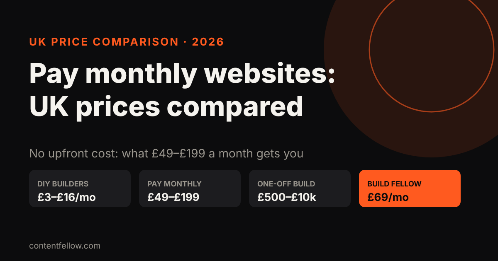
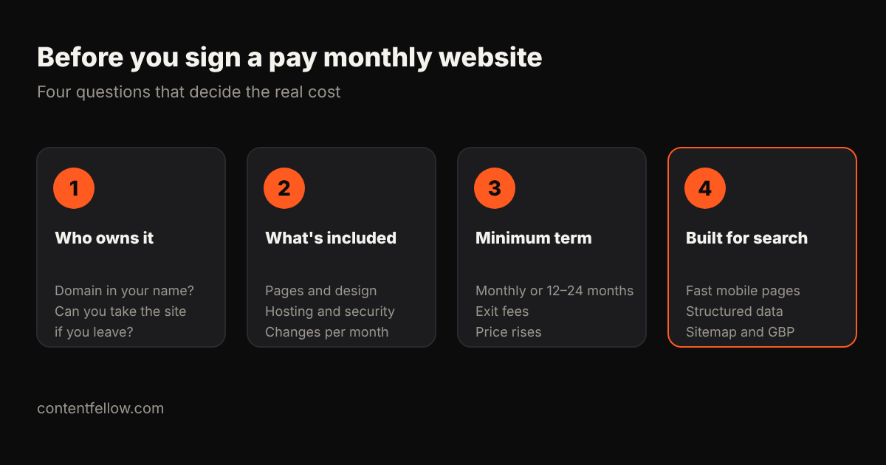

# Pay Monthly Websites UK: 2026 Price Comparison for Small Businesses

> **Quick answer:** UK pay monthly websites typically cost **£49 to £199 a month** with no upfront fee, usually including design, hosting and updates. DIY website builders cost about £3–£16 a month, and a one-off build costs £500–£10,000 plus running costs. The most important difference between plans isn't price but **ownership and minimum term**: check whether you keep the domain and site if you leave. *(Prices as published by each provider on 16 October 2026. Check their sites for current offers.)*

**Transparency note:** ContentFellow wrote this comparison and our Build Fellow is included. We've only listed prices providers publish themselves.

## Published UK pay monthly website prices

| Provider / type | Published price | Notes (as published) |
|---|---|---|
| ContentFellow Build Fellow | £69 a month, no upfront fee | Custom site up to 5 pages, hosting, security, updates, 2 change requests a month, free homepage preview |
| Convrtem | From £49 a month | Pay monthly websites, no upfront costs |
| Opace | £50 a month | Brochure websites for startups and small businesses |
| StoreBuilder (guide) | Typically £49–£199 a month | Typical UK pay monthly range |
| Atomic | £100 a month + VAT | Design, build, hosting and maintenance |
| DIY builders (Wix, Squarespace, Hostinger) | About £3–£16 a month | You build and maintain it yourself |

For one-off build prices and three-year totals, see [how much a small business website costs in the UK](/blog/small-business-website-cost-uk/).

## Four questions before you sign

1. **Who owns it?** Is the domain registered in your name? If you leave, can you take the design and content, or does the site switch off?
2. **What's included?** Number of pages, custom design or template, hosting, SSL, security, backups, and how many changes a month.
3. **What's the minimum term?** Monthly, or 12–24 months? Are there exit fees or annual price rises?
4. **Is it built for search?** Fast mobile pages, structured data, a sitemap and clear service pages help you show up on Google and in AI answers like ChatGPT. See [how to get recommended by ChatGPT](/blog/get-business-recommended-by-chatgpt-uk/).

## Pay monthly vs buying outright

| | Pay monthly | Buy outright |
|---|---|---|
| Upfront cost | £0 | £500–£10,000 |
| Monthly cost | £49–£199 | £5–£150 for hosting and care |
| Updates and security | Usually included | Extra, or your job |
| Best for | Cash flow, wanting it handled | Bigger budgets, wanting full control |

Over three years, a £69 plan totals about £2,484. A £1,500 freelancer build plus £20 a month care totals about £2,220. They're close; the difference is whether someone is keeping the site updated, secure and improving.

## How the Build Fellow compares

The **[Build Fellow](/services/build-fellow/) is £69 a month**: a custom website of up to five pages, with hosting, security and updates included, plus two change requests every month. There's no upfront fee, billing is monthly, and you can get a **free homepage preview within 3 working days** before paying anything.

**[Get your free homepage preview →](/services/build-fellow/)**

## Frequently asked questions

### How much is a pay monthly website in the UK?
Most UK pay monthly websites cost £49 to £199 a month with no upfront fee. Prices usually include design, hosting and updates.

### Are pay monthly websites worth it?
They suit small businesses that want a professional site without a large upfront bill and want updates handled. Check ownership and minimum term first.

### Do I own a pay monthly website?
It depends on the provider. Always ask whether the domain is in your name and what happens to the site and content if you cancel.

### What's the cheapest way to get a website in the UK?
A DIY builder at about £3–£16 a month, if you have the time to build and maintain it yourself.

### Can I see the website before paying?
Some providers offer previews. The ContentFellow Build Fellow includes a free homepage preview within 3 working days.
