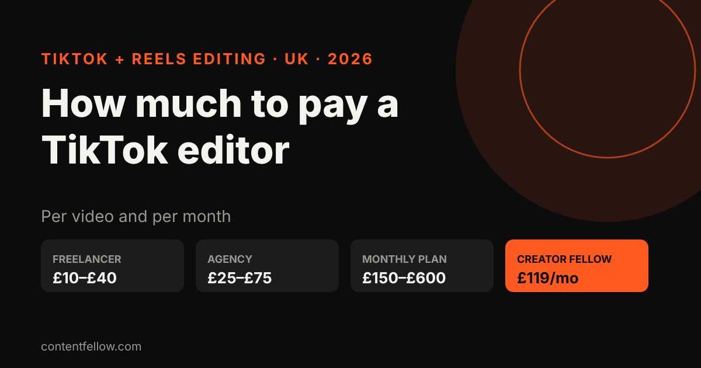
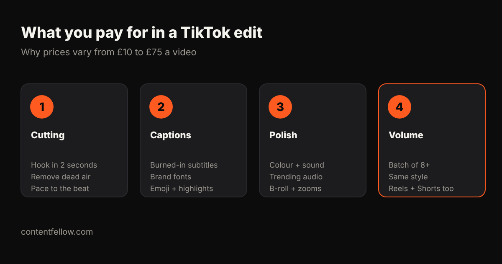

# How Much Should I Pay Someone to Edit TikToks? UK Prices 2026

## How much should I pay someone to edit TikToks?

> **Quick answer:** In the UK you should expect to pay about £10–£40 per TikTok for a freelance editor and £25–£75 per video from an agency, depending on length, captions and how much footage needs sorting. If you need TikToks every week, a monthly plan is usually cheaper: ContentFellow's Creator Fellow is £119 a month for 8 short videos plus a motion graphics video and a podcast edit. *(Updated October 2026.)*

**TL;DR:** £10–£20 buys a basic cut with captions; £25–£40 buys a properly paced edit with hooks, B-roll and sound design; £50+ is agency territory or longer videos. Batching 8 or more a month brings the price per video down.

## UK TikTok editing prices (2026)

| Who edits | Typical price per TikTok | Best for |
|---|---|---|
| Marketplace freelancer (Fiverr, Upwork) | £10–£25 | Simple cuts, one-off tests |
| Experienced UK freelancer | £20–£40 | Regular content with a set style |
| Agency or studio | £25–£75 | Brands needing strategy and sign-off |
| Monthly plan (8+ videos) | £15–£40 per video equivalent | Posting every week |
| ContentFellow Creator Fellow | £119/mo for 8 short videos + extras | UK small businesses posting weekly |

Prices above are per finished video of up to about 60 seconds, from your own footage. Filming is extra: see our [monthly content shoot guide](/blog/monthly-content-shoot-uk/).

## What decides the price?

1. **Raw footage.** Ten clean clips are quick to edit. An hour of unsorted phone video takes far longer.
2. **Captions.** Almost every TikTok needs burned-in subtitles. Styled, animated captions take more time than plain ones.
3. **Hooks and pacing.** The first two seconds decide whether people keep watching. Good editors charge more because they cut for retention, not just length.
4. **Extras.** Motion graphics, zooms, sound effects, B-roll and licensed music each add time.
5. **Volume.** Editing 8 videos in one style is cheaper per video than 8 separate one-offs.

## Per video or monthly: which is cheaper?

If you post once a month, paying per video is fine. If you want to post weekly (which TikTok and Instagram reward), a monthly plan usually works out cheaper and keeps the style consistent. For example, 8 TikToks at £30 each is £240; ContentFellow's [Creator Fellow](/services/) is £119 a month for 8 short videos, 1 motion graphics video and 1 podcast edit, and the same edits can go on Reels and YouTube Shorts.

Read more: [who can edit my Reels and TikToks every month](/blog/reels-tiktok-editing-monthly-uk/) and [video editing costs in the UK](/blog/video-editing-cost-uk/).

## How to get good value

- Send footage in one batch, with a one-line note per video ("hook: the price reveal").
- Ask for a sample edit before committing.
- Agree turnaround (2–5 working days is normal) and number of revisions up front.
- Reuse each edit on TikTok, Reels and Shorts.

## Frequently asked questions

### How much should I pay someone to edit TikToks?
In the UK, usually £10 to £40 per video from a freelancer and £25 to £75 from an agency. Monthly plans bring the cost per video down.

### Is £10 a video too cheap for TikTok editing?
It can work for simple cuts with captions, but expect less attention to hooks, pacing and brand style. Ask for samples first.

### Is there a monthly TikTok editing service in the UK?
Yes. ContentFellow's Creator Fellow is £119 a month and includes 8 short videos, 1 motion graphics video and 1 podcast edit.

### Do I need to film the videos myself?
For editing-only plans, yes. If you want filming too, the Studio Fellow at £149 a month includes one on-site shoot each month.

### Can the same edit go on Reels and Shorts?
Yes. Vertical 9:16 edits work on TikTok, Instagram Reels and YouTube Shorts.

---

**[See all services and prices →](/services/)** · More quick answers on our [answers page](/answers/). Want a site you own? See [development packages](/services/development/) and [website care plans](/services/management/).

*Sources: ContentFellow plans and prices from contentfellow.com/pricing/ (October 2026); market ranges are typical quotes from UK freelancer marketplaces and agency price pages checked October 2026. Prices include everything: ContentFellow is not VAT registered. Last updated 19 October 2026.*
