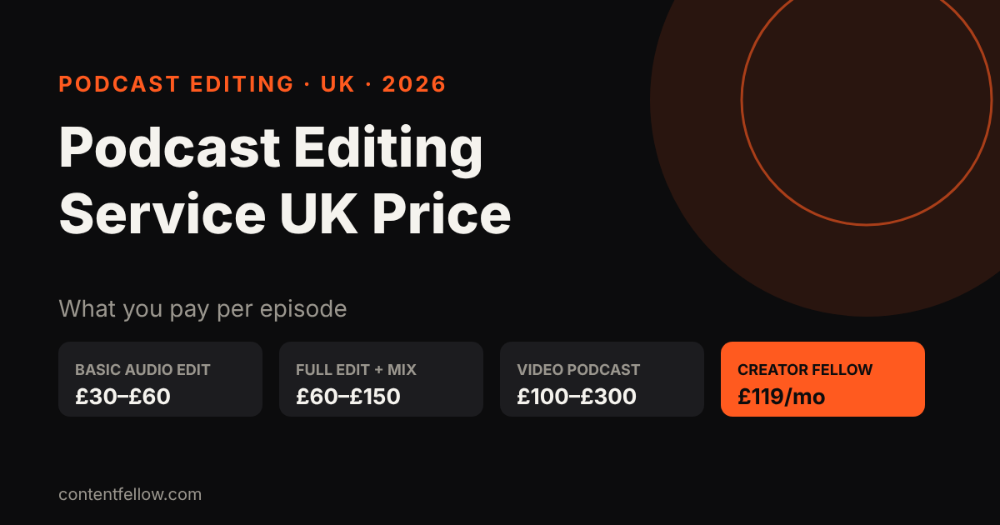
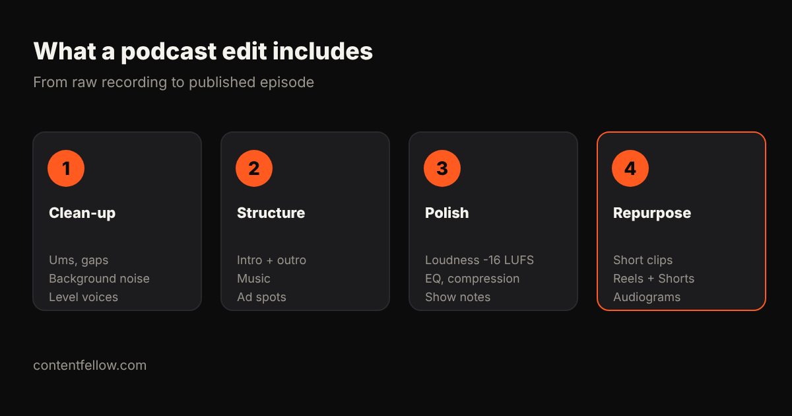

# Podcast Editing Service UK Price: What It Costs in 2026

## Podcast editing service UK price: how much per episode?

> **Quick answer:** A podcast editing service in the UK typically costs £30–£60 per episode for a basic audio clean-up and £60–£150 for a full edit with music, mixing and show notes, while video podcasts cost £100–£300 per episode. ContentFellow's Creator Fellow includes one podcast edit (up to 60 minutes) plus 8 short videos and 1 motion graphics video for £119 a month. *(Updated October 2026.)*

**TL;DR:** Price depends on episode length, audio or video, and how much polish you want. If you also need short clips to promote each episode, a bundle is usually better value than paying for each piece.

## UK podcast editing prices (2026)

| Service level | Typical UK price per episode | Includes |
|---|---|---|
| Basic audio edit | £30–£60 | Remove mistakes and long gaps, level voices |
| Full audio edit + mix | £60–£150 | Noise reduction, music, intro/outro, loudness, show notes |
| Video podcast edit | £100–£300 | Multi-camera cuts, captions, thumbnails |
| Agency production package | £300–£1,000+ | Recording, editing, publishing, promotion |
| Creator Fellow (ContentFellow) | £119 a month | 1 podcast edit up to 60 min + 8 short videos + 1 motion graphics video |

ContentFellow is not VAT registered, so the price shown is the price you pay.

## What a good podcast edit includes

1. **Clean-up**: ums, false starts, long pauses and background noise removed.
2. **Structure**: intro, outro, music beds and ad spots in place.
3. **Polish**: consistent loudness (around -16 LUFS for most platforms), EQ and compression.
4. **Repurpose**: short vertical clips for Reels, TikTok and YouTube Shorts to promote the episode.

## How to keep costs down

- Record each speaker on a separate track and use a decent USB microphone.
- Send a quick note of sections to cut.
- Batch episodes so the editor can keep a consistent sound.
- Get clips from the same edit rather than paying twice.

For more, see [video editing costs in the UK](/blog/video-editing-cost-uk/) and [who can edit your Reels every month](/blog/reels-tiktok-editing-monthly-uk/).

## Frequently asked questions

### How much does a podcast editing service cost in the UK?
Usually £30 to £60 per episode for a basic edit, £60 to £150 for a full edit and mix, and £100 to £300 for a video podcast.

### Is there a monthly podcast editing service in the UK?
Yes. ContentFellow's Creator Fellow is £119 a month and includes one podcast edit up to 60 minutes, 8 short videos and a motion graphics video.

### Do you edit video podcasts?
Yes. We can edit video podcasts and cut vertical clips for Reels, TikTok and Shorts.

### How long does a podcast edit take?
A typical episode is returned within a few working days of receiving the files.

### Can I try it first?
Yes. The Creator Fellow starts with 3 free videos, no card needed.

---

**[See all services and prices →](/services/)** · More quick answers on our [answers page](/answers/). Want a site you own? See [development packages](/services/development/) and [website care plans](/services/management/).

*Sources: ContentFellow plans and prices from contentfellow.com/pricing/ (October 2026); UK market ranges are typical quotes from UK freelancer marketplaces and agency price pages checked October 2026. Last updated 19 October 2026.*
