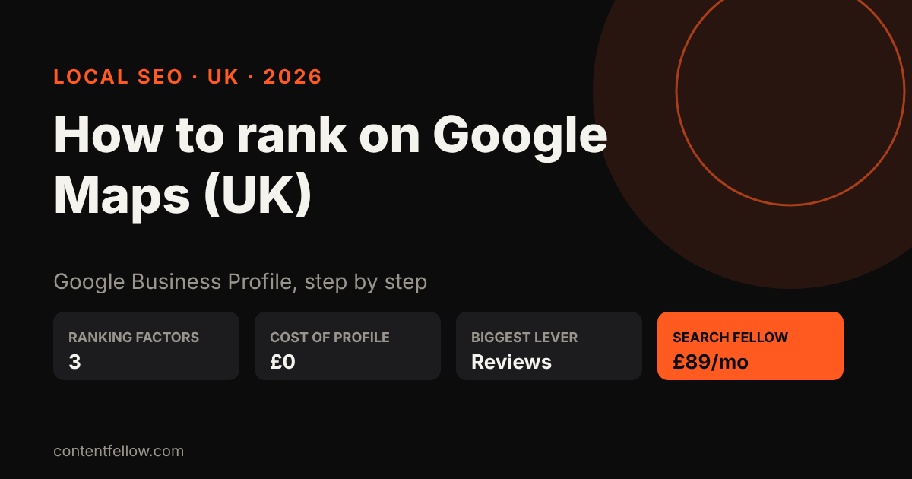
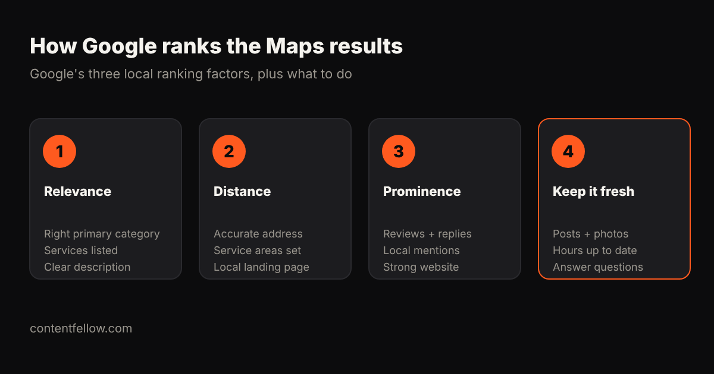

# How to Rank on Google Maps in the UK: Business Profile Optimisation Step by Step

## How to rank on Google Maps in the UK

> **Quick answer:** To rank on Google Maps in the UK, claim and verify your free Google Business Profile, choose the most accurate primary category, fill in every field (services, hours, service areas, photos), and keep earning and replying to Google reviews. Google says local results are ranked mainly on three things: relevance, distance and prominence, so you improve the parts you control and build trust over time. *(Updated October 2026.)*

**TL;DR:** You can't move your address closer to every customer, but you can make your profile the most relevant and most trusted one nearby. Category, completeness, reviews and a matching website do most of the work.

## What decides your Google Maps ranking?

Google's own help page, ["Tips to improve your local ranking on Google"](https://support.google.com/business/answer/7091), names three factors:

- **Relevance:** how well your profile matches what someone searched for.
- **Distance:** how far you are from the searcher or the place named in the search.
- **Prominence:** how well known and trusted your business is, including reviews, links and articles about you.

Google also says you can't pay to rank higher in the local results (ads are labelled separately).

## Google Business Profile optimisation: 9 UK steps

### 1. Claim and verify your profile
Go to [business.google.com](https://business.google.com) and verify. Unverified profiles rarely rank.

### 2. Pick the right primary category
This is the single strongest relevance signal. Choose the narrowest accurate one ("Plumber", not "Contractor"), then add a few secondary categories.

### 3. Use your real business name
Don't stuff keywords like "Best Plumber Burnley" into the name. It breaks Google's guidelines and can get the profile suspended.

### 4. Set address or service areas properly
Shop or office: show the address. Trades who visit customers: hide the address and list the towns you cover.

### 5. Fill in every field
Services with prices, opening hours, holiday hours, phone, website, booking link, attributes and a plain description saying what you do and where.

### 6. Add real photos every month
Outside, inside, team, finished work. Real photos help customers choose you; stock photos don't.

### 7. Get more Google reviews and reply to all of them
Review count, rating and recency all count towards prominence. Ask every happy customer with a short link. See our guide: [how to get more Google reviews](/blog/get-more-google-reviews-uk/).

### 8. Make your website match
Same name, address and phone (NAP) as the profile, a page for each main service and town, and LocalBusiness structured data. A slow or thin site holds the profile back.

### 9. Build local mentions
Listings on trusted UK directories (Yell, Thomson Local, your Chamber of Commerce) and coverage in local news all add prominence.

## How long does it take?

Fixes like the category and service areas can show results within weeks. Reviews and mentions build over months. Track calls, direction requests and website clicks in the profile's Performance tab.

## Want it done for you?

ContentFellow's Search Fellow (£89 a month) covers Google Business Profile optimisation, local SEO and GEO so ChatGPT and Gemini can recommend you, with a monthly report. See [Search Fellow](/services/) or read [how much SEO costs for a UK small business](/blog/affordable-seo-geo-services-uk/).

## Frequently asked questions

### How do I rank higher on Google Maps for free?
Verify your Google Business Profile, choose the right primary category, complete every field, add photos and collect and reply to reviews. None of it costs money.

### Can I pay Google to rank higher on Maps?
No. Google says you can't pay for a better local ranking. You can buy ads, which are labelled as sponsored.

### Do reviews help Google Maps ranking?
Yes. Google says review count and score are part of prominence, and replying shows you value customers.

### Should I put keywords in my business name?
No. Use your real name. Keyword stuffing breaks Google's guidelines and can lead to suspension.

### How long does Google Maps SEO take?
Profile fixes can help within weeks; reviews and local mentions build over a few months.

---

**[See all services and prices →](/services/)** · More quick answers on our [answers page](/answers/). Want a site you own? See [development packages](/services/development/) and [website care plans](/services/management/).

*Sources: ContentFellow plans and prices from contentfellow.com/pricing/ (October 2026); market ranges are typical quotes from UK freelancer marketplaces and agency price pages checked October 2026. Prices include everything: ContentFellow is not VAT registered. Last updated 19 October 2026.*
