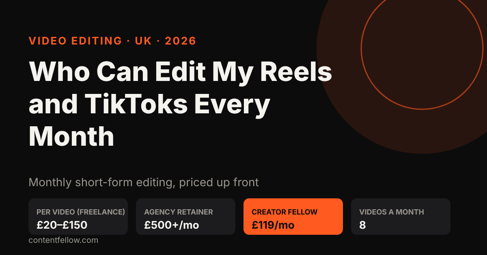
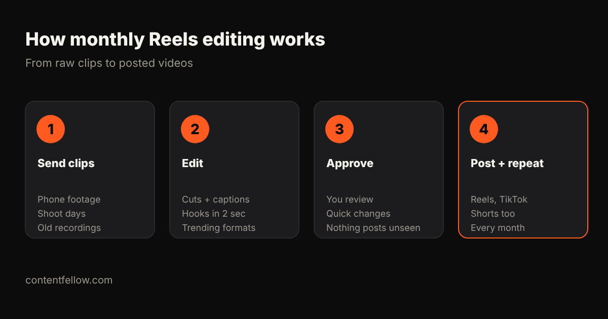

# Who Can Edit My Reels and TikToks Every Month? UK Prices and Options (2026)

## Who can edit my Reels and TikToks every month?

> **Quick answer:** A freelance video editor, a social media agency or a monthly editing subscription can edit your Reels and TikToks every month in the UK. Freelancers usually charge £20–£150 per short video, agencies £500 or more a month, and ContentFellow's Creator Fellow edits 8 short videos, 1 motion graphics video and 1 podcast (up to 60 minutes) for £119 a month. *(Updated October 2026.)*

**TL;DR:** If you post more than a few times a month, a fixed monthly plan beats paying per video. You send raw clips, the editor returns captioned, hook-first vertical videos, you approve them, and they go out on Instagram, TikTok and YouTube Shorts.

## Your three options in the UK

| Option | Typical UK price | Good for | Watch out for |
|---|---|---|---|
| Freelancer (Fiverr, Upwork, local) | £20–£150 per video | One-off batches | Turnaround and quality vary; you manage briefs |
| Social media agency | £500–£2,000+ a month | Editing plus posting and strategy | Long contracts, VAT on top |
| Editing subscription (Creator Fellow) | £119 a month | 8 videos a month, steady output | Set number of videos each month |

So **how much should you pay someone to edit TikToks?** For a simple captioned 15–60 second video, £20–£50 is the usual freelance range; with motion graphics, B-roll and sound design it is closer to £80–£150. On a monthly plan, 8 videos for £119 works out at under £15 a video, with a motion graphics video and a podcast edit included.

## What a good monthly editor does

1. **Hooks in the first 2 seconds.** Most viewers decide almost instantly whether to keep watching.
2. **Burned-in captions.** Many people watch with the sound off.
3. **Platform formats.** 9:16 vertical, safe zones for buttons, the right length for each platform.
4. **A consistent look.** Your fonts, colours and logo, so every video is recognisably yours.
5. **A calendar.** A steady number each week rather than a burst then silence.

## Where do the clips come from?

Phone footage is fine for most small businesses. If you want better raw material, our Studio Fellow (£149 a month) films an on-site shoot of up to 3 hours in 4K, which gives the editor a month of clips. To have them posted for you too, add the Social Fellow: Manage + Post (£129 a month). The Growth Fellow (£389 a month) bundles all five Fellows.

## What to ask before you hire an editor

- How many videos a month, how long, and how many rounds of changes?
- What turnaround do you promise?
- Do I own the edited files?
- Is VAT extra? (ContentFellow is not VAT registered, so its prices are the full amount.)
- Is there a minimum contract? (Ours is monthly.)

For the wider picture, see [video editing costs in the UK](/blog/video-editing-cost-uk/) and our [video editing subscription comparison](/blog/video-editing-subscription-comparison/).

## Frequently asked questions

### Who can edit my Reels and TikToks every month?
A freelance editor, a social media agency or an editing subscription. ContentFellow's Creator Fellow edits 8 short videos a month plus a motion graphics video and a podcast for £119.

### How much should I pay someone to edit TikToks?
Typically £20 to £50 per simple captioned TikTok from a UK freelancer, and £80 to £150 for heavier edits. Monthly plans bring the cost per video down.

### Can I try it before paying?
Yes. The Creator Fellow starts with 3 free videos, no card needed.

### Do you post the videos as well?
Editing is the Creator Fellow. Posting is the Social Fellow: Manage + Post at £129 a month, or get both in the Growth Fellow.

### Is there a long contract?
No. Plans are monthly and you can change or cancel from the next month.

---

**[See all services and prices →](/services/)** · More quick answers on our [answers page](/answers/). Want a site you own? See [development packages](/services/development/) and [website care plans](/services/management/).

*Sources: ContentFellow plans and prices from contentfellow.com/pricing/ (October 2026); UK market ranges are typical quotes from UK freelancer marketplaces and agency price pages checked October 2026. Last updated 19 October 2026.*
