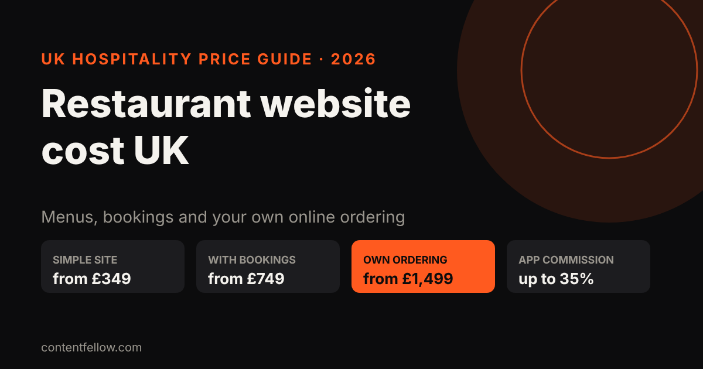
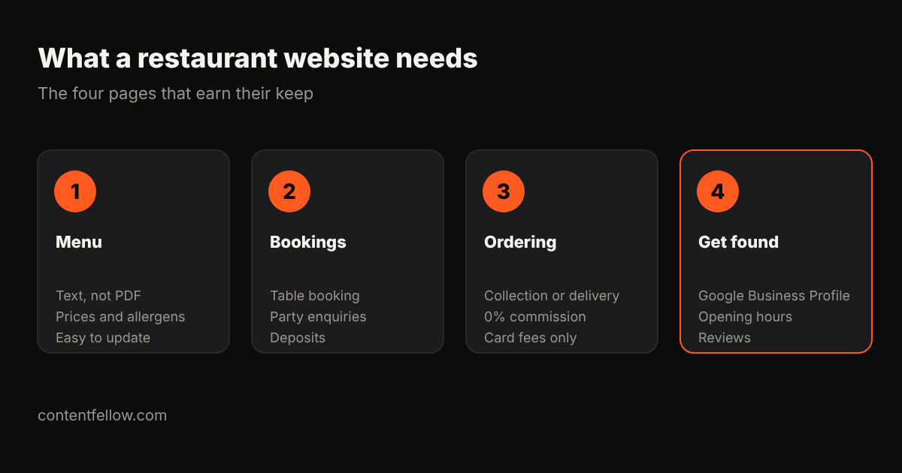

# Restaurant and Café Website Cost UK: What You'll Pay in 2026

> **Quick answer:** A UK restaurant or café website costs about **£349 to £750** for a simple site with menu and contact details, **£749 to £1,500** with table bookings, and **£1,499 to £3,000** with your own online ordering. Your own ordering costs only card fees per order, compared with **30–35%** commission on full-service delivery apps like Deliveroo. *(October 2026.)*

## How much does a restaurant website cost?

| What you need | Typical UK cost | ContentFellow |
|---|---|---|
| Simple site: menu, hours, map, contact | £349–£750 | Launch £349 |
| Site with table bookings and events | £749–£1,500 | Grow £749 |
| Own online ordering (collection/delivery) | £1,499–£3,000 | Shop £1,499 |
| Agency custom build | £3,000–£10,000 | — |
| Monthly care (hosting, menu updates) | £29–£100 a month | Care £49 |

## What delivery apps really cost you

| Channel | Commission per order |
|---|---|
| Deliveroo (full service) | 30–35% |
| Just Eat (you deliver) | about 14–16% plus card processing |
| Your own ordering website | 0% commission; card fees only |

**Example:** on a £15 order at 35%, the app takes £5.25. Moving even 50 orders a week to your own site saves about £260 a week at that rate, which covers a £1,499 ordering site within weeks. Many restaurants keep the apps for discovery and push regulars to order direct.

*Commission figures: Aexir and Jamezz UK delivery app guides (2026).*

## What should a restaurant website include?

1. **Menu as text, not a PDF:** readable on phones, indexed by Google, and easy to update. Include prices and allergen notes.
2. **Bookings:** table booking, party and event enquiries, deposits for big groups.
3. **Ordering:** collection or delivery with no commission.
4. **Get found:** Google Business Profile, correct opening hours and reviews, which also drive AI answers like "best café near me".

## ContentFellow restaurant websites

Launch £349 · Grow £749 (bookings) · Shop £1,499 (online ordering). Half to start, half at launch. Menu updates and hosting from [Care at £49 a month](/services/management/). [See development packages →](/services/development/)

Want food photos and Reels too? Our [Studio Fellow](/services/studio-fellow/) shoots on-site from £149 a month.

## Frequently asked questions

### How much does a restaurant website cost in the UK?
Usually £349 to £750 for a simple site, £749 to £1,500 with bookings, and £1,499 to £3,000 with your own online ordering.

### Is my own online ordering cheaper than Deliveroo?
Per order, yes: you pay card fees instead of a 30–35% commission. You still need to promote it to your customers.

### Should my menu be a PDF?
No. A text menu loads faster on phones, can be read by Google and AI assistants, and is easier to update.

### Can I take table bookings on my website?
Yes. A booking form or booking tool can handle tables, events and deposits for larger groups.

### How do I update my menu?
On a care plan we update it for you; otherwise use a simple editor on your website.

---

*Sources: Aexir, Jamezz, Aviko UK delivery commission guides (2026); ContentFellow package prices. Last updated 17 October 2026.*
