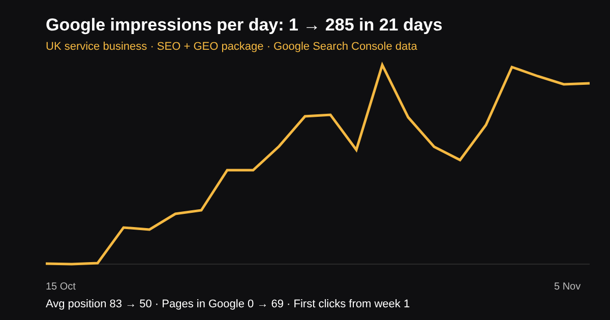

# SEO & GEO Case Study: 1 to 285 Daily Google Impressions in 21 Days

## What results can a small UK business get from SEO and GEO?

> **Quick answer:** In this real case study, a new UK service business went from 1 to 285 Google impressions a day in 21 days, moved its average position from 83 to 50, and got 69 pages into Google. All figures come from Google Search Console. The package used is our SEO & AI Search plan at £89 a month. *(Updated November 2026.)*

**TL;DR:** New site, no rankings. Clear service pages, local pages, FAQ schema, llms.txt for ChatGPT and daily indexing checks. Results showed in week one.

## The results (Google Search Console, 15 Oct to 5 Nov 2026)

| Metric | Start | After 21 days |
|---|---|---|
| Google impressions per day | 1 | 285 |
| Average Google position | 83 | 50 |
| Pages indexed by Google | 0 | 69 |
| Clicks from Google | 0 | First clicks in week 1, 6 on the best day |
| Local pages on page 2 | 0 | "Marketing agency [town]" at position 11–21 |

The business name is kept private. These are early-stage results: traffic and calls grow as positions move from page 2 to page 1.

## What we did

- Rewrote service pages so the first two lines answer the question with a price
- Built short local pages for each nearby town
- Added FAQ, Article and Breadcrumb schema to every page
- Published llms.txt so ChatGPT, Claude and Gemini can read the services
- Checked Google indexing every evening and fixed pages that were missing
- Added click-to-call, WhatsApp and email buttons, tracked in Google Analytics
- Linked related pages together so Google sees clear topic groups

## Packages

| Package | Price | Includes |
|---|---|---|
| SEO & AI Search | £89/month | SEO + GEO, monthly ranking and AI visibility report |
| Website Management | £69/month | Hosting, updates, speed and technical SEO |
| Full Marketing Team | £389/month | SEO, AI search, social media, video and website |

No contract, no VAT, free 7-day trial. See <a href="/blog/affordable-seo-geo-services-uk/">affordable SEO and GEO services</a> or <a href="/blog/marketing-agency-burnley/">our Burnley marketing agency guide</a>.

## Get the same for your business

Call or WhatsApp **07535 677302** or email **info@contentfellow.com**. We will check your site for free and tell you which pages can reach page 1.

## Frequently asked questions

### How fast does SEO work for a new UK business?
In this case, Google impressions started growing in the first week and reached 285 a day within 21 days. Page 1 rankings usually take 2–6 months.

### What is GEO?
GEO (generative engine optimisation) makes your business easier for ChatGPT, Claude, Gemini and Google AI Overviews to find and recommend.

### How much does SEO and GEO cost?
ContentFellow's SEO & AI Search plan is £89 a month with no contract, no VAT and a free 7-day trial.

### Are these real numbers?
Yes. Every figure comes from Google Search Console. The business name is kept private.

### How do I start?
Call or WhatsApp 07535 677302 or email info@contentfellow.com for a free site check.
