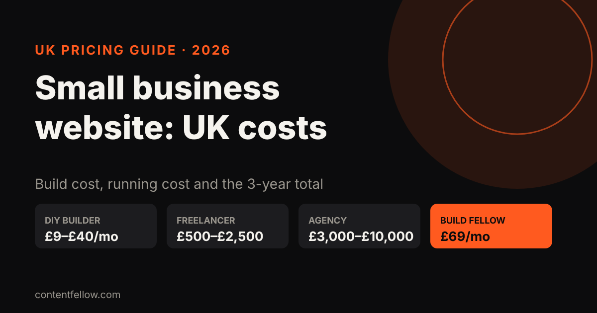
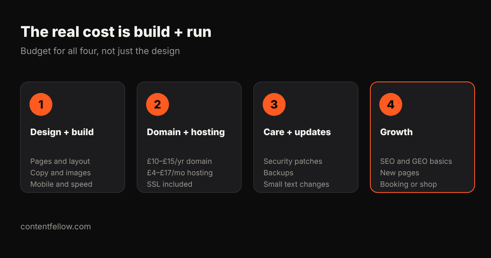

# How Much Does a Small Business Website Cost in the UK in 2026?

> **Quick answer:** A UK small business website costs anywhere from **£200 to £20,000** to build, plus **£5 to £150 a month** to keep running. A DIY site on Wix or Squarespace costs roughly £9–£40 a month, a freelancer typically charges £500–£2,500, and most agencies quote £3,000–£10,000 for a properly built small business site. Monthly website plans spread the cost instead: ContentFellow's Build Fellow is **£69 a month** including hosting and updates. *(Updated October 2026.)*

## UK website costs at a glance

| Option | Upfront cost | Monthly running cost | Best for |
|---|---|---|---|
| DIY builder (Wix, Squarespace) | £0 | £9–£40 | Sole traders with time and a simple offer |
| Freelancer | £500–£2,500 | £5–£50 (hosting, care) | A simple brochure site, if you choose well |
| Small agency | £3,000–£10,000 | £50–£150 (hosting, care) | Businesses wanting custom design and support |
| Ecommerce build | £2,000–£10,000+ | £30–£300 | Online shops |
| Monthly plan (Build Fellow) | £0 | £69 | Small businesses wanting a custom site without a big upfront bill |

Sources: Authentic Style puts UK websites at £200–£20,000, with most small businesses budgeting £3,000–£10,000. Hollis Web quotes £500–£2,500 for a basic UK site and £2,000–£8,000 for ecommerce. GoDaddy says most small businesses are fine on hosting at £3.99–£16.99 a month.

## The real cost is build plus run

The design quote is only part of the bill. Budget for all four:

1. **Design and build:** layout, pages, mobile version, speed, copy and images.
2. **Domain and hosting:** about £10–£15 a year for a .co.uk or .com domain, and £4–£17 a month for decent small business hosting with an SSL certificate.
3. **Care and updates:** security patches, backups, plugin updates and small text changes. Agencies typically charge from £50 a month for this.
4. **Growth:** new pages, a booking system, a shop, and the SEO and GEO work that gets you found.

## What does a website cost over three years?

Comparing upfront prices is misleading. Here's a rough three-year total for a five-page small business site:

| Option | Year 1 | Years 2–3 | 3-year total |
|---|---|---|---|
| DIY builder (~£20/mo plan) | £240 + your time | £480 | ~£720 + 30–60 hours of your time |
| Freelancer (£1,500 build + £20/mo) | £1,740 | £480 | ~£2,220, if they're still around |
| Agency (£4,000 build + £60/mo) | £4,720 | £1,440 | ~£6,160 |
| Build Fellow (£69/mo) | £828 | £1,656 | ~£2,484 |

Your own figures will differ, but the pattern holds: **a cheap build with no care plan often costs more later**, when something breaks or needs changing and nobody is on hand.

## What makes a website cost more?

- **Number of pages.** A five-page site (home, services, about, reviews, contact) is a very different job from 30 pages.
- **Custom design vs template.** Templates are cheaper; a custom design fits your brand and is easier to stand out with.
- **Copywriting.** If you write the words, it's cheaper. Good copy is often what makes a site actually win enquiries.
- **Features.** Booking, payments, a shop, member areas and integrations with your CRM all add cost.
- **SEO and GEO set-up.** Structured data, page speed, and service pages built for Google and AI search. Read our guide on [how to get your business recommended by ChatGPT](/blog/get-business-recommended-by-chatgpt-uk/) to see why this matters in 2026.

## DIY, freelancer, agency or monthly plan?

- **DIY** suits you if you have time, a simple offer and a good eye. The cost is your hours: a basic site often takes 30 to 60 of them.
- **A freelancer** can be great value. Check their recent work, who hosts the site, and what happens if they're unavailable.
- **An agency** makes sense for complex sites, ecommerce at scale, or when you need a team to own the project.
- **A monthly plan** suits small businesses that want a custom site, hosting, security and regular changes for one predictable fee.

## Questions to ask any website provider

- Who owns the domain, the design and the content?
- Where is it hosted, and who handles security and backups?
- How many changes a month are included, and what do extras cost?
- Will the site have structured data, fast mobile pages and a sitemap?
- Is there a minimum term? What happens to the site if I leave?

## How ContentFellow prices websites

The **[Build Fellow](/services/build-fellow/) is £69 a month**: a custom website of up to five pages, with hosting, security and updates included, plus two change requests every month. Billing is monthly, and you approve the site before it goes live.

To get found once it's built, add the [Search Fellow](/services/search-fellow/) (£89 a month) or take the full [Growth Fellow](/services/growth-fellow/) team for £389 a month. Our guide to [LLM optimisation costs](/blog/llm-optimisation-cost-small-business-uk/) explains what search work includes.

**[Pick your Build Fellow →](/services/build-fellow/)**

## Frequently asked questions

### How much does a basic website cost in the UK?
A basic five-page UK small business website typically costs £500 to £2,500 from a freelancer or £3,000 or more from an agency, plus £5 to £150 a month for hosting and care.

### How much does a website cost per month in the UK?
Running costs are usually £5 to £150 a month: hosting from about £4, a website builder plan from £9, and a maintenance plan from about £50. Monthly website plans like the Build Fellow cost £69 including everything.

### Is Wix or Squarespace cheaper than a web designer?
Upfront, yes: plans cost roughly £9 to £40 a month. But you do the work, and a basic site typically takes 30 to 60 hours to build well.

### How long does it take to build a small business website?
A simple five-page site usually takes two to six weeks, depending mostly on how quickly copy, photos and feedback are ready.

### Do I need to pay for website maintenance?
Someone has to update software, keep backups and fix security issues. You can do it yourself, but an unmaintained site is a common way small businesses get hacked or go offline.

### Does a new website help with Google and ChatGPT?
Only if it's built for search: fast pages, clear service pages with prices and locations, structured data and a sitemap. Ask for these in writing.
