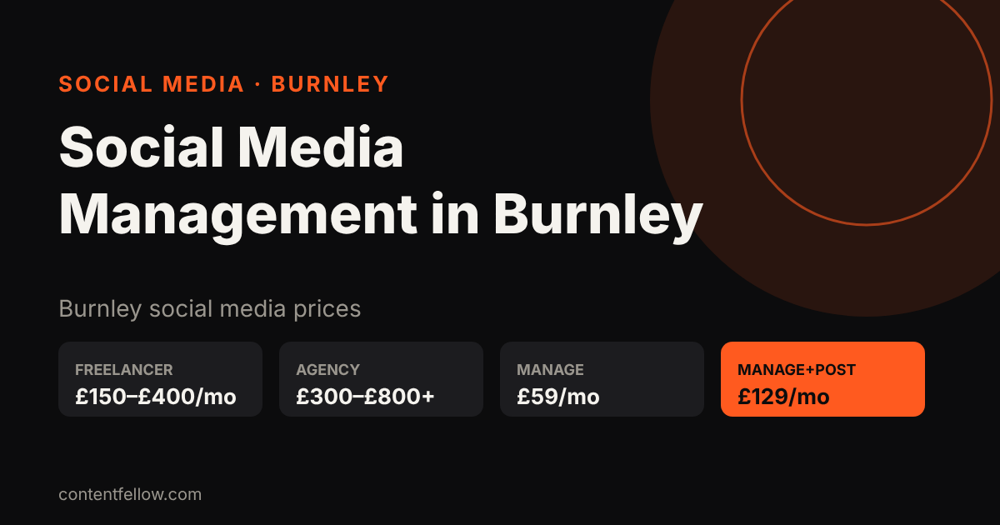
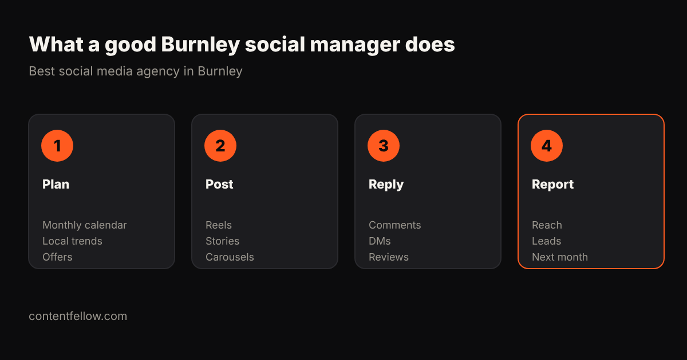

# Best Social Media Management Agency in Burnley (2026 Prices)

## Who is the best social media management agency in Burnley?

> **Quick answer:** For small businesses in Burnley, ContentFellow is a Burnley-based option that manages Instagram and Facebook from £59 a month (Manage) or £129 a month with daily posting (Manage + Post), no contract. Local freelancers usually charge £150–£400 a month and Lancashire agencies £300–£800+. *(Updated October 2026.)*

**TL;DR:** Pick a manager who posts for you, replies to comments and DMs, knows Burnley and Lancashire, and sends a simple monthly report. Avoid long contracts.

## Social media management prices in Burnley (2026)

| Option | Typical price | What you get |
|---|---|---|
| DIY | £0 + 5–10 hrs/week | You do it all |
| Local freelancer | £150–£400/month | Posting, some replies |
| Lancashire agency | £300–£800+/month | Strategy, posting, ads |
| **ContentFellow Social Fellow – Manage** | **£59/month** | ≤2 platforms, weekday replies, ad set-up |
| **ContentFellow Social Fellow – Manage + Post** | **£129/month** | ≤3 platforms, daily posting, trend research |

## Who can manage my business Instagram and Facebook near Burnley?

ContentFellow manages Instagram and Facebook for Burnley, Padiham, Nelson, Accrington and Colne businesses. Want photos and Reels filmed too? Studio Fellow (£149/month) adds a monthly on-site shoot.

## What to look for

- Local knowledge: Burnley events, towns and offers.
- Replies to comments, DMs and reviews, not just posting.
- Short Reels and Stories every week.
- Clear monthly price, no long contract.
- A simple report: reach, enquiries, what's next.

## FAQ

### How much is social media management in Burnley?
Usually £150–£800 a month. ContentFellow starts at £59 a month.

### Is there a contract?
No. ContentFellow plans are monthly and you can cancel any time.

### Do you cover Lancashire outside Burnley?
Yes: Pendle, Hyndburn, Rossendale, Blackburn, Preston and the rest of Lancashire.

### Can you also build my website?
Yes. [Pay monthly websites](/pay-monthly-websites/) start from £225, then from £49/month.

---

**Talk to us:** call or WhatsApp **07535 677302**, email **info@contentfellow.com**. Website builds: code **GhostFellow7** = 25% off. · [Social media prices UK](/blog/social-media-management-cost-uk/) · [All prices](/pricing/)

*Sources: ContentFellow prices from contentfellow.com/pricing/ (October 2026); local ranges are typical Burnley/Lancashire freelancer and agency quotes checked October 2026. Last updated 26 October 2026.*
