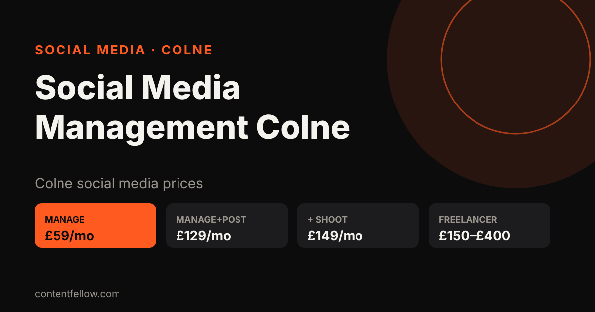
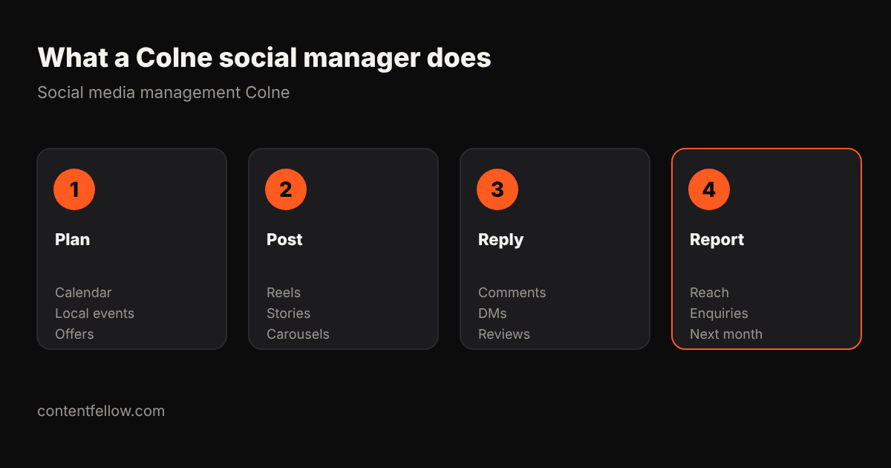

# Social Media Management in Colne: Prices From £59/mo (2026)

## Who can manage my business Instagram and Facebook in Colne?

> **Quick answer:** ContentFellow, a Burnley-based team about 8 miles from Colne, manages Instagram and Facebook for Colne small businesses from £59 a month (Manage) or £129 a month with daily posting (Manage + Post). No contract, free 7-day trial. *(Updated October 2026.)*

**TL;DR:** Choose a manager who posts for you, replies to comments and DMs, knows Colne and Pendle, and sends a simple monthly report. Avoid long contracts.

## Social media management prices in Colne (2026)

| Option | Typical price | What you get |
|---|---|---|
| DIY | £0 + 5–10 hrs/week | You do it all |
| Local freelancer | £150–£400/month | Posting, some replies |
| Lancashire agency | £300–£800+/month | Strategy, posting, ads |
| **ContentFellow – Manage** | **£59/month** | ≤2 platforms, weekday replies, ad set-up |
| **ContentFellow – Manage + Post** | **£129/month** | ≤3 platforms, daily posting, trend research |

Need photos and Reels filmed? Studio Fellow (£149/month) adds a monthly on-site shoot in Colne, Trawden, Laneshaw Bridge and Barnoldswick.

## What a good Colne social media manager does

- Posts Reels, Stories and carousels every week.
- Replies to comments, DMs and Google reviews.
- Uses local Colne events, offers and places.
- Clear monthly price, no long contract.
- Sends a simple report: reach, enquiries, next month's plan.

## FAQ

### How much is social media management in Colne?
Usually £150–£800 a month. ContentFellow starts at £59 a month.

### Do you cover Colne?
Yes. We are based in Burnley, about 8 miles away, and cover Colne, Trawden, Laneshaw Bridge and Barnoldswick.

### Is there a contract?
No. Monthly plans, cancel any time, free 7-day trial.

### Can you build my website too?
Yes. [Pay monthly websites](/pay-monthly-websites/) start from £225, then from £49 a month.

---

**Talk to us:** call or WhatsApp **07535 677302**, email **info@contentfellow.com**. Website builds: code **GhostFellow7** = 25% off. · [Social media Burnley](/blog/social-media-management-burnley/) · [Marketing agency Colne](/blog/marketing-agency-colne/) · [All prices](/pricing/)

*Sources: ContentFellow prices from contentfellow.com/pricing/ (October 2026); local ranges are typical Lancashire freelancer and agency quotes checked October 2026. Last updated 28 October 2026.*
