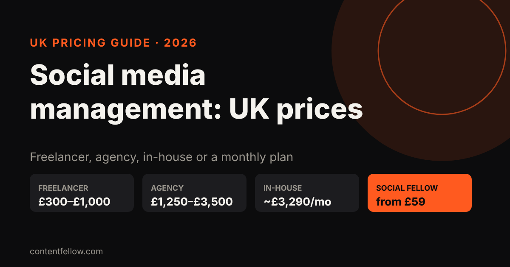
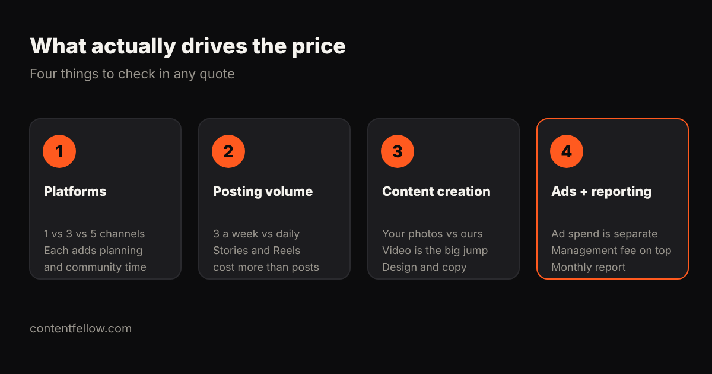

# How Much Does Social Media Management Cost in the UK? (2026 Prices)

> **Quick answer:** Most UK small businesses pay **£300 to £1,500 a month** for professional social media management, not counting ad spend. A freelancer typically charges £300–£1,000 a month, an agency £1,250–£3,500 per channel, and a full-time in-house social media manager costs about £3,290 a month once employer costs are added. Productised monthly plans start lower: ContentFellow's Social Fellow is **from £59 a month**. *(Updated October 2026.)*

## What does social media management actually include?

"Social media management" means different things to different people, which is why quotes vary so much. A full service usually covers:

- **Strategy:** which platforms, what to post, who you're talking to
- **Content:** writing captions, designing graphics, editing short videos
- **Scheduling and posting:** getting it out at the right times
- **Community management:** replying to comments and messages
- **Trend research:** spotting sounds, formats and topics before they peak
- **Reporting:** what worked, what didn't, what's next

Cheaper quotes often cover only scheduling and posting. Before comparing prices, ask exactly which of these six jobs is included.

## UK social media management prices in 2026

| Option | Typical monthly cost | What you usually get | Best for |
|---|---|---|---|
| Do it yourself | £0–£50 (tools) | Your own time, a scheduler like Buffer or Meta Business Suite | Very early businesses with spare hours |
| Freelancer | £300–£1,000 | 1–3 platforms, posting and some content | Businesses happy to brief and manage someone |
| Small agency | £500–£1,500 | Posting, content, light reporting | Businesses wanting a team without a big retainer |
| Agency (per channel) | £1,250–£3,500 | Strategy, content, community, reporting | Larger SMEs with paid ads |
| In-house hire | ~£3,290 | One person, full-time | Businesses posting a lot every day |
| Monthly plan (Social Fellow) | £59 or £129 | Up to 3 platforms, daily posting, trend research | Small businesses wanting consistency on a budget |

Sources: Birdeye's UK pricing guide puts most UK social media marketing at £500–£5,000 a month. Kraken's 2026 analysis puts single-channel agency retainers at £1,250–£3,500 (Whito data) and the average UK freelance social media day rate at £334 (YunoJuno).

## Why is an in-house social media manager so expensive?

The average UK social media manager salary is **£34,229** (Indeed, June 2026). Add employer National Insurance and pension and the real cost is around **£39,500 a year, or £3,290 a month**, before recruitment, software and training. You also get one person's skills: someone great at TikTok may be weaker at LinkedIn or design.

For most businesses with under 20 staff, that's more than social media will return. An outside service gives you a team's skills for a fraction of the cost.

## What drives the price up or down?

1. **Number of platforms.** Each extra channel adds planning, formatting and community time. Three platforms done well beats six done badly.
2. **Posting volume.** Three posts a week is a different job from daily posting with Stories and Reels.
3. **Who creates the content.** If you supply photos and videos, management is cheaper. If the manager has to shoot or edit video, the price jumps. That's why many businesses pair management with a separate [video editing](/blog/video-editing-cost-uk/) or [video production](/blog/video-production-cost-uk/) service.
4. **Paid ads.** Ad spend goes to Meta or TikTok, not the manager. Managers usually charge a separate fee to run ads, either flat or 10–20% of spend.

## How much should a UK small business budget?

- **Sole trader or new business:** £0–£150 a month. Post yourself with a scheduler, or use a low-cost managed plan so it actually happens every week.
- **Local service business (cafés, salons, trades, clinics):** £150–£500 a month. Customers check your feed before they book, so it needs to look active and current.
- **Growing business with a sales team or online shop:** £500–£1,500 a month, often with a small ad budget on top.

Keep social media in proportion. It builds trust and keeps you front of mind, but for many local businesses Google and AI search bring more new customers. Our guide to [GEO vs SEO](/blog/geo-vs-seo-uk-small-business/) explains how those work.

## Questions to ask before you sign

- Which platforms, and how many posts, Stories and Reels per week?
- Who creates the images and videos, and how many rounds of changes do I get?
- Do you reply to comments and messages? Within what time?
- Do I own the accounts and all the content if we stop?
- Is there a minimum contract, and what's the notice period?
- What does the monthly report show?

A good provider answers all six in writing.

## How ContentFellow prices social media

The **[Social Fellow](https://contentfellow.com/#fellows)** has two levels: **Manage at £59 a month** and **Manage + Post at £129 a month**. Both cover up to three platforms, with daily posting and trend research. You approve content before it goes live, billing is monthly, and you can add, remove or upgrade Fellows from the next month.

Need video too? The [Growth Fellow](https://contentfellow.com/#growth) bundles social, shoots, editing, website and search for £389 a month. See our breakdown of [outsourced marketing vs agency vs in-house costs](/blog/outsourced-marketing-team-cost-uk/).

**[Pick your Social Fellow →](https://contentfellow.com/#fellows)**

## Frequently asked questions

### How much does social media management cost per month in the UK?
Most UK small businesses pay £300 to £1,500 a month, excluding ad spend. Freelancers charge £300–£1,000, agencies £1,250–£3,500 per channel, and monthly plans like the Social Fellow start from £59.

### Is £300 a month enough for social media management?
Yes, for one to three platforms with regular posting and content you partly supply. It usually won't cover heavy video production, paid ads management or daily community replies.

### How much does a freelance social media manager charge in the UK?
The average UK freelance social media day rate is about £334, or around £42 an hour. Monthly retainers for small businesses usually fall between £300 and £1,000.

### Does social media management include paid ads?
Not usually. Ad spend is paid to the platform, and managing ads is often a separate fee. Always ask whether ads are included before comparing quotes.

### How many platforms should a small business be on?
Two or three, chosen by where your customers spend time. Facebook and Instagram suit most local businesses, LinkedIn suits B2B, and TikTok suits younger audiences.

### Can I cancel a social media management contract?
It depends on the provider. Many agencies ask for 3 to 12 months. ContentFellow bills monthly and you can change or remove your Fellow from the next month.
