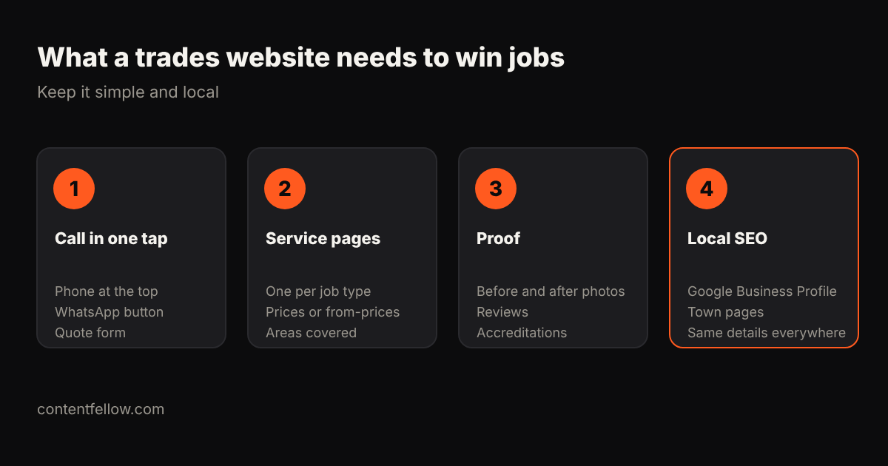

# Tradesperson Website Cost UK: Plumbers, Electricians and Builders (2026)

> **Quick answer:** A website for a UK plumber, electrician, builder or other tradesperson costs about **£349 to £750** for a simple, effective site, **£749 to £3,000** with quote forms, reviews and town pages, or around **£69 a month** on a website subscription. Agencies charge **£3,000 to £10,000**, which most sole traders don't need. *(October 2026.)*

## How much does a trades website cost?

| Option | Typical UK cost | Good for |
|---|---|---|
| DIY builder | £10–£30 a month + your time | Getting something online fast |
| Budget package | £399–£1,249 one-off | Basic brochure site |
| ContentFellow Launch | £349 one-off | Up to 7 pages: services, areas, contact |
| ContentFellow Grow | £749 one-off | Quote form, reviews, blog, SEO setup |
| Build Fellow subscription | £69 a month | No upfront cost, changes included |
| Agency | £3,000–£10,000 | Larger firms with multiple teams |

UK reference prices: Cheap Web Design from £399+VAT, Juggernaut Tech £499–£1,249, freelancers typically £500–£3,000.

## What should a trades website include?

1. **Call in one tap:** phone number at the top of every page, a WhatsApp button and a short quote form.
2. **A page for each service:** boiler repair, rewiring, extensions. Show prices or "from" prices and the areas you cover.
3. **Proof:** before and after photos, reviews, Gas Safe/NICEIC/TrustMark details if you have them.
4. **Local SEO:** a Google Business Profile, a page for each main town you work in, and the same name, number and address everywhere.

## What not to pay for

- A big custom design. Customers want to call you, not admire animations.
- Expensive "SEO packages" before your Google Business Profile and reviews are sorted.
- Lead-generation sites that charge per lead if your own site can bring calls direct.

## ContentFellow websites for trades

**Launch £349** or **Grow £749** one-off, or the **[Build Fellow at £69 a month](/services/build-fellow/)** with hosting and changes included. Keep it secure with [Care from £49 a month](/services/management/). [See development packages →](/services/development/)

## Frequently asked questions

### How much does a plumber's website cost in the UK?
Most plumbers need a simple site costing £349 to £750, or a monthly plan around £69. Agency builds of £3,000 or more are rarely necessary.

### What should an electrician's website include?
One-tap call, a page per service, areas covered, reviews, accreditations like NICEIC, and a quote form.

### Do tradespeople need SEO?
Local SEO, yes: Google Business Profile, reviews and town pages bring most calls. Start there before paying for wider SEO.

### Is a Facebook page enough instead of a website?
It helps, but a website ranks on Google, appears in AI answers and looks more trustworthy for bigger jobs.

### How long does a trades website take to build?
About 1 to 2 weeks for a simple site once you've sent photos, services and areas covered.

---

*Sources: Cheap Web Design, Juggernaut Tech, WebPulse Lab (2026); ContentFellow package prices. Last updated 17 October 2026.*
