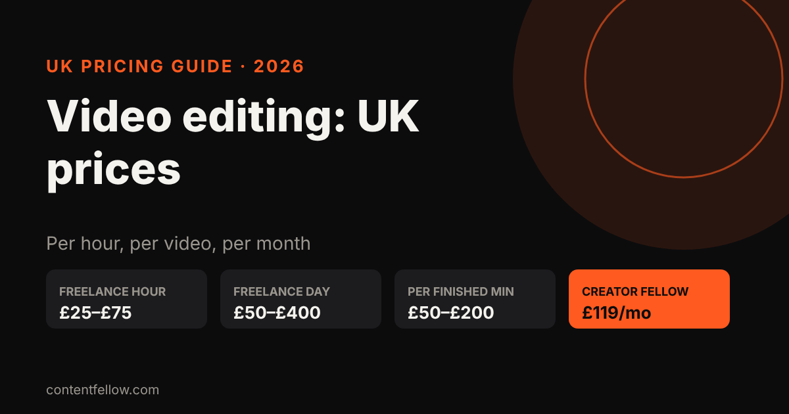
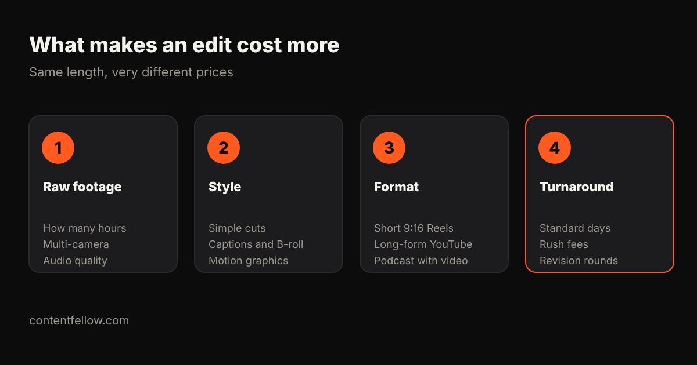

# How Much Does Video Editing Cost in the UK? Reels, YouTube and Podcasts (2026)

> **Quick answer:** UK freelance video editors typically charge **£25 to £75 an hour**, **£50 to £400 a day**, or **£50 to £200 per finished minute**. A short Reel or TikTok usually costs £30–£150 to edit, a 10-minute YouTube video £150–£600, and a one-hour podcast £75–£300. If you need videos every week, a monthly plan is often cheaper: ContentFellow's Creator Fellow is **£119 a month** for 8 short videos, a motion graphics video and a podcast edit. *(Updated October 2026.)*

## UK video editing rates in 2026

| Pricing model | Typical UK rate | When it's used |
|---|---|---|
| Per hour | £25–£75 | Small or unpredictable jobs |
| Per day | £50–£400 | Larger projects, agency freelancers |
| Per finished minute | £50–£200 | Corporate and explainer videos |
| Per project | £100–£2,000+ | One-off films, ads, YouTube series |
| Monthly plan | from about £100 | Regular Reels, Shorts and podcasts |

Sources: Wise's UK guide puts freelance video editors at £50 to around £400 a day. John Isaacson's UK pricing guide lists £25–£75 an hour, £50–£200 per finished minute and £100–£2,000+ per project.

## Prices by format

| Format | Typical UK freelance price | What affects it |
|---|---|---|
| Short Reel / TikTok / Short (15–60s) | £30–£150 each | Captions, B-roll, hooks, trend edits |
| YouTube video (8–15 min) | £150–£600 each | Raw footage length, graphics, pacing |
| Podcast (60 min, audio + video) | £75–£300 each | Number of cameras, audio clean-up, clips |
| Motion graphics / animated explainer | £300–£2,000+ | Length, custom illustration, voice-over |
| Corporate or promo film (2–3 min) | £300–£1,500 | Interviews, colour grading, music licences |

These ranges are drawn from the hourly and per-minute rates above. Beginners charge less and specialist motion designers charge more.

## What makes an edit cost more?

1. **Raw footage.** An editor has to watch everything you send. Three hours of footage for a 60-second Reel takes longer than 10 minutes of footage.
2. **Style.** Simple cuts are quick. Animated captions, B-roll, sound design and motion graphics add hours.
3. **Format.** Vertical short-form needs strong hooks and fast pacing; long-form needs structure; podcasts need multi-camera switching and audio clean-up.
4. **Turnaround and revisions.** Rush jobs cost extra, and every extra round of changes is more time.

The cheapest way to cut editing costs is **better footage**: good sound, steady shots and less of it. If you're not filming yet, see our guide to [video production costs in the UK](/blog/video-production-cost-uk/).

## Freelancer, agency or monthly plan?

- **Freelancer:** best for one-off projects, or if you find a reliable editor who understands your brand. Watch for availability, briefing time and inconsistent turnaround.
- **Agency:** best for ads and polished campaigns, with higher prices to match.
- **Monthly plan:** best when you need a steady flow (weekly Reels, a monthly podcast) at a fixed price.

### The monthly maths

Eight Reels a month at a typical £50 freelance rate is £400, before a podcast edit or any motion graphics. A monthly plan that covers all three at a flat fee is usually cheaper and saves you rebriefing someone each time.

## Questions to ask a video editor

- How many revision rounds are included?
- What's the turnaround for each format?
- Will you add captions, and are they burned in or separate files?
- Is music licensed for commercial use on social media?
- Do I get the project files, or only the finished videos?
- Can you work from my brand fonts, colours and templates?

## How ContentFellow prices video editing

The **[Creator Fellow](/services/creator-fellow/) is £119 a month**: 8 short videos for Reels, TikTok or Shorts, one motion graphics video, and one podcast edit of up to 60 minutes. Each video includes two rounds of revisions, and you approve everything before it's posted.

Pair it with the [Studio Fellow](/services/studio-fellow/) for monthly shoots and the [Social Fellow](/services/social-fellow/) for posting, or take all five Fellows in the [Growth Fellow](/services/growth-fellow/) for £389 a month. Also see [what social media management costs in the UK](/blog/social-media-management-cost-uk/).

**[Pick your Creator Fellow →](/services/creator-fellow/)**

## Frequently asked questions

### How much does a video editor cost per hour in the UK?
UK freelance video editors typically charge £25 to £75 an hour. Beginners sit at the lower end, while experienced editors and motion designers charge more.

### How much does it cost to edit a Reel or TikTok?
Usually £30 to £150 per video from a UK freelancer, depending on captions, B-roll and how much raw footage there is. Monthly plans bring the per-video price down.

### How much does podcast editing cost in the UK?
A one-hour podcast typically costs £75 to £300 to edit, more if it's filmed with several cameras or needs short clips cut for social media.

### How long does it take to edit a video?
A simple Reel can take one to two hours; a 10-minute YouTube video often takes a full day. Turnaround depends on the editor's workload and revision rounds.

### Is it cheaper to edit videos myself?
Apps like CapCut make basic edits easy and free. The cost is time: most business owners find a few hours a week of editing isn't the best use of it.

### Should I pay per video or monthly?
Pay per video for occasional one-offs. If you post every week, a monthly plan usually costs less and gives you consistent quality and turnaround.
