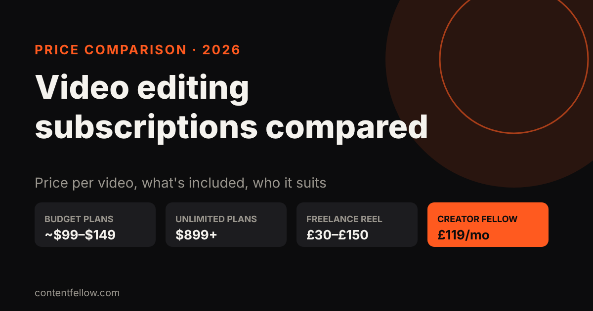
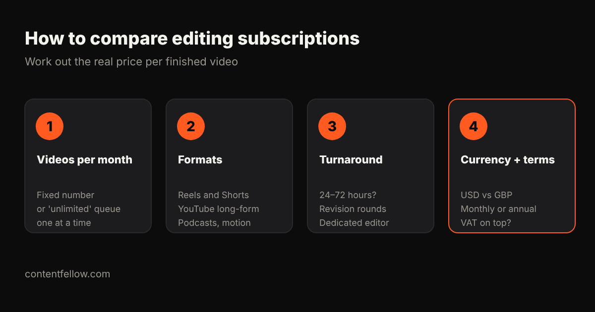

# Video Editing Subscriptions Compared: Best Value for Small Businesses (2026)

> **Quick answer:** Video editing subscriptions range from about **$99–$149 a month** for a small number of short videos to **$899–$1,700+ a month** for "unlimited" plans with a dedicated editor. For a small business posting a few Reels a week, a fixed-number plan is usually the best value. In the UK, ContentFellow's Creator Fellow is **£119 a month** for 8 short videos, a motion graphics video and a podcast edit. *(Prices as published by each provider on 16 October 2026; most are in US dollars. Check their sites for current offers.)*

**Transparency note:** ContentFellow wrote this comparison and our Creator Fellow is included. We've only listed prices providers publish themselves.

## Published video editing subscription prices

| Provider | Published price | What's included (as published) | Price per short video |
|---|---|---|---|
| ContentFellow Creator Fellow | £119 a month | 8 short videos, 1 motion graphics video, 1 podcast edit (≤60 min), 2 revision rounds each | under £15 (before the extras) |
| VidChops | From $99 a month | Editing, you approve | depends on plan |
| Feedbird | $149 a month for 5 videos (up to $549 for 25) | Short-form editing, captions, posting included | about $22–$30 |
| Video Husky | $549–$1,590 a month | Subscriptions or credit bundles | depends on plan |
| beCreatives | $899 a month ($809 quarterly) | Unlimited requests, dedicated team | depends on volume |
| Flocksy | $1,199–$3,799 a month | Unlimited editing, flat rate | depends on volume |
| Freelance UK editor | £30–£150 per Reel | Per-video pricing | £30–£150 |

For UK hourly and per-minute rates, see [how much video editing costs in the UK](/blog/video-editing-cost-uk/).

## How to compare editing subscriptions

1. **Videos per month.** "Unlimited" usually means one request at a time in a queue. A fixed number is easier to plan around.
2. **Formats.** Check Reels and Shorts, YouTube long-form, podcasts and motion graphics are all covered, not just one.
3. **Turnaround and revisions.** 24–72 hours is common; check how many revision rounds are included.
4. **Currency and terms.** Many services bill in US dollars, so UK prices move with the exchange rate. Check for VAT, annual discounts and cancellation terms.

## Which plan fits?

| Your situation | Best value |
|---|---|
| 1–2 Reels a week | Fixed plan with 5–10 videos a month |
| Short-form plus a podcast or YouTube | A plan that covers several formats |
| Daily video across many brands | Unlimited subscription with a dedicated editor |
| Occasional one-off videos | Freelancer per video |

## How the Creator Fellow compares

The **[Creator Fellow](/services/creator-fellow/) is £119 a month** in pounds, with no exchange-rate surprises: 8 short videos for Reels, TikTok or Shorts, one motion graphics video and one podcast edit of up to 60 minutes, each with two rounds of revisions. Billing is monthly, and you can **try it with 3 free videos** from your own footage (you keep them either way). Need footage filmed too? Pair it with the [Studio Fellow](/services/studio-fellow/).

**[Get your 3 free videos →](/services/creator-fellow/)**

## Frequently asked questions

### How much does a video editing subscription cost?
From about $99–$149 a month for a few short videos to $899–$1,700 or more for unlimited plans. UK-based plans like the Creator Fellow cost £119 a month.

### Is unlimited video editing worth it for a small business?
Usually not. Unlimited plans suit teams publishing daily; most small businesses get better value from a fixed number of videos.

### What's the cheapest way to get Reels edited?
A fixed-number subscription usually works out at £15–£30 per video, cheaper than most freelancers at £30–£150 per Reel.

### Do editing subscriptions include posting?
Some do, most don't. Feedbird includes posting; ContentFellow posting is part of the Social Fellow.

### Can I try a video editing service for free?
Some offer trials. The ContentFellow Creator Fellow edits 3 short videos free from your footage, and you keep them.
