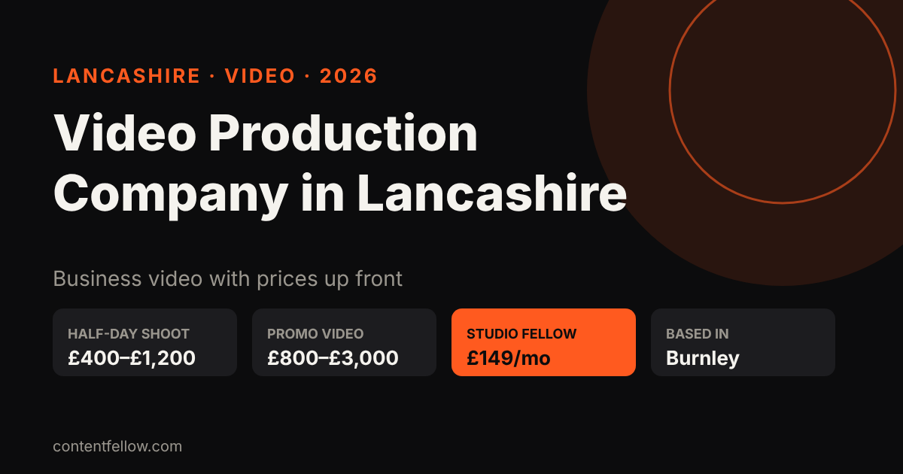
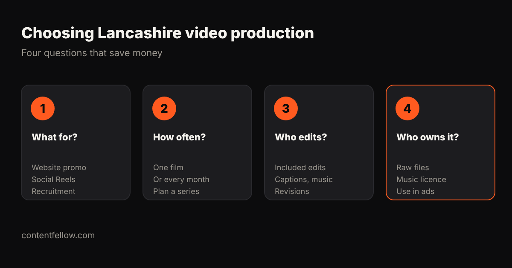

# Video Production Company in Lancashire: Prices and What to Expect (2026)

## Video production company in Lancashire: what does it cost?

> **Quick answer:** A video production company in Lancashire typically charges £400–£1,200 for a half-day shoot and £800–£3,000 for a finished promo or corporate video, with multi-camera and drone work costing more. ContentFellow, based in Burnley, offers a monthly alternative: the Studio Fellow includes one on-site shoot of up to 3 hours with photo and 4K video for £149 a month. *(Updated October 2026.)*

**TL;DR:** For a single flagship film, book a production company by the project. For a steady supply of social video and photos, a monthly shoot plus editing is usually far cheaper.

## Typical Lancashire video prices (2026)

| Job | Typical price | Notes |
|---|---|---|
| Half-day shoot (up to 4h), one camera | £400–£1,200 | Editing often extra |
| 60–90 second promo video | £800–£3,000 | Script, shoot, edit, music |
| Corporate or recruitment film | £1,500–£5,000+ | Interviews, multiple locations |
| Event filming | £500–£1,500 a day | Highlights edit extra |
| Monthly shoot (Studio Fellow) | £149 a month | Up to 3h on-site, photo + 4K video, 20 edited photos |

ContentFellow is not VAT registered, so £149 is the full price. See the UK-wide picture in [video production costs](/blog/video-production-cost-uk/) and local detail in [Burnley videographer prices](/blog/videographer-burnley-lancashire-prices/).

## Which areas of Lancashire do we cover?

Shoots are on-site across Burnley and about 20 miles around it: Padiham, Nelson, Colne and Pendle, Accrington, Blackburn, Clitheroe and Rossendale. Editing, social media and websites are done remotely anywhere in the UK. See our [Burnley page](/burnley/).

## How to choose a Lancashire video production company

1. **What is the video for?** A website promo, Reels or a recruitment film need different approaches.
2. **One film or every month?** Regular content usually beats one expensive film for small businesses.
3. **Who edits, and how many revisions?** Ask about captions, music and vertical versions.
4. **Who owns the footage?** Make sure you can use it on your site, social and ads.

## Turning footage into results

Pair the shoot with the **Creator Fellow (£119/mo)** for 8 edited short videos, or the **Growth Fellow (£389/mo)** for shoots, editing, social, website and SEO in one plan.

## Frequently asked questions

### How much does a video production company in Lancashire charge?
Typically £400 to £1,200 for a half-day shoot and £800 to £3,000 for a finished promo video. ContentFellow's Studio Fellow is £149 a month for a monthly shoot.

### Is there a video production company in Burnley?
Yes. ContentFellow is based in Burnley and films on-site across Burnley, Pendle, Accrington, Blackburn and East Lancashire.

### Do you film in Preston or Manchester?
Our regular on-site area is about 20 miles around Burnley. Ask for further locations; editing and other services work UK-wide.

### Can I get vertical videos for Reels and TikTok?
Yes. Every shoot is planned for both website video and vertical social clips.

### Can I try it first?
Yes. The Studio Fellow starts with a free mini shoot.

---

**[See all services and prices →](/services/)** · More quick answers on our [answers page](/answers/). Want a site you own? See [development packages](/services/development/) and [website care plans](/services/management/).

*Sources: ContentFellow plans and prices from contentfellow.com/pricing/ (October 2026); UK market ranges are typical quotes from UK freelancer marketplaces and agency price pages checked October 2026. Last updated 19 October 2026.*
