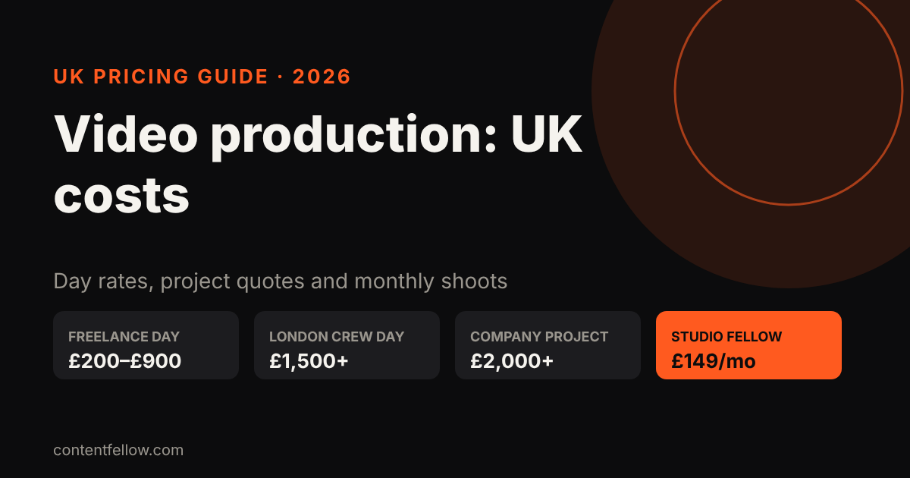
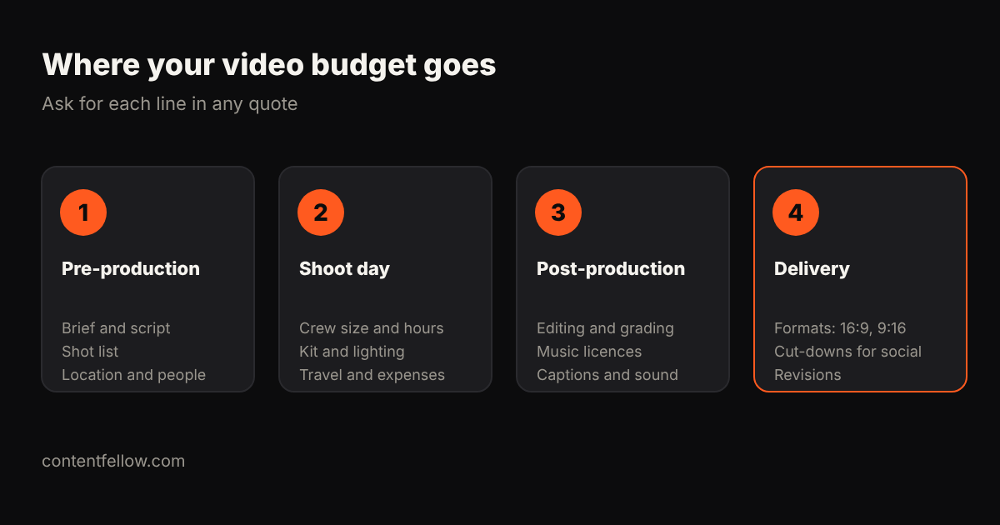

# How Much Does Video Production Cost for UK Small Businesses? (2026)

> **Quick answer:** A UK freelance videographer typically charges **£200 to £900 a day**, depending on experience and location, plus editing. A London crew day can cost £1,500–£2,500, and production companies usually quote **£2,000 or more per project**. For regular content rather than one big film, monthly shoots are often better value: ContentFellow's Studio Fellow is **£149 a month** for one on-site shoot with photo and 4K video. *(Updated October 2026.)*

## UK video production prices in 2026

| Option | Typical cost | What you usually get | Best for |
|---|---|---|---|
| Phone + DIY | £0–£300 (kit) | Your own footage, your own time | Quick behind-the-scenes clips |
| Freelance videographer | £200–£900 a day | One person shooting; editing often extra | One-off promos, events, testimonials |
| London crew day | £1,500–£2,500 | Camera operator, sound, lighting | Polished brand films |
| Production company | £2,000–£20,000+ per project | Script, crew, edit, music, revisions | Adverts and flagship brand films |
| Monthly shoots (Studio Fellow) | £149 a month | One on-site shoot up to 3 hours, photo + 4K video | Steady content for social, website and ads |

Sources: Creative Clan puts a solo London videographer at £400–£900 a day. UK videographers on Reddit and Facebook groups report day rates from £200 outside London to £450 plus expenses as a common mid-level rate, and £1,500–£2,500 for London client shoot days.

## Where your video budget goes

Every video quote, from a freelancer or a production company, is made of four parts. Ask for each as a separate line:

1. **Pre-production:** the brief, script or outline, shot list, locations, and who appears on camera.
2. **Shoot day:** crew size, hours, camera and lighting kit, travel and expenses.
3. **Post-production:** editing, colour grading, sound, music licences and captions.
4. **Delivery:** formats (16:9 for YouTube and your website, 9:16 for Reels and TikTok), cut-downs for social, and rounds of revisions.

The biggest hidden cost is usually post-production. A day of shooting can easily need two days of editing. If a quote seems cheap, check whether editing is included at all. Our guide to [video editing costs in the UK](/blog/video-editing-cost-uk/) has the numbers.

## What makes a shoot cost more?

- **Crew size.** A solo shooter is cheapest. Adding sound, lighting and a director multiplies the day rate.
- **Location.** London rates run higher, and travel and parking add up.
- **Scripted vs documentary.** Scripted adverts with actors need far more planning than filming your team at work.
- **Licensing.** Commercial music, stock footage and actors' usage rights can cost more than the shoot.
- **Volume of outputs.** One three-minute film is a different job from twenty short clips for social media.

## What does a small business actually need?

Most small businesses don't need a cinematic brand film. They need a steady supply of good, honest content:

- Short clips of you and your team at work
- Customer testimonials
- Product or service close-ups
- Professional photos for the website, Google Business Profile and social

That's why **regular short shoots usually beat one expensive production day**. Fresh content each month keeps your social feeds active, gives AI search engines and Google something current to find, and costs less over a year.

## Example yearly budgets

| Approach | Example | Rough yearly cost |
|---|---|---|
| One freelance day a quarter | 4 × (£450 shoot + £450 edit) | ~£3,600 |
| One production company film | 1 brand film | £2,000–£10,000 |
| Monthly shoots | 12 × £149 Studio Fellow | £1,788 |

## Questions to ask before you book

- Is editing included, and how many finished videos and photos do I get?
- Which formats are delivered (landscape, vertical, square)?
- How many rounds of revisions are included?
- Is music licensed for commercial and social use?
- Who owns the footage, and can I use it in paid ads?
- Are travel and expenses included?

## How ContentFellow prices video production

The **[Studio Fellow](https://contentfellow.com/#fellows) is £149 a month**: one on-site shoot each month of up to three hours, covering photo and 4K video, with 20 edited photos delivered within five working days. We're based in Burnley, Lancashire. You approve everything before it's used, and each video includes two rounds of revisions.

Want the footage turned into Reels and Shorts? Add the [Creator Fellow](https://contentfellow.com/#fellows), or take the full [Growth Fellow](https://contentfellow.com/#growth) team (shoots, editing, social, website and search) for £389 a month.

**[Pick your Studio Fellow →](https://contentfellow.com/#fellows)**

## Frequently asked questions

### How much does a videographer cost per day in the UK?
UK freelance videographers usually charge £200 to £900 a day. Mid-level rates of around £450 plus expenses are common outside London, and London crew days often cost £1,500 or more.

### How much does a 1-minute promotional video cost in the UK?
A simple one-minute promo from a freelancer typically costs £500 to £1,500 including a shoot and edit. A scripted advert from a production company usually costs several thousand pounds.

### Is it cheaper to film videos on a phone?
Yes, and modern phones film well. The cost is your time, plus the gap in lighting, sound and editing quality. Many businesses mix phone clips with regular professional shoots.

### How often should a small business film new content?
Monthly works well for most. It keeps social media, your website and your Google Business Profile current without overloading your team.

### Do I own the videos and photos?
It depends on the contract. Always check that you can use the footage on your website, social media and paid ads without extra fees.

### Does video help with SEO?
Indirectly. Video keeps visitors on your pages and gives Google and AI search fresh, specific content, especially when paired with clear service pages.
