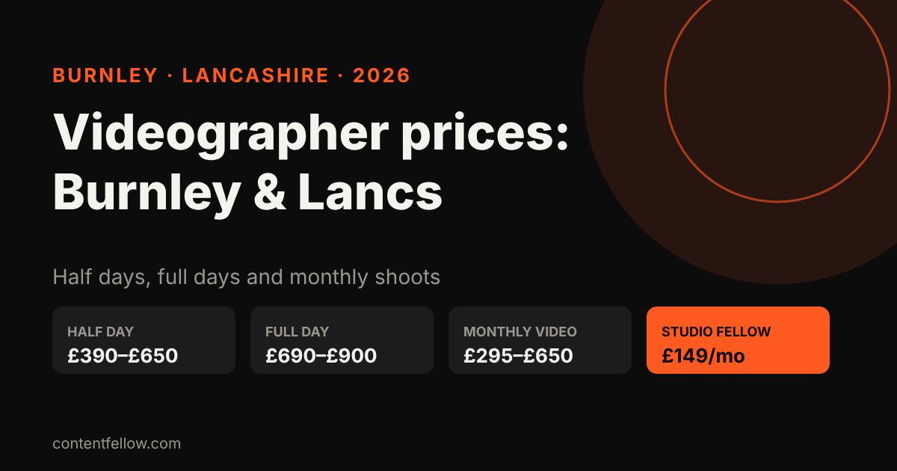
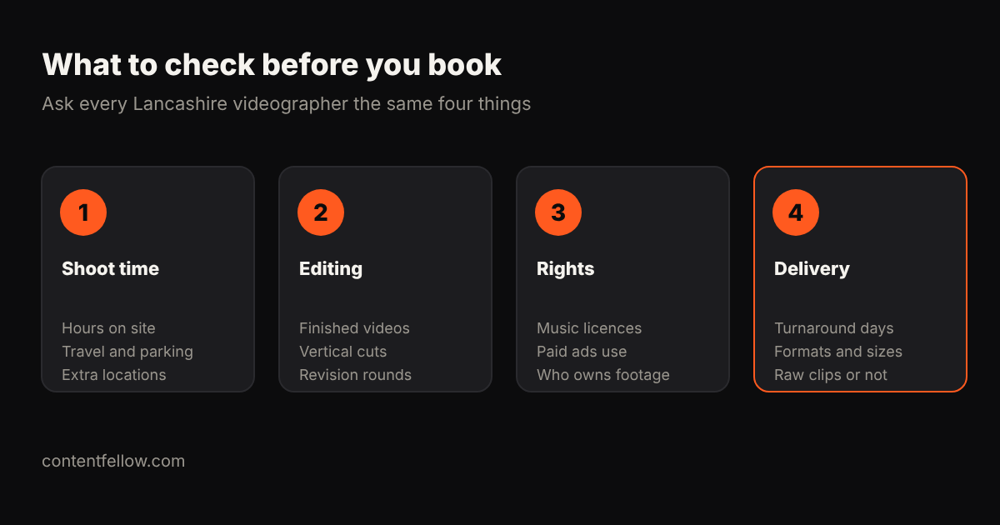

# Videographer in Burnley and Lancashire: Prices 2026

> **Quick answer:** A business videographer in Burnley or elsewhere in Lancashire typically charges **£390 to £650 for a half day** and **£690 to £900 for a full day** in 2026, with editing sometimes extra. Monthly social video packages from solo operators run about **£295 to £650 a month**. ContentFellow, based in Burnley, offers the **Studio Fellow at £149 a month** for one on-site shoot with photo and 4K video, and the **Creator Fellow at £119 a month** for short-form editing. *(Updated October 2026.)*

## How much does a videographer cost in Burnley and Lancashire?

Published UK ranges are a fair guide for Lancashire, because London is the main outlier: Whito puts London rates at or above the top of each range. Here is what you can expect to pay as of October 2026:

| Option | Typical cost (UK, 2026) | What you usually get | Best for |
|---|---|---|---|
| Phone and DIY | £0–£300 for kit | Your own clips, your own time | Quick behind-the-scenes posts |
| Solo videographer, half day | £390–£650 | 3–4 hours on site, one shooter | A promo, testimonials, a product video |
| Solo videographer, full day | £690–£900 | 6–8 hours, one shooter | Events, several locations, a bigger edit |
| Drone add-on (CAA-licensed) | £250–£650 a half day | Aerial shots of your premises or site | Venues, builders, estates |
| Monthly social video package | £295–£650 a month | One shoot a month, cut into clips | Steady content for Reels and TikTok |
| Studio package with strategy | £1,250–£1,950 a month | Shoots, edits and planning calls | Larger brands with bigger budgets |
| Studio Fellow (ContentFellow) | £149 a month | One on-site shoot up to 3 hours, photo + 4K video | Local businesses that want fresh content every month |

Sources: Whito's [UK photography and video cost research](https://whito.co.uk/research/photography-costs-uk/) (updated September 2026) gives solo videographer rates of £390–£650 a half day and £690–£900 a full day, YunoJuno's booked average of £427 a day, monthly social video packages of £295–£650, studio packages of £1,250–£1,950 a month and drone coverage of £250–£650 a half day. London rates sit at or above the top of each range.

## Why do Lancashire videographers quote such different prices?

Two quotes for "a video" can be £300 apart and both be fair. The difference is almost always in what is included:

- **Editing time.** A half day of filming can need a full day of editing. Some videographers include one finished edit; others charge editing separately at day rates. Whito puts standalone editing days at £150–£280 for junior editors and £300–£550 for mid-level editors.
- **Number of finished videos.** One two-minute film is a different job from ten 30-second vertical clips for social media.
- **Crew.** A solo shooter is cheapest. A second camera operator, sound recordist or lighting assistant can double the day rate.
- **Travel.** Shoots in Burnley, Padiham, Nelson or Colne cost a local videographer very little to reach. Travel from Manchester or further usually adds mileage, parking and time.
- **Licensing.** Commercial music and the right to use footage in paid ads can cost extra, so ask before you book.
- **Experience and kit.** Cinema cameras, gimbals and lighting kits cost money, and established operators charge for that and for their track record.

## What should a small business in Burnley actually buy?

Most local businesses don't need a cinematic brand film. They need a steady supply of honest, good-looking content that shows the real business:

- Short clips of you and your team at work
- Customer testimonials
- Close-ups of products, food or finished jobs
- Professional photos for your website, Google Business Profile and social media

One big shoot a year goes stale within weeks on social media. **Regular shorter shoots usually beat one expensive day**, because you always have something new to post, and Google and AI assistants see an active business.

## What to look for in a Burnley or Lancashire videographer

Before you book anyone, check these:

1. **A portfolio of business work, not only weddings.** Lancashire has many excellent wedding videographers. Business content is a different skill: short, direct, made for phones and fast to deliver.
2. **Vertical video experience.** Ask to see Reels or TikToks they have made. A 16:9 film cropped to 9:16 rarely works well.
3. **Clear deliverables in writing.** How many finished videos, how long, which formats, and by when.
4. **Revisions included.** Two rounds is common. Find out what a third costs.
5. **Usage rights.** You should be able to use the footage on your website, social media and in paid ads with no extra fees.
6. **Reviews you can check.** Look for Google reviews from other local businesses.
7. **Insurance.** Public liability insurance matters when someone is filming on your premises, around customers or staff.
8. **Turnaround.** Social content loses value fast. A week is reasonable; a month is not.

## Example yearly budgets for a Lancashire business

| Approach | Example | Rough yearly cost |
|---|---|---|
| Half day each quarter | 4 × £520 (mid-point of £390–£650) | ~£2,080, editing may be extra |
| Full day twice a year | 2 × £800 | ~£1,600, plus editing |
| Monthly social video package | 12 × £295–£650 | £3,540–£7,800 |
| Studio Fellow | 12 × £149 | £1,788 |
| Studio Fellow + Creator Fellow | 12 × (£149 + £119) | £3,216 |

These are illustrative, using the ranges in the table above. Your own quotes will vary.

## Questions to ask before you book

- Is editing included, and how many finished videos and photos will I get?
- Will you deliver vertical (9:16) versions for Reels, TikTok and Shorts?
- How many rounds of revisions are included?
- Is the music licensed for commercial and social media use?
- Who owns the footage, and can I use it in paid ads?
- Are travel and parking included for my location?
- How quickly will I get the finished files?

## How ContentFellow prices video in Burnley and Lancashire

ContentFellow is based in Burnley. We built our plans for local businesses that want regular content without a day-rate invoice every time.

- **[Studio Fellow](/services/studio-fellow/): £149 a month.** One on-site shoot each month of up to three hours, covering photo and 4K video. You get 20 edited photos within five working days. On-site shoots cover Burnley and roughly 20 miles around it, including Padiham, Nelson, Colne, Accrington, Clitheroe, Blackburn and Rawtenstall.
- **[Creator Fellow](/services/creator-fellow/): £119 a month.** 8 short videos for Reels, TikTok and Shorts, 1 motion graphics video and 1 podcast edit of up to 60 minutes. Editing is done remotely, so this works anywhere in the UK.

Use them together and the footage from your monthly shoot becomes a month of short videos. Billing is monthly, you approve everything before it goes live, and you can add, remove or upgrade a Fellow from the next month. We're a sole trader, not VAT registered, so the price you see is the full price with no VAT added.

See every plan side by side on our [pricing page](/pricing/), read more about [marketing for Burnley businesses](/burnley/), or browse quick answers to common questions in our [answers hub](/answers/). For national figures, read our guide to [video production costs in the UK](/blog/video-production-cost-uk/).

**[Book your Studio Fellow →](/services/studio-fellow/)**

## Frequently asked questions

### How much does a videographer cost in Burnley?
Expect about £390 to £650 for a half day and £690 to £900 for a full day in 2026. Editing is sometimes charged separately, so check what each quote includes.

### How much does a videographer charge per hour in Lancashire?
Most business videographers in Lancashire quote by the half day or full day rather than by the hour. Based on the UK ranges above, a half day of 3 to 4 hours works out at roughly £100 to £215 an hour.

### Is a videographer cheaper in Lancashire than in Manchester or London?
London usually costs more: Whito puts London rates at or above the top of each UK range. Manchester prices vary by supplier, but booking a local Lancashire videographer also saves you travel and parking costs.

### How long does a short business video take to make?
A simple promo or set of social clips can be filmed in a half day. Editing usually takes a few days to a week, depending on how many videos you need.

### Do I need a full day of filming?
Rarely, for social media content. A half day, or a three-hour monthly shoot, is enough for testimonials, team clips and product shots. Full days suit events or several locations.

### Can ContentFellow film at my business in East Lancashire?
Yes. Studio Fellow shoots happen on-site in Burnley and about 20 miles around it, including Padiham, Nelson, Colne, Accrington, Clitheroe and Blackburn. Editing, social media, websites and SEO are delivered remotely across the UK.

### Who owns the video footage?
It depends on the contract. Make sure you can use the footage on your website, social media and paid ads without extra fees, and ask whether raw clips are included.

*Sources: Whito, "Photography Costs UK 2026" (updated 25 September 2026); ContentFellow plan prices. Last updated 18 October 2026.*
