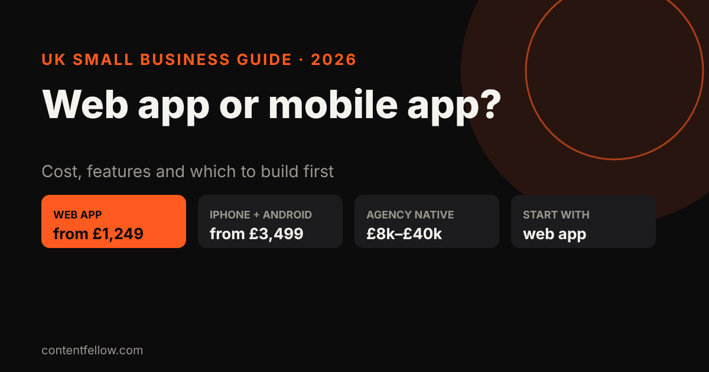
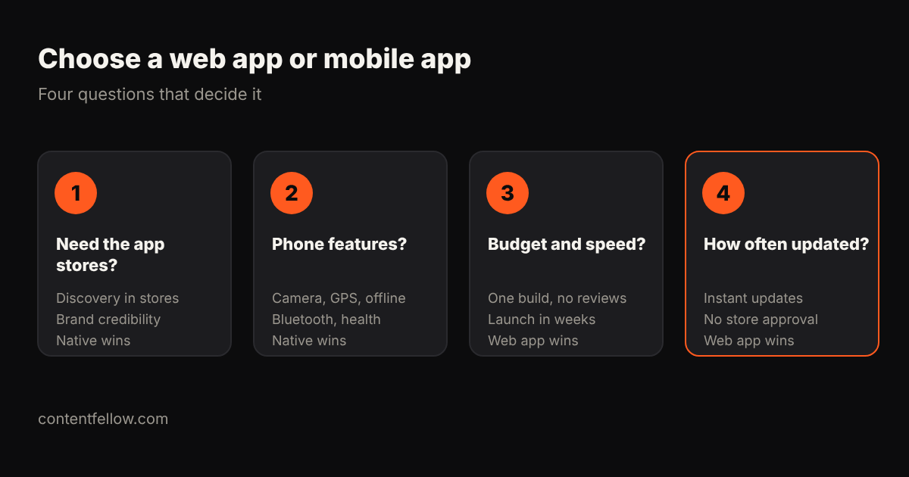

# Web App vs Mobile App: Which Should a UK Small Business Build?

> **Quick answer:** Most UK small businesses should start with a **web app** (also called a PWA): it works on every phone from the browser, customers can add it to their home screen, and it costs far less. With ContentFellow it starts at **£1,249**, against **£8,000 to £40,000** for a typical agency-built native app. Build a **native iPhone and Android app** when you need the app stores, heavy phone features or offline use. *(October 2026.)*

## What's the difference?

- **Web app (PWA):** a website that behaves like an app. Customers open it in the browser and can add it to their home screen. One build works on iPhone, Android and desktop.
- **Native mobile app:** built for iPhone and Android and downloaded from the App Store or Google Play. It can use more phone features and appears in store searches.

## Web app vs mobile app compared

| | Web app (PWA) | Native mobile app |
|---|---|---|
| Typical UK cost | from about £1,249 | £3,499 (simple, fixed price) to £8,000–£40,000+ (agency) |
| Works on | Every device with a browser | iPhone and Android (built for each, or cross-platform) |
| App store listing | No | Yes |
| Updates | Instant, no store approval | Store review for each release |
| Phone features | Camera, location, notifications (most) | Full access, including Bluetooth, health data, background tasks |
| Offline use | Limited | Strong |
| Store fees | None | Apple £79/year, Google $25 one-off |

## When should you build a web app?

- Booking, ordering, loyalty cards, client portals and internal tools.
- You want to launch in weeks and update often.
- Your budget is under about £5,000.

## When should you build a native app?

- Customers expect to find you in the App Store.
- You need offline use, Bluetooth, health data or heavy background features.
- You plan frequent daily use, where an app icon and push notifications pay off.

## Can you start with a web app and move to native later?

Yes, and it's often the smartest route. A web app proves people use it; you then build a native app around the features they actually use.

## ContentFellow app prices

- **App Starter (web app):** £1,249, up to 5 screens, login and forms
- **App Pro (iPhone and Android):** £3,499, up to 10 screens, published to both stores
- **App Custom:** from £6,499, with backend, payments, admin and notifications

[See development packages](/services/development/) · keep it running with [App Care from £149 a month](/services/management/) · full guide: [app development cost UK](/blog/app-development-cost-uk/).

## Frequently asked questions

### Is a web app cheaper than a mobile app?
Usually yes, because one build works on every device and there are no store reviews or fees. Web apps start from around £1,249; native apps from £3,499 at fixed price or £8,000 or more at agencies.

### Can a web app send push notifications?
Yes, on Android and on iPhone when the web app is added to the home screen. Native apps still offer more control.

### Do web apps work offline?
Partly. They can cache some content, but native apps handle offline use much better.

### Will my web app appear in the App Store?
No. Web apps are found through your website and Google. Choose a native app if store listings matter.

### Which is better for a small business?
For most small businesses, a web app first. Move to native once customers are using it regularly and need native features.

---

*Sources: Foresight Mobile and Fulminous UK app pricing; Apple Developer Program UK; Google Play Console (reviewed October 2026). Last updated 17 October 2026.*
